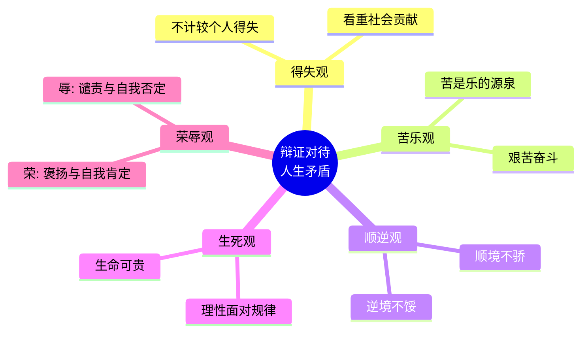

# 辩证对待人生矛盾（五个正确对待：得失、苦乐、顺逆、生死、荣辱）

## 辩证对待人生矛盾的内涵

人生是一个充满矛盾的过程。==辩证对待人生矛盾==，是指运用马克思主义唯物辩证法，正确认识和处理人生中必然遇到的五对基本矛盾：**得失、苦乐、顺逆、生死、荣辱**。这不仅是心理调节技巧，更是确立科学人生态度的理论基石。

> [!IMPORTANT]
> 核心逻辑：矛盾具有普遍性和两面性。不回避矛盾，而是在对立统一中把握人生方向，实现个人价值与社会价值的统一。

## 为什么需要辩证思维？

若缺乏辩证思维，极易陷入极端化误区：
- **片面追求享乐**：忽视“苦”对意志的磨砺，导致精神空虚。
- **畏惧逆境**：遇到挫折即悲观失望，丧失奋斗动力。
- **荣辱倒置**：以金钱地位为荣，以劳动奉献为耻，背离社会主义道德本质。

只有树立正确观念，才能在复杂的社会环境中保持定力，将个人理想融入国家事业。

## 怎么做：五个正确对待的实践路径

### 1. 树立正确的荣辱观
荣辱是基本道德范畴。**荣**是社会对个人履行义务的褒扬及自我肯定；**辱**是对不履行义务的谴责及自我否定。
- **行动指南**：以“八荣八耻”为基准，将荣誉感转化为道德行为的动力。
- ==核心结论==：荣辱观具有鲜明的**动力、导向和调节作用**。

### 2. 正确处理顺境与逆境
顺逆对人生的作用都是双重的。

| 情境 | 常见误区 | 正确态度 | 关键行动 |
| :--- | :--- | :--- | :--- |
| **顺境** | 得意忘形，停滞不前 | 乘顺风而勇进 | 抓住机遇，完善自我，居安思危 |
| **逆境** | 悲观失望，自暴自弃 | 处低谷而力争 | 变压力为动力，勇于战胜困难 |

> [!TIP]
> 记忆口诀：顺境不骄抓机遇，逆境不馁变动力。

### 3. 树立正确的苦乐观与生死观
- **苦乐**：准确把握辩证关系。==艰苦奋斗==不是否定物质利益，而是为了实现理想吃苦耐劳。它是成就伟业的不可或缺条件，也是当代青年的精神支撑。
- **生死**：树立生命可贵意识，理性面对生老病死的自然规律，让生命绽放光彩。

## 常见坑与辨析

> [!WARNING]
> **易错点**：认为“艰苦奋斗”过时了，或将其等同于“吃苦受罪”。
> **正解**：艰苦奋斗的主旨在于**奋斗**，价值在于**奉献**。它在新时代被赋予新内涵，如刻苦学习、反对浪费、创新攻关。

> [!NOTE]
> **辨析**：个人理想 vs 社会理想。
> 社会理想规定、指引个人理想；个人理想是社会理想的凝练和升华。坚持“得其大者可以兼其小”，将小我融入大我。

## 算对了的例子（简答题示范）

**题目**：简述如何树立正确的顺逆观？

**参考解析**：
1.  **认识双重性**：顺境和逆境对人生都有积极和消极两面影响。
2.  **对待顺境**：要乘顺风而勇进，抓住机遇丰富自己，同时切莫得意忘形，做好应对逆境的心理准备。
3.  **对待逆境**：要处低谷而力争，受磨难而奋进，将压力转化为动力，不悲观失望，勇于战胜逆境。
4.  **最终目标**：善于利用顺境，勇于正视和战胜逆境，从而实现远大理想和个人价值。
