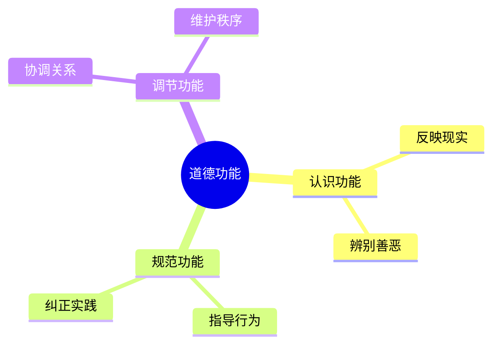

# 道德的功能与作用

## 道德的功能与作用是什么

在《思想道德与法治》第五章中，我们不仅要背诵道德的定义，更要理解它“如何运转”。试想：当你在食堂看到有人插队，你感到反感并投去责备的目光，这种心理和行为背后，究竟是哪一种道德功能在起作用？是让你“知道”这是错的，还是“阻止”他继续做？

> [!IMPORTANT]
> ==道德是以善恶为评价方式，主要依靠社会舆论、传统习俗和内心信念来发挥作用的行为规范的总和。== 其功能系统中，==认识功能、规范功能、调节功能==是最基本的三大功能。

## 三大基本功能辨析

道德的功能是指道德作为社会意识形式对社会发展所具有的功效与能力。区分这三者是简答题与选择题的高频考点：

| 功能 | 核心关键词 | 作用机制 | 典型场景 |
| :--- | :--- | :--- | :--- |
| **认识功能** | 反映、认知 | 帮助人们认识社会道德生活规律 | 学习道德理论，明辨是非 |
| **规范功能** | 指导、纠正 | 通过评价等方式约束行为 | 遵守校规校纪，践行公德 |
| **调节功能** | 协调、平衡 | 依靠舆论、信念化解矛盾 | 调解纠纷，维系人际和谐 |

> [!TIP]
> 记忆口诀：“==认==清现实辨善恶，==规==范行为指方向，==调==节关系促和谐”。做题时，若题干强调“指导和纠正行为”，选规范功能；若强调“协调人际关系”，选调节功能。

## 道德作用与法治的关系

理解了内在功能，还需厘清道德与法律的外部边界。坚持和发展中国特色社会主义，既要发挥思想道德的==引领和教化作用==，又要发挥法律的==规范和强制作用==。二者如车之两轮、鸟之两翼，相辅相成。

*   **约束手段不同**：法治靠国家强制力（外在）；德治靠舆论、习俗、信念（内在）。
*   **违规后果不同**：违法承担法律责任；失德遭受道德谴责。
*   **相互促进**：道德为法治提供价值基础，法治为道德提供制度保障。例如，《民法典》将“见义勇为”等道德要求上升为法律规范，正是==法治承载道德理念==的体现。

> [!WARNING]
> 切勿将“规范功能”等同于“法律规范”。道德的规范功能是==非强制性==的，依靠的是软约束；而法律规范依靠的是国家强制力的硬约束。混淆二者是常见误区。

## 真题实战解析

**【例题】** 道德通过评价等方式，指导和纠正人们的行为和实际活动，协调人们之间的关系，这指的是道德的（ ）
A. 认识功能 B. 调节功能 C. 沟通功能 D. 教育功能

**【解析】** 本题题眼在于“指导和纠正行为”与“协调关系”。虽然题干后半句提到了“协调关系”（易误选B），但前半句“指导和纠正人们的行为和实际活动”是==规范功能==的典型定义表述。然而，观察选项发现并无“规范功能”。此时需回归教材逻辑：在部分语境下，广义的调节功能包含了通过评价来纠正行为以达成关系协调的过程。但在标准三功能分类中，此描述最贴近规范功能。若必须在给定选项中选择，且题目侧重“协调人们之间的关系”这一最终目的，则应选 **B. 调节功能**。

> [!CAUTION]
> 此类题目需注意版本差异。最新版教材明确将“指导纠正行为”归为规范功能，“协调关系”归为调节功能。若考试中同时出现这两个选项，请严格对应关键词；若缺失规范功能选项，则优先选择涵盖面更广的调节功能或根据题干重心判断。
