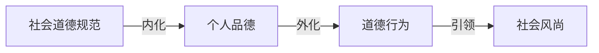

# 锤炼个人品德（涵养高尚道德品格、道德修养中的践行、积极引领社会风尚）

我们已经学过社会公德、职业道德和家庭美德，但如果这些规范只停留在纸面上，谁来把它们变成现实？答案就是每一个具体的“人”。

> [!IMPORTANT]
> ==社会主义道德建设的落脚点是个人品德==，其状况影响着社会主义市场经济体制的完善和社会主义民主政治建设的进程。

## 涵养高尚道德品格

什么是个人品德？它是通过社会道德教育和个人自觉的道德修养所形成的稳定的心理状态和行为习惯。

为什么要涵养它？因为外在的道德规范必须内化为个人的品质才能发挥作用。正如中国传统道德的根本要求是“公义胜私欲”，社会主义道德的核心是为人民服务，这些宏观原则最终都要靠个人的高尚品格来承载。

> [!NOTE]
> **相近概念辨析**：社会公德、职业道德、家庭美德是“领域性”规范；个人品德是“主体性”素养，是所有道德规范的最终落脚点。

## 道德修养中的践行

知道了要涵养品格，具体怎么做？

> [!TIP]
> 记忆口诀：**学思并重、省察克治、慎独自律、知行合一**。

道德修养是指个体自觉地将一定社会的道德规范、准则及要求内化为内在的道德品质，以促进人格的自我陶冶、自我培育和自我完善的实践过程。

在这个过程中，有一个极易被忽视的关键点：从“知道该怎么做”到“真正去做”，中间隔着什么？

> [!WARNING]
> 在道德认知向道德行为转化的过程中，==道德意志和道德信念是关键环节==。缺乏意志力，再好的认知也会沦为空谈。

| 修养环节 | 核心内涵 | 常见误区 |
| :--- | :--- | :--- |
| 道德认知 | 明辨善恶是非 | 以为懂了就会做 |
| 道德情感 | 产生爱憎好恶 | 仅凭一时冲动 |
| 道德意志 | 克服困难坚持 | 半途而废 |
| 道德信念 | 笃信不疑 | 随波逐流 |
| 道德行为 | 落实于行动 | 言行不一 |

## 积极引领社会风尚

个人品德不仅是私事。当无数个体的道德修养汇聚起来，就能积极引领社会风尚。作为南邮学子，无论是在未来的职业生活中坚守诚实守信这一步入职业殿堂的通行证，还是在网络生活中恪守网络道德，都是在用实际行动为社会风尚注入正能量。

> [!CAUTION]
> 切勿将“锤炼个人品德”等同于“独善其身”。个人品德的最终指向是服务人民、奉献社会，这与社会主义道德的核心（为人民服务）一脉相承。

## 经典考题实战

来看一道历年真题的逻辑推演：

**题目**：在道德认知向道德行为转化的过程中，关键环节是什么？

**解析步骤**：
1. **审题定位**：题目问的是“转化过程”中的“关键环节”，起点是“认知”，终点是“行为”。
2. **排除干扰**：很多人会误选“道德情感”或“道德实践”。但情感只是催化剂，实践已经是结果。
3. **锁定考点**：要把脑子里的“知”变成手脚上的“行”，遇到诱惑时能管住自己，遇到困难时能坚持下去，靠的是什么？靠的是坚定的==道德意志==和不可动摇的==道德信念==。

**结论**：关键环节是道德意志和道德信念。
