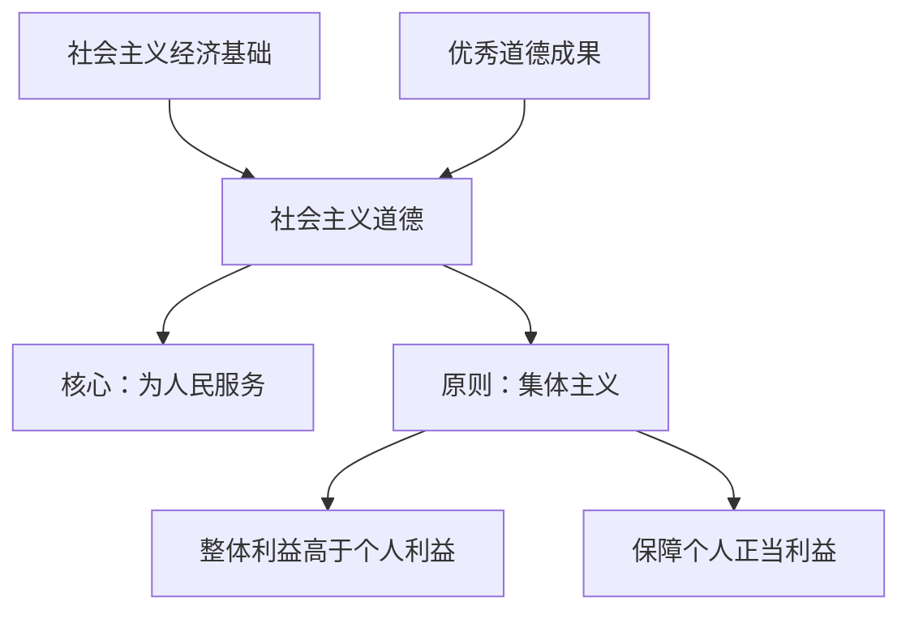

# 坚持以集体主义为原则（社会主义道德建设的原则）

## 是什么：集体主义是社会主义道德建设的原则

**集体主义**是社会主义道德建设的原则，它强调==国家利益、社会整体利益高于个人利益==，同时重视和保障个人的正当利益。

要理解这一原则，先区分两个概念：

| 比较项 | 核心 | 原则 |
|---|---|---|
| 内容 | 为人民服务 | 集体主义 |
| 地位 | 社会主义道德的核心 | 社会主义道德的原则 |
| 答题关键词 | 为什么人服务 | 如何处理个人与集体的利益关系 |

> [!IMPORTANT]
> 社会主义道德的核心是**为人民服务**，原则是**集体主义**。二者不能互换。

## 为什么：集体主义为什么成为原则

社会主义道德是社会主义经济基础的反映，也是对人类优秀道德成果的吸收和借鉴。它克服了以往阶级社会道德的片面性和局限性，坚持以为人民服务为核心、以集体主义为原则，展现出真实而强大的道义力量。

可以从一个现实问题理解：个人利益与公共利益发生矛盾时，是否只能牺牲一方？集体主义并不是简单否定个人利益，而是要求把国家利益、社会整体利益和个人利益统一起来；当二者发生矛盾时，个人利益应当服从国家利益和社会整体利益。

## 怎么做：把握三个层次

集体主义的道德要求具有层次性，不能把所有要求都理解成“无私奉献”。

| 层次 | 道德要求 | 主要适用范围 |
|---|---|---|
| 最高层次 | 无私奉献、一心为公 | 共产党员和先进分子应当达到 |
| 较高层次 | 先公后私、先人后己 | 具有较高社会主义道德觉悟的人能够达到 |
| 最基本层次 | 顾全大局、遵纪守法、热爱祖国、诚实劳动 | 对我国公民最基本的道德要求 |

> [!TIP]
> 记忆顺序：**无私奉献—先公后私—公民基本要求**。答题时既要写要求，也要写层次，避免只罗列短语。

## 相近概念与常见误区

集体主义不等于只顾集体、不要个人，也不等于把任何“多数人的意见”都当作正当要求。它反对的是损公肥私、损人利己，而不是个人的正当利益。

| 概念 | 对个人利益的态度 | 对整体利益的态度 |
|---|---|---|
| 集体主义 | 重视和保障正当利益 | 强调整体利益高于个人利益 |
| 个人主义 | 把个人利益置于首位 | 容易忽视或损害整体利益 |
| 极端集体主义理解 | 否认一切个人利益 | 把服从集体绝对化 |

> [!WARNING]
> 常见失分点有三个：把“原则”答成“为人民服务”；把集体主义写成“完全否定个人利益”；把最低层次机械写成“公私兼顾、不损公肥私”而漏掉教材表述中的**顾全大局、遵纪守法、热爱祖国、诚实劳动**。

## 例题：简答题怎样答完整

**题目：集体主义的三个层次的道德要求。**

**参考答案：**

集体主义的道德要求分为三个层次：一是**无私奉献、一心为公**，这是最高层次，是共产党员和先进分子应当努力达到的道德要求；二是**先公后私、先人后己**，这是较高层次，是具有较高社会主义道德觉悟的人能够达到的要求；三是**顾全大局、遵纪守法、热爱祖国、诚实劳动**，这是对我国公民最基本的道德要求。

> [!NOTE]
> 若题目问“社会主义道德的原则是什么”，直接答“集体主义”；若问“为什么”，则围绕经济基础、优秀道德成果的吸收借鉴，以及社会主义道德的先进性和道义力量展开。
