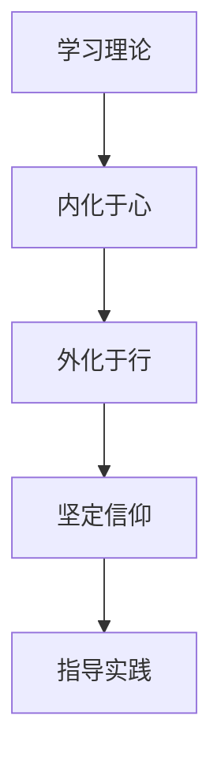

# 增强对马克思主义、共产主义的信仰

## 什么是“信仰马克思主义”

信仰不是盲目的崇拜，而是建立在科学认知基础上的坚定信念。对大学生而言，==确立马克思主义的科学信仰，是确立崇高理想信念的前提==。马克思主义之所以值得信仰，在于它揭示了人类社会发展规律，为我们认识世界、改造世界提供了科学的世界观和方法论。

## 为什么需要马克思主义信仰

理想信念是精神之“钙”。没有理想信念，或理想信念不坚定，精神上就会“缺钙”，就会得“软骨病”。

> [!IMPORTANT]
> 马克思主义信仰是崇高理想信念的基石。它为我们提供：
> - **奋斗目标**：昭示人生前进方向
> - **精神动力**：催生克服困难的勇气
> - **精神支柱**：防止精神空虚和行为迷失

## 马克思主义思想理论的特质

马克思主义之所以成为科学信仰，源于其独特的理论品质：

| 特质 | 内涵 |
|------|------|
| **科学性** | 揭示自然、社会、思维发展的一般规律 |
| **人民性** | 代表最广大人民的根本利益 |
| **实践性** | 在实践中产生并指导实践 |
| **发展性** | 与时俱进，随实践不断丰富发展 |

> [!TIP]
> 记忆口诀：**“科人实发”**——科学、人民、实践、发展，四性统一。

## 怎么做：确立并坚定信仰

确立马克思主义信仰，不能停留在口头上，必须落实到行动中：

理想信念是一个思想认识问题，更是一个实践问题。==只有实践才是通往理想彼岸的桥梁==。

## 常见误区辨析

> [!WARNING]
> - **误区1**：把马克思主义当作教条。实际上，它是行动的指南，必须与中国具体实际相结合。
> - **误区2**：认为信仰是私事。实际上，马克思主义信仰关乎人生方向和民族复兴。
> - **误区3**：只学不做。信仰必须知行合一，在实践中检验和深化。

## 典型例题

**简答题**：为什么说理想信念是精神之“钙”？

**参考解答**：

理想信念是精神上的“钙”，没有理想信念或理想信念不坚定，精神上就会“缺钙”，就会得“软骨病”。

1. **理想信念昭示奋斗目标**，为人生提供前进方向；
2. **理想信念催生前进动力**，提高精神境界；
3. **理想信念是精神支柱**，防止精神空虚和行为迷失。

> [!CAUTION]
> 答题要点必须完整，三个层次缺一不可：目标、动力、支柱。
