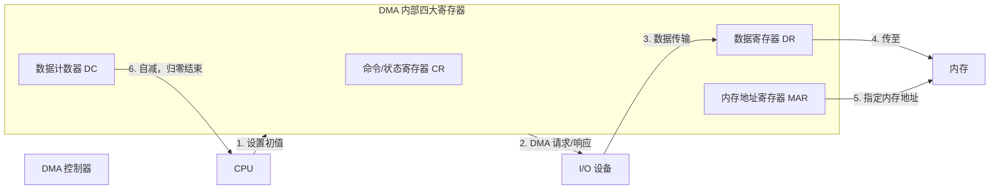

# DMA控制器的组成与四种寄存器的作用

## 从“CPU 亲力亲为”到“DMA 代劳”

早期的程序直接控制方式下，CPU 传输数据就像自己拿着水杯一勺一勺地舀水——全程盯着，效率极低。中断方式虽能让 CPU 在设备准备时去忙别的，但每传输一个数据字仍需 CPU 介入。当需要**大批量、连续传输数据**（如磁盘读写）时，==DMA 方式让 CPU 只做启动和收尾，数据传送全程由 DMA 控制器接管==。

DMA 控制器内部有四个关键的寄存器，它们分工协作，完成数据块的搬运：

### 四个寄存器分别干什么

| 寄存器 | 作用 | 通俗比方 |
| :--- | :--- | :--- |
| **命令/状态寄存器（CR）** | 接收 CPU 发出的 `READ` / `WRITE` 命令；存放设备当前状态 | “任务书”和“状态灯” |
| **内存地址寄存器（MAR）** | 存放要读写的内存地址：输入时存目标地址，输出时存源地址 | “搬运目的/起始地” |
| **数据寄存器（DR）** | 临时寄存正在传输的数据 | “手上拿的那个桶” |
| **数据计数器（DC）** | 存放本次需传输的字节数，每传一个就减 1，减到 0 表示完成 | “还要搬几趟” |

### 一次完整 DMA 传输流程

1. CPU 将命令、内存地址、字节数写入 CR、MAR、DC 后，启动设备并释放总线。
2. 设备准备好后向 DMA 发请求；DMA 向 CPU 申请总线使用权。
3. DMA 拿到总线后，按照 MAR 的地址，把 DR 与内存间的数据送出，同时 MAR 加一、DC 减一。
4. 循环上述步骤，直到 DC 变为 0，DMA 向 CPU 发中断信号，告知传输完毕。

> [!IMPORTANT]
> ==DMA 传输的是数据块==。CPU 只在数据块开始前和传输完的中断处理后介入，块内传输由硬件自主完成。

### DMA 和其他方式核心区别

| 方式 | CPU 介入时机 | 适合场景 |
| :--- | :--- | :--- |
| 程序直接控制 | 每传输一个字节全程轮询 | 极慢速设备 |
| 中断驱动 | 每字节/每字完成都发生中断 | 低速字符设备 |
| **DMA** | **只在一整个数据块开始前/结束后介入** | **磁盘等高速块设备** |
| 通道 | 整个 I/O 过程几乎不介入 | 大型机复杂 I/O |

> [!WARNING]
> 常见误区：认为 DMA 方式完全不需要 CPU 管理。实际上，CPU 仍需设置寄存器并响应传输完成中断。另外，==DMA 控制器与通道的区别常考==：DMA 以“数据块”为单位，每块前后 CPU 介入；通道可执行通道程序，处理完整的文件级传输，脱离 CPU 的程度更深。

### 一道算对了的例子

某 DMA 控制器配合磁盘工作。已知磁盘以 40KB/s 速率连续读数据，DMA 一次传送 4KB 的数据块。若 CPU 设置 DMA 寄存器耗时 20μs，DMA 完成中断处理耗时 20μs，则 CPU 为传送一个 4KB 块所占用的时间比例是多少？

**思路**：传送一个 4KB 块所需总时间 $T_{\text{total}} = \frac{4\text{KB}}{40\text{KB/s}} = 0.1\text{s}$。CPU 占用时间 $T_{\text{CPU}} = 20\mu s + 20\mu s = 40\mu s$。占比 $= \frac{40\times 10^{-6}}{0.1} = 0.04\%$。可见，==DMA 极大解放了 CPU，使其在传输期间可并行执行其他任务==。
