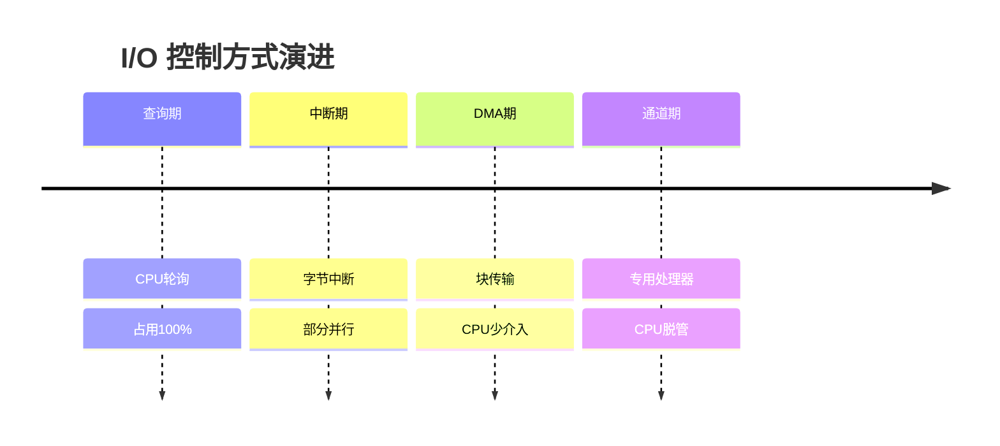

# I/O控制方式（程序查询、中断、DMA、通道）及比较

## 它是什么：四种 I/O 控制方式

先问一句：CPU 要读键盘或磁盘数据，最笨的办法是什么？就是 CPU 一直盯着设备——“好了没？好了没？”这就是==程序查询（程序直接控制）方式==：CPU 轮询设备状态，设备未就绪就死等，CPU 被完全占用。

后来想出的办法是：设备好了再“叫”CPU。于是有了==中断方式==：设备完成一次数据传送后发中断，CPU 暂停用户进程，从目态切到管态执行中断处理程序，完了再回目态继续原进程。注意，中断只能在两条机器指令之间响应，且==目态到管态的唯一转换途径就是中断==。

再往后：如果传一整块数据都让 CPU 中断一次次搬运，太累。于是 DMA（直接存储访问）出现——由 DMA 控制器接管总线，在内存和I/O设备间直接批量传数据，只在开始和结束打扰 CPU。DMA 控制器有四类寄存器（命令/状态/内存地址/数据计数等）协同工作。

最后是==通道方式==：通道是一种 I/O 专用处理器，能自己执行通道程序，把整个传输过程管完。DMA 还要 CPU 在块前后参与，通道基本让 CPU 完全脱管。

## 为什么需要：CPU 不该做搬运工

I/O 比 CPU 慢得多。若让 CPU 陪着等，并发性和 CPU 利用率都会崩。所以演进主线就是：==减少 CPU 对 I/O 的介入程度，让 CPU 与 I/O 越来越并行==。

## 怎么做与比较

| 控制方式 | CPU 介入 | 数据单位 | 并行性 | 效率 |
|---|---|---|---|---|
| 程序查询 | 全程轮询 | 字/字节 | 串行 | 最低 |
| 中断 | 每单位一次 | 字/字节 | 部分并行 | 中 |
| DMA | 整块前后 | 数据块 | 较好并行 | 高 |
| 通道 | 几乎不管 | 一组块/全程 | 完全脱管 | 最高 |

> [!IMPORTANT]
> 比 DMA 效率更高的是==通道方式==；DMA 方式下数据交换不经过 CPU；通道本质是 ==I/O 专用处理器==，属于硬件机制。

## 相近概念区别、坑与算对了的例子

- 中断 vs DMA：中断是设备叫 CPU 来“搬字节”，DMA 是 DMA 控制器自己“搬块”再汇报。
- DMA vs 通道：DMA 每个数据块前后仍需 CPU 参与；通道执行通道程序管完整过程，CPU 更自由。
- 常见坑：原语（P/V）执行不可被中断；但中断本身与外部信号异步，与 CPU 处于目态/管态无关。
- 填空题例子：设备控制方式分程序直接查询、==中断方式==、DMA 和通道。若问“I/O 与存储交换不经过 CPU”，选 ==DMA 方式==；问“什么控制方式比 DMA 效率高”，答==通道方式==。

> [!TIP]
> 记忆：查中 D 通（查询、中断、DMA、通道），效率递增，CPU 越闲。
