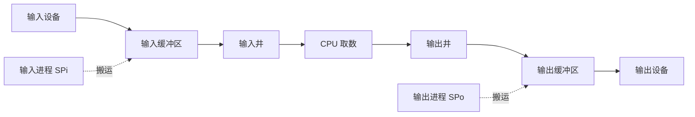

# SPOOLing系统的组成与虚拟设备原理

SPOOLing（Simultaneous Peripheral Operations On-Line，外部设备联机并行操作）是一种典型的==虚拟设备==技术：通过硬件与软件的功能扩充，把原来独占使用的设备改造成能为多个进程共享的设备。它的基本思想是「脱机输入/输出」的电子化——用磁盘上的共享区域模拟当时昂贵的外围机，让慢速 I/O 设备与 CPU 并行工作，从而提高系统效率。

## 为什么需要它

早期的打印机、读卡机都是独占设备，一次只能被一个作业占用，慢速设备会长时间占着宝贵的 CPU 等待。直接联机会造成 CPU 空转，脱机方式又要人工搬运磁带。SPOOLing 让 CPU 只和高速的磁盘交互，真实设备由后台进程慢慢搬运，==用户进程感觉像是独占了设备==。

## 系统组成

SPOOLing 系统常被称为「输入井/输出井 + 缓冲区 + 进程」的三层结构：

| 组件 | 位置 | 作用 |
| --- | --- | --- |
| 输入井 / 输出井 | 磁盘 | 收容 I/O 输入数据、用户输出数据 |
| 输入 / 输出缓冲区 | 内存 | 暂存数据，起速度匹配作用 |
| 输入进程 $\text{SP}_i$ / 输出进程 $\text{SP}_o$ | 系统进程 | 在真实设备与井之间传送数据 |

- **输入井**模拟脱机输入的磁盘，收容 I/O 设备送来的数据；CPU 需要输入时直接从井中读入内存。
- **输出井**模拟脱机输出的磁盘，收容用户程序的输出数据；输出设备空闲时再由输出进程送往输出缓冲区和设备。
- 输入进程 $\text{SP}_i$ 与输出进程 $\text{SP}_o$ 分别模拟脱机输入/输出的外围控制机。

> [!IMPORTANT]
> ==SPOOLing 把共享设备（磁盘）改造成若干台虚拟输入/输出设备==；从用户角度看，它把独占设备变成了共享设备，这就是「虚拟设备」。

## 虚拟设备与其他概念的区别

| 概念 | 含义 | 与 SPOOLing 的关系 |
| --- | --- | --- |
| 独占设备 | 一次仅一个进程使用 | SPOOLing 改造的对象 |
| 共享设备 | 可多进程并发访问（如磁盘） | SPOOLing 用它当「井」 |
| 虚拟设备 | 硬件+软件扩充后看起来像独占 | ==SPOOLing 的产物== |

> [!WARNING]
> 常见坑：问「SPOOLing 使什么成为虚拟设备」时要答==设备==，不是处理器、存储器或链路；它改造的是独占设备，而井本身是磁盘上的共享区域。

## 例子

打印机一次只能服务一个作业，但若配备 SPOOLing：作业把要打印的内容先送到==输出井==，输出进程 $\text{SP}_o$ 在打印机空闲时从输出井经输出缓冲区慢慢打印。这样打印期间 CPU 继续处理其他作业，各作业看起来都「独占」了打印机——这正是虚拟设备的效果。
