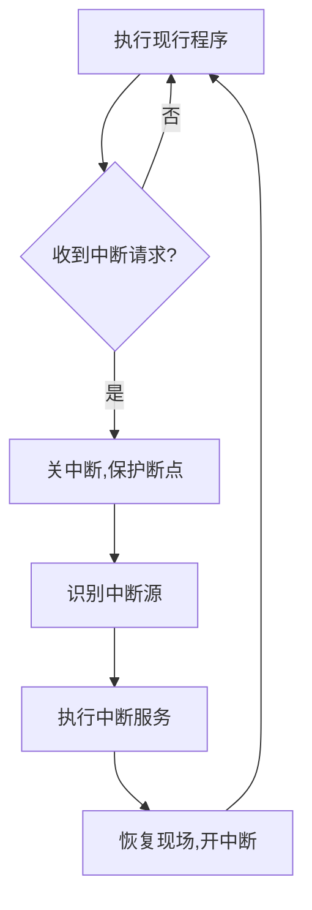

# 中断的概念、类型与处理过程

如果 CPU 只能按顺序一条条执行指令，当外设还没准备好数据时该怎么办？死等吗？显然不行。这就引出了让操作系统“活”起来的核心机制——中断。

> [!IMPORTANT]
> ==中断是指 CPU 暂停当前程序，转去处理突发事件，处理完再返回原断点继续执行的机制。==它是操作系统由“被动执行”走向“主动管理”的基石。

## 为什么需要中断

没有中断时，CPU 只能通过**程序直接查询控制方式**（轮询）反复检查设备状态，极度浪费算力。引入中断后，CPU 可以在等待 I/O 时去执行别的进程，等设备就绪再发信号通知 CPU。这也直接支撑了操作系统的三种基本类型：批处理系统靠中断实现作业自动切换；分时系统靠时钟中断分配时间片；实时系统靠中断保证及时响应。

同时，中断也是==核心态与用户态==切换的桥梁。用户程序运行在**用户态**，无权执行特权指令；当发生中断或系统调用时，硬件强制将机器状态切为**核心态**，交由操作系统管理程序执行。

## 中断的类型

按照事件来源和实现手段，Linux 操作系统将中断分为两类：

| 分类 | 触发源 | 特点 | 举例 |
| :--- | :--- | :--- | :--- |
| **硬中断** | 外部硬件信号 | 异步，由设备发出 | I/O 完成、时钟信号 |
| **软中断** | 软件指令/内核 | 同步，由程序引发 | 系统调用、缺页异常 |

> [!NOTE]
> 南邮历年真题考点：Linux 操作系统按照事件来源和实现手段将中断分为==硬中断、软中断==。填空题常考，务必记准这两个词。

## 中断的处理过程

一次完整的中断处理包含四个阶段，可用下图表示：

1. **中断请求**：外设或内部异常发出信号。
2. **中断响应**：CPU 在每条指令执行周期末尾检测信号。若允许响应，则进入==核心态==，==关中断并保护断点==（将程序计数器 PC 和程序状态字 PSW 压栈）。
3. **中断处理**：根据中断向量找到对应的中断服务程序并执行。
4. **中断返回**：恢复被中断程序的现场（出栈），开中断，返回原断点继续执行。

## 相近概念辨析：设备的控制方式

中断不仅是一个概念，更是设备控制演进的关键一环。结合真题，设备的控制方式分为四种：

> [!TIP]
> 记忆口诀：“查、中、D、通”。即：程序直接查询控制方式 $\to$ ==中断方式== $\to$ DMA 方式 $\to$ 通道方式。这四种方式对 CPU 的占用率依次递减。

*   **程序直接查询**：CPU 全程死等，效率最低。
*   **中断方式（程序中断控制方式）**：CPU 不等了，设备好了叫 CPU，但数据传输仍需 CPU 参与。
*   **DMA 方式**：批量数据传输交给 DMA 控制器，传完才用中断通知 CPU。
*   **通道方式**：相当于一个专用小 CPU，独立管理整条 I/O 通路。

## 常见坑与真题演练

> [!WARNING]
> 易错坑：把“中断”等同于“系统调用”。系统调用是通过软中断（如 `int 0x80` 或 `syscall` 指令）实现的，属于软中断的一种，但硬中断完全由硬件触发，两者不可混淆。

> [!CAUTION]
> 答题时，“中断方式”也可写全称“程序中断控制方式”，填空题需根据空格长度和上下文灵活填写，标准答案均认可。

**【真题示例】**
题目：设备的控制方式分为程序直接查询控制方式、____、DMA 方式和通道方式。
分析：回顾设备控制的四种演进方式，查询之后、DMA 之前，正是利用中断机制解放 CPU 的阶段。
答案：==中断方式（程序中断控制方式）==。
