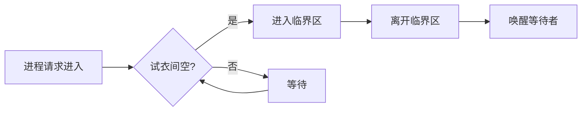

# 临界区、临界资源与互斥的概念

## 临界区与临界资源

设想两个进程同时往同一台打印机发送数据：A 进程刚发一半，B 进程抢占后又发一半，结果打印出的内容交错混杂、完全不可用。问题出在哪？——打印机一次只能被一个进程完整使用，两个进程却同时访问了它。

### 基本概念

**临界资源**：一次仅允许一个进程使用的共享资源，如打印机、共享变量、文件等。

**临界区**：进程中访问临界资源的那段代码。多个进程访问同一临界资源的临界区互称相关临界区。

> [!IMPORTANT]
> ==互斥==是同步的一种特殊情况：多个进程竞争使用临界资源时，必须保证任一时刻只有一个进程进入临界区。

可以把临界区想成一间“单人试衣间”：



### 临界区的四条使用原则

写临界区代码时，必须满足：

| 原则 | 含义 |
|------|------|
| **有空让进** | 临界区空闲时，请求进入的进程应能立即进入 |
| **无空等待** | 临界区忙时，其他进程必须等待 |
| **多种择一** | 有多个进程同时请求时，只能选一个进入 |
| **有限等待** | 任何进程不能在临界区外无限等待（防止饿死） |

记忆口诀：**“有空进，无空等，多选一，不饿死”**。

> [!TIP]
> 前两条合起来保证了互斥——既不浪费资源，也不破坏独占性。

### 用信号量实现互斥

```c
semaphore mutex = 1;   // 互斥信号量

// 进程 Pi
do {
    P(mutex);          // 进入区：申请进入临界区
    临界区;            // 访问临界资源
    V(mutex);          // 退出区：释放临界区
    剩余区;
} while (true);
```

**注意顺序**：P 在临界区前，V 在临界区后。考验你一个容易忽略的点——如果多个临界资源分别用不同信号量保护，各进程的 P 操作顺序必须一致，否则可能死锁。例如哲学家问题中，所有哲学家必须都先拿左筷子再拿右筷子，若有人反着拿就出事了。

> [!WARNING]
> 信号量 `mutex` 初值必须为 1。若初值为 0，所有人都进不去；若初值 >1，则允许多个进程同时进入，互斥失效。

### 一个算对的例子

**售票厅问题**：最多容纳 20 人，每进来一人占一个名额。

信号量 `s` 初值 20：
- `s > 0`：还可进入 `s` 人；
- `s = 0`：厅满，无人等待；
- `s < 0`：厅满，`|s|` 人在外等。

```c
cobegin
process Pi(i = 1, 2, ...)
begin
    P(s);       // 申请进入名额
    进入售票厅;
    购票;
    退出;
    V(s);       // 释放名额
end;
coend
```

若最多有 $n$ 人想进，信号量变化范围为 $[\,20-n,\;20\,]$。当 $n=5$ 时，$s$ 最小为 $20-5=15$，说明最多容纳 20 人的大厅从未满员过，因为外面最多只有 5 人在等。

### 互斥与同步的区别

| | 互斥 | 同步 |
|--|--|--|
| 关注点 | 竞争使用资源 | 协作完成任务 |
| 典型场景 | 打印机、共享变量 | 生产者-消费者 |
| 本质 | 同步的特殊情况 | 一般的有序协作 |

> [!NOTE]
> 生产者-消费者问题中常需要**两个信号量**：`empty` 和 `full` 管同步，`mutex` 管互斥。三个信号量缺一不可——“同步靠 empty/full，互斥靠 mutex”。
