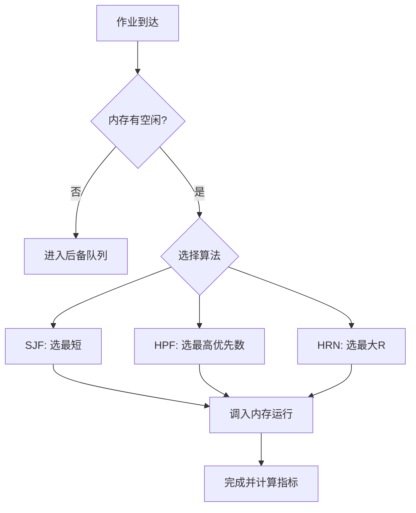

# 作业调度算法及性能评价（周转时间、带权周转时间）

# 作业调度算法及性能评价

在批处理系统中，==作业调度==（Job Scheduling）决定了哪些作业从外存调入内存并获得 CPU 资源。其核心目标是提高系统吞吐量并优化用户感知的等待体验。

## 核心评价指标

评价调度算法优劣主要依赖以下两个时间指标：

1.  **周转时间** ($T$)：作业从提交到完成的时间间隔。
    $$ T = \text{完成时间} - \text{提交时间} $$
2.  **带权周转时间** ($W$)：周转时间与实际运行时间之比，反映作业的“相对等待痛苦程度”。
    $$ W = \frac{\text{周转时间}}{\text{运行时间}} $$

> [!IMPORTANT]
> ==平均周转时间==和==平均带权周转时间==越小，说明系统整体效率越高，用户等待越短。

## 常见调度算法对比

| 算法 | 策略描述 | 优点 | 缺点 |
| :--- | :--- | :--- | :--- |
| **FCFS** | 先来先服务 | 公平，实现简单 | 护航效应，长作业阻塞短作业 |
| **SJF** | 短作业优先 | ==平均周转时间最短== | 长作业可能饥饿，需预估运行时间 |
| **HRN** | 最高响应比优先 | 兼顾长短作业 | 计算复杂，$R=1+\frac{\text{等待}}{\text{运行}}$ |
| **HPF** | 最高优先数优先 | 紧急任务优先 | 低优先级可能长期饥饿 |

## 典型例题解析

**场景**：两道作业批处理系统。作业调度采用**非抢占式 SJF**，进程调度采用**抢占式 HPF**（优先数小者优先）。

| 作业 | 到达 | 运行(分) | 优先数 |
| :--- | :--- | :--- | :--- |
| A | 10:00 | 40 | 5 |
| B | 10:20 | 30 | 3 |
| C | 10:30 | 50 | 4 |
| D | 10:50 | 20 | 6 |

**推导过程**：
1.  **10:00**：A 到达，进入内存运行。
2.  **10:20**：B 到达，进入内存。B(3) 优先级高于 A(5)，**B 抢占 CPU**。A 暂停（已跑 20 分，剩 20 分）。
3.  **10:50**：B 运行结束（30 分钟）。此时内存空出一位。等待队列有 C(50分, P4)、D(20分, P6)。
    *   **作业调度 (SJF)**：D(20) < C(50)，**D 调入内存**。
    *   **进程调度 (HPF)**：内存中 A(剩20, P5) vs D(20, P6)。A 优先级高，**A 继续运行**。
4.  **11:10**：A 运行结束。C 调入内存。
    *   内存中 C(50, P4) vs D(20, P6)。C 优先级高，**C 运行**。
5.  **12:00**：C 结束。**D 运行**。
6.  **12:20**：D 结束。

**结果计算**：

| 作业 | 完成时间 | 周转时间 $T$ | 带权周转 $W$ |
| :--- | :--- | :--- | :--- |
| A | 11:10 | $70$ | $70/40=1.75$ |
| B | 10:50 | $30$ | $30/30=1.0$ |
| C | 12:00 | $90$ | $90/50=1.8$ |
| D | 12:20 | $90$ | $90/20=4.5$ |

$$ \text{平均周转时间} = \frac{70+30+90+90}{4} = 70 \text{ 分钟} $$

> [!WARNING]
> **常见坑**：混淆“作业调度”与“进程调度”。本题中，**作业调度**决定谁进内存（看运行时间 SJF），**进程调度**决定谁占 CPU（看优先数 HPF）。务必分步判断，不可混用规则。
