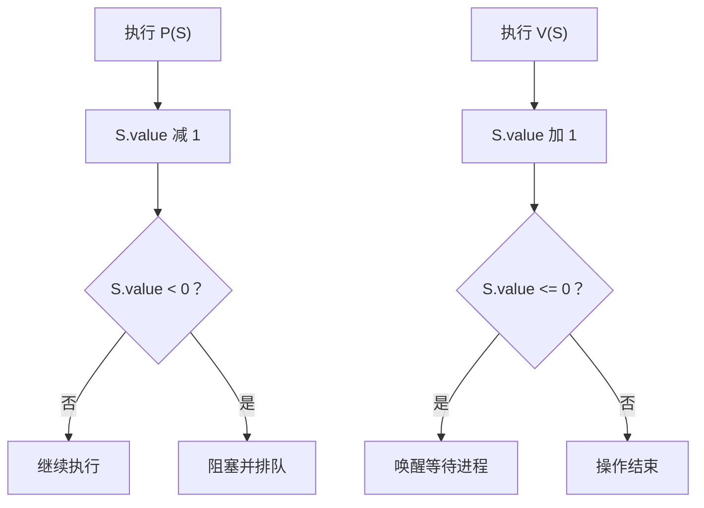

# 信号量机制与P、V操作的定义

## 为什么需要信号量

多个进程并发执行时，可能同时修改共享变量、争用打印机或访问有限缓冲区，仅靠“加锁后检查”容易出现忙等，也难以表达“资源不足就排队”。信号量机制用==一个整型变量加等待队列==统一管理资源申请、释放和进程阻塞，既能实现互斥，也能实现进程同步。

## 信号量与 P、V 操作

记录型信号量可抽象为：

```c
typedef struct {
    int value;          // 资源计数值
    PCB *queue;         // 等待进程队列
} semaphore;
```

P、V 操作都是==不可中断的原子操作==，执行过程中不能被其他进程打断。

```c
P(S) {                  // 申请资源，wait(S)
    S.value--;
    if (S.value < 0)
        block(S.queue); // 无可用资源，插入等待队列
}

V(S) {                  // 释放资源，signal(S)
    S.value++;
    if (S.value <= 0)
        wakeup(S.queue);// 唤醒一个等待进程
}
```

其执行逻辑如下：



> [!IMPORTANT]
> P 操作表示申请资源，可能使调用进程阻塞；V 操作表示释放资源，可能唤醒等待进程。==不能把它们理解成普通的加减法语句==。

## 信号量取值怎么理解

若信号量 $S$ 的初值为 $N$，通常表示初始有 $N$ 个同类资源。

| 当前取值 | 通常含义 |
|---|---|
| $S>0$ | 还有 $S$ 个资源可直接申请 |
| $S=0$ | 资源已分配完，暂时没有进程因该信号量等待 |
| $S<0$ | 无可用资源，等待队列中有 $\lvert S\rvert$ 个进程 |

例如，信号量 $S$ 初值为 $3$，当前值为 $-2$，说明等待队列中有 $\lvert-2\rvert=2$ 个进程，因此选择“2 个”。这里初值 $3$ 只用于判断资源规模，==等待人数直接由当前负值的绝对值确定==。

> [!WARNING]
> “$S=0$ 表示没有进程等待”只针对该信号量当前状态；不能据此推断整个系统没有其他阻塞进程。另外，不同教材对整型信号量的描述可能略有差异，本课解题应采用上述记录型信号量口径。

## 两类典型用法

| 用途 | 初值与操作位置 | 作用 |
|---|---|---|
| 互斥 | `mutex=1`；临界区前 `P(mutex)`，后 `V(mutex)` | 保证临界区一次只进入一个进程 |
| 同步 | 按初始资源数设置；在“条件”前后成对安排 P、V | 保证事件先后关系或资源数量约束 |

以售票厅最多容纳 $20$ 人为例，定义 `semaphore s = 20`：

```c
Process buyer() {
    P(s);          // 申请一个进入名额
    进入售票厅;
    购票;
    退出售票厅;
    V(s);          // 释放一个进入名额
}
```

此时 $s>0$ 表示还能进入的人数，$s=0$ 表示厅内已满，$s<0$ 时 $\lvert s\rvert$ 表示厅外等待人数。若最多有 $n$ 个购票者都执行了 P 操作，则 $s$ 的理论取值范围为：

$$20-n\le s\le20$$

> [!TIP]
> 解 PV 题先问两个问题：“要限制的是什么资源？”“资源不足时谁应等待？”再确定信号量初值和 P、V 的位置。互斥锁必须成对出现；同步信号量则常由不同进程分别执行 P、V。

> [!CAUTION]
> 生产者—消费者问题中，应先 `P(empty)` 或 `P(full)` 申请资源，再 `P(mutex)` 进入临界区。若先拿互斥锁再等待资源，可能持锁阻塞，使其他进程无法释放资源，最终形成死锁。
