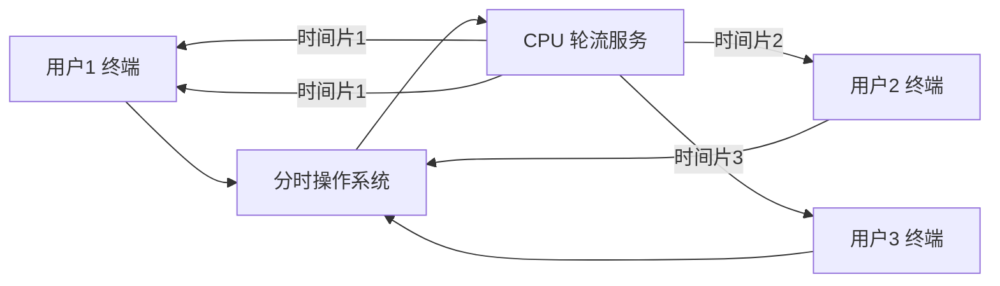

# 分时系统的工作原理与特征

## 什么是分时系统

分时系统（Time-Sharing System）是一台主机连接多个终端，多个用户通过各自的终端==同时==使用这台计算机。操作系统把 CPU 时间划分成一个个很短的时间片，轮流分配给各个用户的作业。

由于 CPU 速度远快于人的操作速度，每个用户感觉自己独占了一台计算机，但实际上是大家轮流共享 CPU。

## 为什么需要分时系统

批处理系统虽然提高了资源利用率，但用户提交作业后无法干预，缺乏交互能力。用户希望：

- 能随时输入命令、查看结果（**交互性**）
- 等待时间不能太长（**及时性**）
- 多个用户互不干扰（**独立性**）

分时系统正是为满足这些需求而诞生的。

## 分时系统的四大特征

| 特征 | 含义 |
|------|------|
| **多路性（同时性）** | 多个用户通过各自终端同时使用一台计算机 |
| **独立性** | 各用户互不干扰，感觉独占计算机 |
| **及时性** | 系统能在很短时间内响应用户请求 |
| **交互性** | 用户可与系统进行人机对话 |

> [!IMPORTANT]
> 四大特征口诀：==多路、独立、及时、交互==。考试常出选择题，注意"无序性"不属于分时系统特征。

## 时间片与响应时间的关系

分时系统的核心机制是**时间片轮转**。每个用户作业每次最多运行一个时间片 $q$，时间片用完后让出 CPU，排到就绪队列末尾等待下一轮。

设用户数为 $n$，时间片为 $q$，则一个用户从发出请求到再次获得 CPU，最坏情况下需要等待：

$$T_{\text{响应}} \approx n \times q$$

要保证响应时间不超过 $T_{\max}$，则时间片应满足：

$$q \leq \frac{T_{\max}}{n}$$

> [!WARNING]
> 时间片不能太大也不能太小：太大则响应时间变长，失去"及时性"；太小则进程切换开销占比过高，CPU 利用率下降。

## 算一个例子

> 分时系统中有 100 个用户，要求响应时间不超过 2s，时间片最大应为多少？

$$q_{\max} = \frac{T_{\max}}{n} = \frac{2000\ \text{ms}}{100} = 20\ \text{ms}$$

选 **B. 20ms**。

> [!TIP]
> 记住公式 $q = T / n$，直接代入即可，注意单位统一换算成 ms。

## 与相近概念的区别

| 对比项 | 分时系统 | 实时系统 | 批处理系统 |
|--------|----------|----------|------------|
| **核心目标** | 交互性、及时响应 | 在截止时间内完成任务 | 提高吞吐量 |
| **用户交互** | 强交互 | 有限交互 | 无交互 |
| **时间要求** | 秒级响应 | 毫秒甚至微秒级 | 无严格要求 |
| **典型场景** | 多用户终端 | 工业控制、武器系统 | 批量数据处理 |

> [!NOTE]
> 分时系统与多道程序设计的关系：多道程序设计是分时系统的底层基础（多道、宏观并行、微观串行），分时系统在此基础上增加了时间片轮转和人机交互机制。
