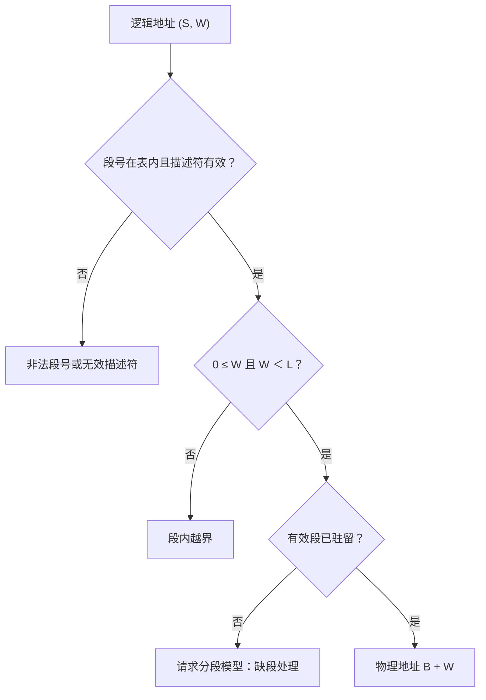

# 段式存储管理的基本原理与地址转换

### 为什么需要段式管理

一段代码、全局数据和一个栈最初就有不同的用途；如果希望分别设置权限、共享或装入，为什么还要把它们当作同一种对象？段式管理让每一段代表一个逻辑单元，段长可变。相比之下，分页把虚拟地址空间按固定大小划成页，物理内存按同样大小划成页框。

### 段表与地址结构

逻辑地址由段号 $S$ 和段内位移 $W$ 组成。设段表有 $T$ 个表项，有效段的长度为 $L$；当该段驻留时，表项还给出物理首址 $B$。以下是一个**用长度（不是最大位移）表示界限**的教学模型，并用独立状态位标记请求分段中的驻留情况：

### 地址转换步骤

1. 若 $S$ 不在 $0$ 到 $T-1$ 内，或对应描述符无效，访问就不合法，不能用这样的表项转换。
2. 若该段存在，检查 $0\le W<L$。例如段长为 100，偏移 100 是下一字节，不在该段内。
3. 位移合法而有效段尚未驻留时，在请求分段模型中进入缺段处理；该状态不等于段号非法。驻留且通过检查时，物理地址为 $B+W$。

> [!IMPORTANT]
> “段不在内存”和“没有这样一个有效的段”是不同问题。这里的检查顺序、长度约定和术语服务于本教学模型；实际异常名称、段权限和界限形式须按具体系统或题设解释。

### 一个算对的例子

假设段号 0 到 4 都有有效描述符；段 4 尚未调入，其长度仍可检查但没有可用的物理首址。

| 段号 | 物理首址 | 长度 | 驻留 |
| --- | ---: | ---: | --- |
| 0 | 200 | 400 | 是 |
| 1 | 2300 | 300 | 是 |
| 2 | 800 | 100 | 是 |
| 3 | 1300 | 580 | 是 |
| 4 | — | 80 | 否 |

- $[1,10]$ 通过全部检查，得到 $2300+10=2310$。
- $[2,99]$ 等于段 2 最后一个允许的偏移，得 $800+99=899$；$[2,100]$ 和 $[2,150]$ 均越界。
- $[4,40]$ 的段号、描述符和偏移都合法，仅因不驻留而走缺段路径；$[5,1]$ 超出段表，不是同一类问题。

### 与页式管理的区别

| 对比项 | 分页 | 分段 |
| --- | --- | --- |
| 切分对象 | 虚拟地址空间的固定大小页面，对应等大的物理页框 | 可变长的逻辑单元，如代码段或数据段 |
| 典型地址转换 | 查出页框号，再用页框基址加页内偏移 | 查出该段首址与长度，位移合法时加到首址 |
| 组织上的代价 | 尾页可能有内部碎片 | 若每段在物理内存里连续摆放，段之间可能留下外部碎片 |

> [!TIP]
> 看到“段长 100”，先写出最后一个合法偏移 99；看到“最大合法偏移 100”，边界才是包含 100。字段表示哪一种，决定比较时能不能带等号。
