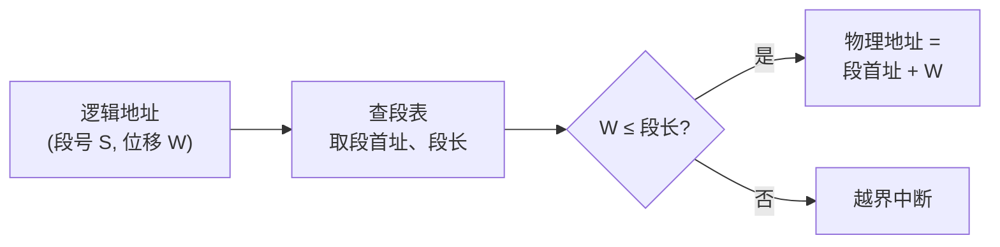

# 段式存储管理的基本原理与地址转换
先看一个现象：页式管理把程序切成固定大小的“页”，但程序员写程序时关心的不是页，而是“函数”“数组”“全局数据区”这些有逻辑含义的单位。段式管理就是按程序的自然逻辑结构来划分内存空间。

### 为什么需要段式管理

页式管理的页是物理单位，对用户不可见；而段是==信息的逻辑单位==，每一段包含一组意义相对完整的信息，比如代码段、数据段、栈段。段式管理的好处是：

- 便于程序模块化处理和保护（不同段可设不同权限）
- 便于多个进程共享同一段（如共享库）
- 便于动态链接
- 段长按实际需要决定，不固定

### 段表与地址结构

段式管理中，逻辑地址由两部分组成：

$$
\text{逻辑地址} = (\text{段号 } S,\ \text{段内位移 } W)
$$

系统为每个进程维护一张**段表**，每项记录该段在内存中的**段首址**和**段长**。

地址转换的关键公式：

$$
\text{物理地址} = \text{段首址} + \text{段内位移}
$$

>[!IMPORTANT]
> 与页式不同，段式不是“框号 × 页长 + 页内地址”，而是直接从段表中取出该段的起始地址，加上位移量即可。**没有乘法，只有加法。**

### 地址转换步骤

给定逻辑地址 $(S, W)$：

1. 从段表寄存器中找到段表在内存中的起始位置。
2. 以段号 $S$ 为索引查段表，得到该段的**段首址**和**段长**。
3. 检查合法性：
   - 若段号超出段表长度 → **缺段中断**（或非法段号）。
   - 若 $W \geq$ 段长 → **越界中断**。
4. 若合法，则物理地址 $= \text{段首址} + W$。

>[!WARNING]
> 段表中某一项的“段首址”为空或标记无效，说明该段尚未调入内存，此时产生的是**缺段中断**，不是越界。这是两类完全不同的异常，考试常在这里设坑。

### 一个算对的例子

给定段表：

| 段号 | 段首址 | 段长 |
| :--: | :----: | :--: |
| 0 | 200 | 400 |
| 1 | 2300 | 300 |
| 2 | 800 | 100 |
| 3 | 1300 | 580 |
| 4 | — | — |

求逻辑地址 $[1,10]$、$[2,150]$、$[4,40]$ 对应的物理地址。

- $[1,10]$：段 1 首址 2300，段长 300，$10 < 300$，合法。物理地址 $= 2300 + 10 = ==2310==$。
- $[2,150]$：段 2 段长 100，$150 > 100$ → **越界中断**。
- $[4,40]$：段 4 首址为空 → **缺段中断**。

>[!TIP]
> 判断顺序：先看**段号是否有效**（缺段），再看**位移是否越界**（越界），最后才算加法。顺序错了结论就错了。

### 与页式管理的区别

| 对比项 | 分页 | 分段 |
| :--- | :--- | :--- |
| 划分依据 | 物理单位，固定大小 | 逻辑单位，段长不固定 |
| 地址维度 | 一维线性地址空间 | 二维（段号 + 段内地址） |
| 用户可见性 | 对用户透明 | 用户可见 |
| 主要目的 | 减少外碎片，提高内存利用率 | 满足用户模块化、共享、保护需求 |
| 地址转换 | 页框号 × 页长 + 页内地址 | 段首址 + 段内位移 |

>[!CAUTION]
> 页式地址转换有一次乘法，段式只是加法。如果题目问“页式与段式地址转换的本质区别”，抓住这一点可以快速判断。

段式管理解决了“按逻辑组织程序”的需求，但段长不固定会带来**外部碎片**问题，实际系统往往采用==段页式==结合两者优点。
