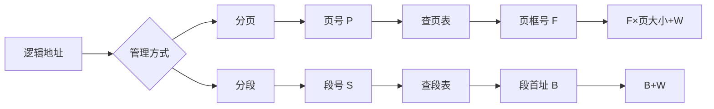

# 分页与分段的区别

## 什么是分页与分段

分页和分段都是把进程的逻辑地址空间划分成若干部分，再装入物理内存，但二者的划分依据不同：

- **分页**：按固定大小的“页”划分，页是==存储管理的物理单位==，用户通常看不见。
- **分段**：按程序的逻辑模块划分，段是==信息与程序的逻辑单位==，一段通常具有相对完整的含义。

> [!IMPORTANT]
> 分页主要为系统管理内存服务；分段主要为用户表达程序逻辑服务。

## 划分依据与地址结构

| 比较项 | 分页 | 分段 |
|---|---|---|
| 划分依据 | 固定大小的页 | 程序的逻辑模块 |
| 大小 | 页大小固定，由硬件或系统确定 | 段长可变，由程序结构决定 |
| 地址空间 | 一维，地址为 $P,W$ | 二维，地址为 $S,W$ |
| 用户可见性 | 通常不可见 | 段号和段长通常对程序员可见 |
| 分配单位 | 页框，固定大小 | 段，按段长分配 |
| 主要目的 | 提高内存利用率，减少外部碎片 | 便于编程、共享与信息保护 |

分页地址可表示为：

$$
L=P\times \text{页大小}+W
$$

其中 $P$ 是页号，$W$ 是页内偏移。查页表得到页框号 $F$ 后：

$$
\text{物理地址}=F\times \text{页大小}+W
$$

分段地址则表示为 $(S,W)$。查段表得到段首址 $B$ 后：

$$
\text{物理地址}=B+W
$$

## 为什么要同时使用

单独分页时，程序虽然被拆成固定大小的页，却看不出代码段、数据段等逻辑结构；单独分段时，段长不一，容易产生外部碎片。

段页式管理结合二者：先按逻辑关系把程序划分为段，再把每段划分为固定大小的页，内存仍按页框分配。因此，它既保留模块化特征，又能提高内存利用率。

## 常见坑

> [!WARNING]
> “页”不是用户感觉上的页面；“段”也不等于固定长度的内存分区。

1. **页号、页框号不能混淆**：页号来自逻辑地址，页框号来自页表。
2. **偏移不能越界**：分页中 $0\le W<\text{页大小}$；分段中必须满足 $0\le W<\text{段长}$。
3. **段页式地址一般要拆两次**：先由段号定位段，再由段内页号定位页。
4. **碎片判断要区分内外碎片**：分页仍可能产生内部碎片；分段主要产生外部碎片。

## 例题：分页地址转换

某页大小为 $1024\text{B}$，某逻辑地址对应的页号为 $2$，页内偏移为 $952$。若页表项表明第 $2$ 页装入第 $5$ 个物理块，则：

$$
\text{物理地址}=5\times1024+952=6072
$$

再如逻辑地址 $2148$：

$$
P=\left\lfloor\frac{2148}{1024}\right\rfloor=2,\qquad
W=2148\bmod1024=100
$$

因此查页表得到页框号 $F$ 后，物理地址就是：

$$
F\times1024+100
$$

> [!TIP]
> 记忆口诀：分页“页大小固定、地址一维”，分段“长度可变、地址二维”；分页先查页表，分段先查段表。
