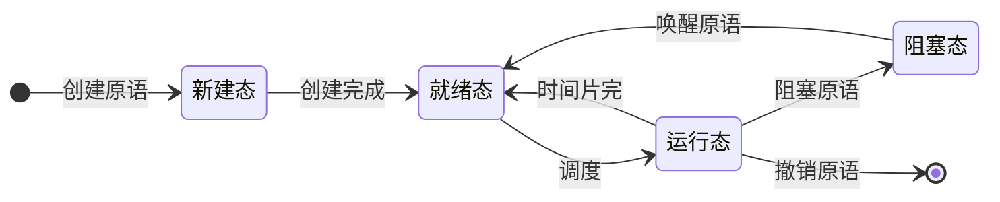
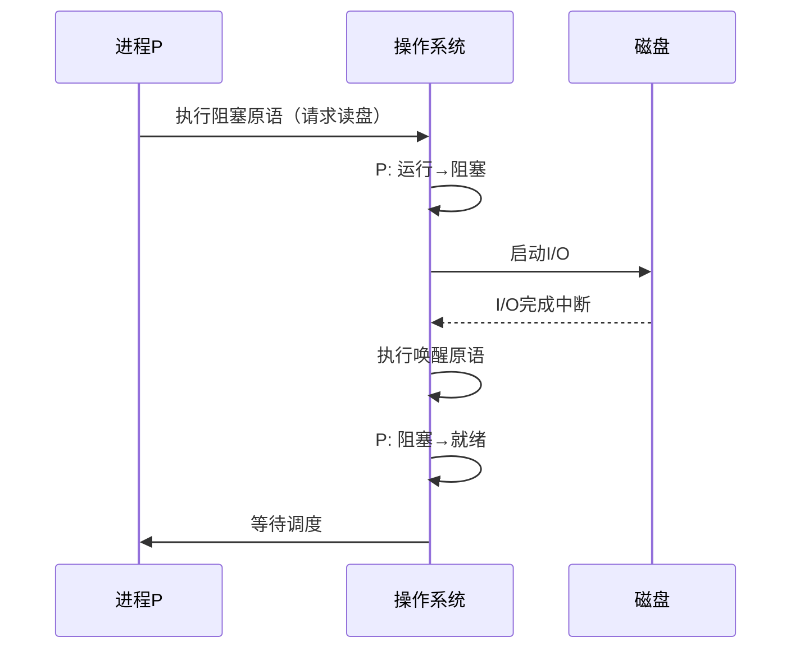

# 原语的概念与进程控制原语（创建、撤销、阻塞、唤醒）

## 原语与进程控制原语

### 从一个问题说起

进程的状态会在就绪、运行、阻塞之间切换。那么，谁来执行这些切换动作？如果让普通程序代码来做，会发生什么？

假设进程 A 在执行“把自己从运行态改为阻塞态”的代码，改到一半时时钟中断来了，调度器把 CPU 分给进程 B。此时 A 的状态改了一半——既不是运行也不是阻塞，系统数据被破坏。这说明：**进程状态的切换不能由普通程序指令随意完成，必须由操作系统内核以“不可分割”的方式执行**。这就是原语存在的根本原因。

### 原语是什么

> [!IMPORTANT]
> **原语（Primitive）是由操作系统内核实现的、由若干条机器指令组成的“原子操作”程序段，执行期间==不允许被中断==。**

“原子”的含义是：要么全部执行完，要么一步也不执行，中间状态对外不可见。实现方式通常是在原语执行期间关中断，执行完再开中断。

原语与普通函数的区别：

| 对比项 | 普通函数 | 原语 |
| --- | --- | --- |
| 执行者 | 用户程序（用户态） | 操作系统内核（核心态） |
| 可否被中断 | 可以 | 执行期间关中断，不可打断 |
| 功能层次 | 应用逻辑 | 对系统关键数据结构的操作（如 PCB 队列） |
| 典型例子 | `printf()`、`sort()` | 创建原语、阻塞原语 |

> [!WARNING]
> 原语≠系统调用。系统调用是用户程序进入内核的“门”，原语是内核内部实现某些关键操作的原子代码段。一次系统调用内部可能调用多个原语。

### 为什么用原语操作进程

进程控制的核心操作都涉及对 **PCB（进程控制块）** 和 **进程队列** 的修改。比如将 PCB 从就绪队列摘下来插入阻塞队列，这需要改两个队列指针。如果在改到一半被中断，队列链表就会断裂，整个系统的进程管理就崩溃了。所以==创建、撤销、阻塞、唤醒这四个进程控制操作必须用原语实现==。

---

## 四类进程控制原语

四个原语对应进程生命周期中的关键转折点：

### 创建原语（Create）

**触发场景**：提交批处理作业、用户登录、操作系统创建服务进程、父进程“孵化”子进程（如 `fork()`）。

**执行步骤**：

1. 为新进程申请一个空白 PCB；
2. 分配必要的资源（内存、文件等）；
3. 初始化 PCB（写入 PID、状态置为“新建态”、初始化寄存器上下文等）；
4. 若系统当前的性能和内存容量允许，将 PCB 插入就绪队列，新建态 → 就绪态。

> [!NOTE]
> 这一步回答了一个容易被忽略的事实：==进程可以创建子进程，但程序不能创建子程序==。进程有生命周期，程序只是静态代码。创建原语正是进程“诞生”的唯一入口。

### 撤销原语（Terminate / Destroy）

**触发场景**：进程正常结束、因错误被终止、被父进程或操作系统强制撤销。

**执行步骤**：

1. 根据 PID 找到目标 PCB，读出其状态；
2. 若进程仍在运行，则终止其执行，回收处理机；
3. 回收该进程占用的所有资源（内存、打开的文件、I/O 设备等）；
4. 若其有子进程，按策略一并终止或交由系统接管（不同操作系统不同）；
5. 从所在队列摘除 PCB，释放 PCB 本身。

> [!TIP]
> 撤销原语和创建原语是一对“生死拍档”：创建负责从无到有（NULL → PCB），撤销负责从有到无（PCB → NULL）。答题时按“找 PCB → 回收资源 → 删 PCB”的逆序记即可。

### 阻塞原语（Block / Wait）

**触发场景**：运行中的进程请求某种事件但尚不能满足——如请求 I/O、申请已被占用的资源、执行 P 操作发现信号量不足。

**关键点**：阻塞是进程==主动==的行为。没有哪个进程会说“我突然被阻塞了”，它是自己执行阻塞原语，把自己送入阻塞队列。

**执行步骤**：

1. 保护当前进程的 CPU 现场到其 PCB；
2. 将 PCB 状态从运行态改为阻塞态；
3. 将该 PCB 插入对应等待事件的阻塞队列（如某设备的 I/O 等待队列）；
4. 转进程调度，让出 CPU。

> [!CAUTION]
> 阻塞原语和“时间片用完”是两回事：时间片用完是**被动**的，进程转向就绪态；阻塞是**主动**的，转向阻塞态。考过这个坑——时间片用完 → 就绪态（选 B），不是等待态。

### 唤醒原语（Wakeup）

**触发场景**：某个事件发生后（如 I/O 完成、信号量 V 操作），需要把等待该事件的进程叫醒。

**执行步骤**：

1. 找到该事件对应的阻塞队列；
2. 从队列中取出一个（或所有）等待的 PCB；
3. 将 PCB 状态从阻塞态改为就绪态；
4. 将 PCB 从阻塞队列移入就绪队列。

> [!TIP]
> 阻塞和唤醒是一对严格配对的原语：==有阻塞必有唤醒==。阻塞发生在事件等待之前，唤醒发生在事件发生之后。考试常考“一个进程被唤醒意味着什么”——答案是 **变为就绪态**，而不是立即获得 CPU。

---

## 一个典型的例子

设进程 P 执行如下流程：运行中请求磁盘读入数据 → 阻塞 → 磁盘 I/O 完成的信号到达 → 唤醒。

问：P 被唤醒后立刻运行吗？**不是**。唤醒只是把 P 放入就绪队列，P 需要等待调度器再次选中它才能上 CPU。

这解释了常考的两道题：

- “时间片用完” → **就绪态**。进程没有等待任何事件，只是被动退让。
- “进程被唤醒” → **就绪态**。等待的事件发生了，但它还没有拿到 CPU。

---

## 常见坑与辨析

| 易混点 | 正解 |
| --- | --- |
| 阻塞 vs 就绪 | 阻塞是等**事件**，就绪是等 **CPU**。CPU 空闲时阻塞进程也不可运行 |
| 唤醒 = 运行？ | 不是。唤醒只是从阻塞队列移到就绪队列 |
| 原语 = 系统调用？ | 不是。原语是内核内部的原子操作 |
| 挂起 vs 阻塞 | 挂起是把进程映像换出到外存，阻塞是等事件；挂起的原因是内存不足或优先级管理 |

> [!IMPORTANT]
> 最后记一句话：**原语保证进程控制操作不可分割，四个原语管住进程的“生、死、睡、醒”——创建（生）、撤销（死）、阻塞（睡）、唤醒（醒）。**
