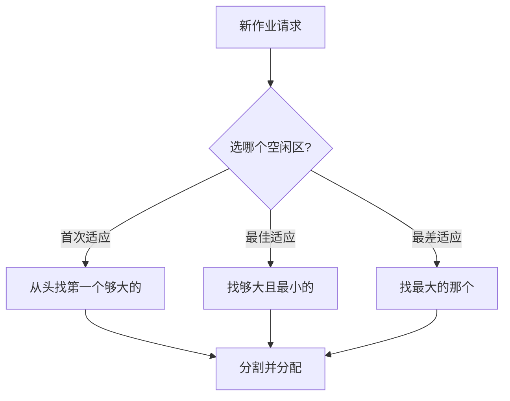

# 可变分区分配算法（首次适应、最佳适应、最差适应）

> [!IMPORTANT]
> 分区存储管理分为==固定分区==和==可变分区==两种方式。固定分区的每个分区大小可以不同但预先固定；而可变分区（动态分区）是在作业装入时，按其实际需求量划分内存空间。

## 为什么需要可变分区分配算法

固定分区虽然简单，但分区大小在系统初始化时就已确定。如果一个大作业只能放进大分区，或者小作业占用了大分区，都会造成严重的==内部碎片==。

那么，能不能让分区“随作业长度变化”？这就是可变分区的思路。但问题随之而来：随着作业的反复装入与撤离，空闲区会被切割成许多不连续的小块（外部碎片）。当新作业到来时，该把它塞进哪一块空闲区？这就引出了**动态分区分配算法**。

## 三种核心算法怎么做

假设当前空闲分区链/表中有若干空闲块，面对一个新作业，三种策略的选择逻辑截然不同：

- **首次适应算法（First Fit, FF）**：空闲分区按==地址递增==次序排列。每次分配时从链首开始查找，找到第一个满足要求的空闲区即停止。
- **最佳适应算法（Best Fit, BF）**：空闲分区按==容量递增==次序排列。遍历整个链表，挑出能满足要求且容量最小的空闲区进行分配。
- **最差适应算法（Worst Fit, WF）**：空闲分区按==容量递减==次序排列。总是挑选最大的空闲区进行分配。

> [!TIP]
> 记忆口诀：首次看“位置”，最佳找“刚好”，最差挑“最大”。注意课件考点中，设备分配常用的是先来先服务，而首次适应、最佳适应属于==内存分配算法==，切勿混淆！

## 算对了的例子

设内存空闲分区依次为：$P_1=10\text{KB}$，$P_2=5\text{KB}$，$P_3=20\text{KB}$，$P_4=8\text{KB}$。现有一作业需 $6\text{KB}$ 内存。

| 算法 | 选中分区 | 剩余空闲 | 理由 |
| :--- | :--- | :--- | :--- |
| 首次适应 | $P_1$ | $4\text{KB}$ | 从头找，$P_1(10) \ge 6$，直接命中 |
| 最佳适应 | $P_4$ | $2\text{KB}$ | 满足 $\ge 6$ 的有 $P_1,P_3,P_4$，其中 $P_4(8)$ 最小 |
| 最差适应 | $P_3$ | $14\text{KB}$ | 满足 $\ge 6$ 的有 $P_1,P_3,P_4$，其中 $P_3(20)$ 最大 |

## 相近概念的区别与常见坑

> [!WARNING]
> “最佳”真的最好吗？这是考试最爱挖的坑。最佳适应每次都切下最刚好的块，剩下的往往是极小的碎片，导致后续无法利用，反而产生大量==外部碎片==。最差适应每次都切最大的块，目的是让剩下的空闲区依然足够大，但也容易导致大作业无地可容。

| 对比维度 | 首次适应 (FF) | 最佳适应 (BF) | 最差适应 (WF) |
| :--- | :--- | :--- | :--- |
| 排序依据 | 地址递增 | 容量递增 | 容量递减 |
| 查找开销 | 较小（可能提前停） | 较大（通常需遍历） | 较小（链首即最大） |
| 碎片特征 | 低址端多小碎片 | 极易产生微小外部碎片 | 缺乏大块连续空闲区 |
| 综合性能 | ==最常用、最高效== | 名字好听但未必实用 | 适合中小作业均匀场景 |

> [!NOTE]
> 无论用哪种算法，随着时间推移都会产生外部碎片。解决办法是进行**紧凑（拼接）**技术，将分散的空闲区合并成大块，但这需要硬件支持动态重定位。
