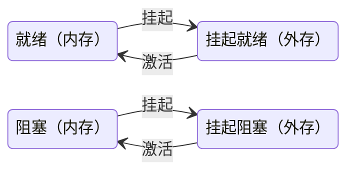
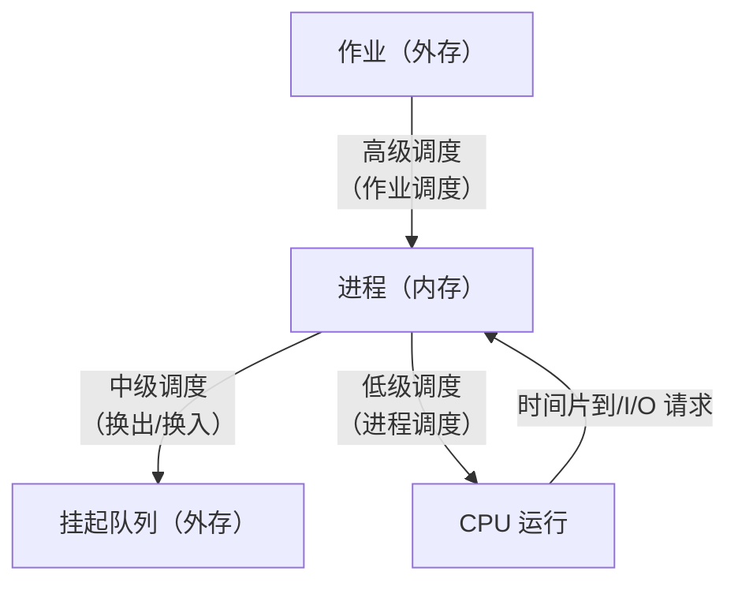

# 处理机的三级调度（高级、中级、低级调度）

## 为什么需要多层调度

如果操作系统只做“选一个进程上 CPU”这件事，会面临两个尴尬：

- 内存里能放的进程数是有限的。如果所有作业都直接进内存，内存很快就会被撑爆。
- CPU 的速度比 I/O 快几个数量级。当所有进程都在等 I/O 时，CPU 只能空转，白白浪费资源。

解决这两个问题的思路，就是把“调度决策”拆成三层，让每一层各自盯住一种核心资源。

> [!IMPORTANT]
> ==三级调度分别管三样东西：作业调度管“创建与接纳”，中级调度管“内存驻留”，低级调度管“CPU 分配”。==

---

## 高级调度（作业调度）：谁能进系统

高级调度负责把外存上的作业调入内存，为它创建进程、分配资源。它的决策频率最低，通常几分钟甚至更久才执行一次。

- **管什么**：从无到有——把作业变成进程；从有到无——进程终止后回收资源。
- **为什么要有**：批处理系统中，作业数量远超内存容量，必须挑选一批作业进入内存，防止内存过载。
- **常见误区**：分时系统和实时系统通常不设作业调度（或只做很轻量的接纳控制），因为这类系统并不攒一批作业再统一处理。

---

## 中级调度（内存调度）：该不该暂时赶出去

中级调度盯的是内存使用率。当内存紧张时，它把暂时不能运行的进程换出到外存（挂起），等条件满足再换回来（激活）。

- **管什么**：进程在内存和外存之间“换入换出”，本质是平衡负载。
- **与高级调度的区别**：高级调度决定“要不要接纳一个新作业”，中级调度只把已在系统中的进程临时挪到外存，不创建也不销毁进程。

> [!WARNING]
> 挂起 ≠ 终止。挂起的进程还存在，只是代码和数据暂时搬到外存，PCB 仍由系统管理。

---

## 低级调度（进程调度）：下一个轮到谁上 CPU

低级调度是整个调度体系中运行频率最高的，几十毫秒就可能执行一次。它从就绪队列中挑一个进程，把 CPU 分配给它。

- **管什么**：决定就绪态 → 运行态的转换。
- **为什么要有**：CPU 是最稀缺的资源，必须在多个就绪进程之间快速切换，保证公平与高效。

---

## 一张图看清三层调度

层次 | 调度对象 | 负责资源 | 频率 | 核心问题
---|---|---|---|---
高级调度 | 作业 → 进程 | 内存接纳 | 低（分钟级） | 选哪些作业创建进程
中级调度 | 进程 ↔ 挂起 | 内存容量 | 中 | 何时换出/换入
低级调度 | 进程 → CPU | 处理器时间 | 高（毫秒级） | 下一个执行哪个

> [!TIP]
> 记忆口诀：**高接纳、中换入换出、低分配 CPU**。

---

## 常见的坑：分不清“调度层次”和“状态转换”

看一道南邮真题：

> 进程从就绪态转为运行态是通过（ ）决定的。  
> A. 高级调度  B. 中级调度  C. 低级调度  D. 以上都不是

很多同学会犹豫中级调度——因为“挂起”与“激活”也涉及状态切换。但关键在于：就绪 → 运行只涉及 CPU 的分配，这恰恰是低级调度的职责。==只要题目问的是“就绪→运行”，答案一定是低级调度。==

另一道题：

> 若当前进程因时间片用完而让出处理机时，该进程应转变为（ ）状态。  
> A. 完成  B. 就绪  C. 运行  D. 等待

时间片耗尽是正常用完了本次 CPU 配额，进程并没有等待任何 I/O，所以不会进入“等待/阻塞”。低级调度把它从运行摘下来，放回就绪队列尾部，自然就是就绪态。这正好印证了上面那条规则：运行 → 就绪也是低级调度的操作范围。

---

## 一个算对了的例子：作业调度 + 进程调度协同

题目条件：两道作业的批处理系统，作业调度用短作业优先（SJF）非抢占，进程调度用优先数抢占（数小优先级高）。

| 作业 | 到达时间 | 运行时间(min) | 优先数 |
|:---:|:---:|:---:|:---:|
| A | 10:00 | 40 | 5 |
| B | 10:20 | 30 | 3 |
| C | 10:30 | 50 | 4 |
| D | 10:50 | 20 | 6 |

**推演关键节点（按题目给的批处理限制：内存最多 2 道）**：

- 10:00 — A 到达并运行。
- 10:20 — B 到达，优先数 3 < 5，抢占 A。A 回就绪队列，B 上 CPU。
- 10:30 — C 到达，但内存已满，C 进后备队列（作业调度不予接纳）。
- 10:50 — B 运行完毕退出。D 到达。作业调度比较 C 与 D 的运行时间：20 < 50，==**SJF 选 D 进内存**==。就绪队列有 A(优先数 5) 与 D(6)，A 优先级更高，上 CPU。
- 11:10 — A 运行完毕退出。内存腾出位置，作业调度把 C 调入。就绪队列有 C(4) 与 D(6)，C 优先级更高，上 CPU。
- 12:00 — C 运行完毕，D 上 CPU。
- 12:20 — D 运行完毕。

| 作业 | 进内存 | 结束 | 周转时间 |
|:---:|:---:|:---:|:---:|
| A | 10:00 | 11:10 | 70 |
| B | 10:20 | 10:50 | 30 |
| C | 11:10 | 12:00 | 90 |
| D | 10:50 | 12:20 | 90 |

平均周转时间 = (70 + 30 + 90 + 90) / 4 = **70 分钟**。

> [!NOTE]
> 这道题的区分点在于：**高级调度决定了 D 比 C 先进入内存**（SJF），而**低级调度决定了 A 比 D 先上 CPU**（优先数抢占）。两层决策缺一不可，各自独立按规则判断。
