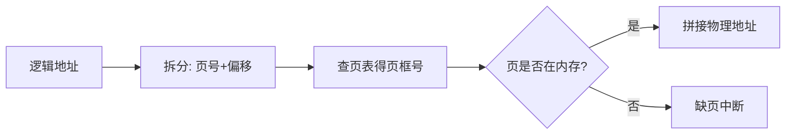

# 存储管理的基本功能与地址转换（地址重定位）

> [!IMPORTANT]
> 核心公式：==物理地址 = 页框号 × 页长 + 页内地址==

## 为什么需要地址转换

程序编译后生成的是从 0 开始的**逻辑地址**。但装入内存时，操作系统分配给它的物理空间往往不在 0 处。CPU 执行指令必须按真实物理地址寻址，因此必须在访问前把逻辑地址“翻译”成物理地址，这个过程就叫**地址重定位（地址映射）**。

同时，存储管理还要负责**存储保护**：既要防止==地址越界==（访问不属于自己的内存），也要防止操作==越权==（如用户态写内核区）。

## 静态重定位 vs 动态重定位

什么时候做这个翻译？有两种策略：

| | 静态重定位 | 动态重定位 |
| :--- | :--- | :--- |
| **时机** | 程序装入后、运行之前，一次性全部转换 | 程序执行过程中，每次访存时实时转换 |
| **实现** | 靠软件（装入程序）实现 | 靠硬件（重定位寄存器）实现 |
| **优点** | 无需增加硬件地址转换机构，便于静态连接 | 程序可在内存中移动，支持虚拟存储 |

> [!NOTE]
> 南邮期末常考填空：“静态重定位是靠**软件**实现的，动态重定位是靠**硬件**实现的。”

## 分页机制下的地址转换怎么做

在分页系统中，逻辑地址被划分为两部分：**页号 $p$** 和 **页内偏移 $d$**。

思考一下：如果页面大小为 4KB（即 $2^{12}$ 字节），逻辑地址 `0` 对应的物理地址是多少？
既然页大小是 4096B，地址 `0` 意味着页号为 0、偏移为 0。查页表找到第 0 页所在的页框号，直接拼上偏移即可。若第 0 页恰好在物理块 0，则物理地址就是 0（这也是课件选择题的考点）。

具体计算步骤如下：
1. **算页号与偏移**：$p = \lfloor \text{逻辑地址} / \text{页大小} \rfloor$，$d = \text{逻辑地址} \pmod{\text{页大小}}$。
2. **查页表**：用 $p$ 查页表，得到对应的页框号 $f$。
3. **算物理地址**：$\text{物理地址} = f \times \text{页大小} + d$。

## 一个算对了的例子

某请求页式系统，页大小为 2048 字节，页表如下：

| 页号 | 页框号 |
| :---: | :---: |
| 0 | 2 |
| 1 | 3 |
| 2 | 6 |
| 3 | （空） |

**求逻辑地址 4800 的物理地址：**
- 页号 $p = \lfloor 4800 / 2048 \rfloor = 2$
- 偏移 $d = 4800 \pmod{2048} = 704$
- 查表：页号 2 对应页框号 6
- 物理地址 $= 6 \times 2048 + 704 = 12992$

**若逻辑地址是 7800 呢？**
- 页号 $p = \lfloor 7800 / 2048 \rfloor = 3$
- 查表发现页号 3 为空（未装入），此时不会算出物理地址，而是触发==缺页中断==。

> [!WARNING]
> 常见坑：除法不要写成小数！例如 $4800 / 2048$ 的商是 2、余数是 704，绝不能写成“21.704”。

> [!TIP]
> 当题目给出十六进制逻辑地址且页大小为 $2^n$ 时，==低 $n$ 位二进制直接就是偏移量，高位就是页号==。例如页大小 4096B（$2^{12}$），逻辑地址 `2F6A(H)` 的低 3 位十六进制 `F6A` 就是偏移，最高位 `2` 就是页号，查表得块号 `E`，物理地址直接拼成 `EF6A(H)`。
