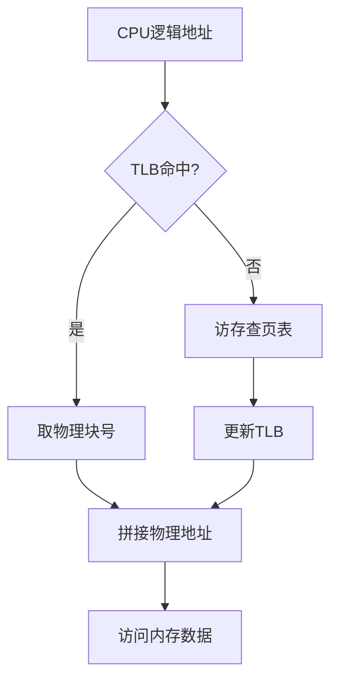

# 快表（TLB）机制及带快表的地址变换过程

## 为什么需要快表

在基本分页存储管理中，每次访问内存数据都需要先查页表获取物理块号，再访问实际数据，这导致==存取速度降低了一半==。为了解决这一瓶颈，我们在 MMU 中增设了一个专用的高速缓冲存储器——相联存储器（Associative Memory），也称 ==TLB（Translation Lookaside Buffer）==或快表。它利用局部性原理，缓存最近访问过的页表项，将“查页表”从内存访问降级为硬件级并行查找。

## 带快表的地址变换过程

当 CPU 给出有效逻辑地址后，系统如何完成转换？请思考：如果每次都串行查 TLB 再查页表，是否还能提速？实际上，现代系统采用==并行比较==机制。

> [!IMPORTANT]
> 核心流程四步走：
> 1. 拆分逻辑地址为页号与页内偏移，页号送入 TLB ==同时比较==所有表项；
> 2. 若命中，直接读出物理块号形成物理地址；
> 3. 若未命中，访问内存页表获取块号，并==将该页表项写入 TLB==；
> 4. 若 TLB 已满，按替换算法（如 LRU）换出旧表项。

[!NOTE]
> TLB 是纯硬件实现的相联存储器，其查找是并行的，与表项数量无关；而内存中的页表查找是串行的。这是两者本质区别。

## 平均访问时间计算

考试中常考有效访问时间（EAT）的计算。假设 TLB 命中率为 $H$，访问 TLB 时间为 $t$，访问内存时间为 $T$，则：

$$
EAT = H \times (t + T) + (1 - H) \times (t + 2T)
$$

> [!WARNING]
> 易错点：未命中时，必须先访问 TLB（耗时 $t$），再访问内存页表（耗时 $T$），最后访问目标内存单元（再耗 $T$），共 ==$t + 2T$==。切勿漏掉首次 TLB 查找时间！

以真题为例：$t=20\mathrm{ns}$, $T=100\mathrm{ns}$, $H=90\%$，代入公式：
$$
EAT = 0.9 \times (20+100) + 0.1 \times (20+200) = 108 + 22 = 130\mathrm{ns}
$$
注：部分教材或题目设定命中时 TLB 与内存访问可重叠，或参数取值略有差异，若选项无 130 而有 128，应按题目隐含模型选择最接近答案。==务必看清题干对“访问时间”的定义==。

## 常见误区辨析

| 对比维度 | 快表（TLB） | 内存页表 |
| :--- | :--- | :--- |
| 存储位置 | MMU 内部高速缓存 | 主存 |
| 查找方式 | 并行相联查找 | 串行索引 |
| 内容完整性 | 仅含部分热点页表项 | 包含全部页表项 |
| 更新时机 | 页面置换/进程切换时刷新 | 随分配动态维护 |

> [!CAUTION]
> 高危误区：认为 TLB 未命中就一定会发生缺页中断！实际上，TLB 未命中仅代表缓存中没有该页表项，只要页表本身在内存中且有效位为 1，仍可正常完成地址转换。==TLB Miss ≠ Page Fault==。

[!TIP]
> 记忆口诀：快表命中一步到，未命中间接查页表；并行比较是关键，替换算法保新鲜。
