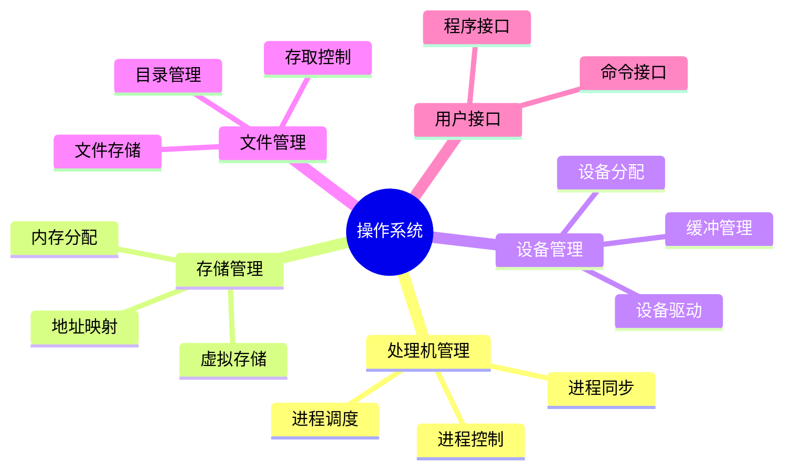

# 操作系统的主要功能（处理机管理、存储管理、设备管理、文件管理、用户接口）

## 从资源管理视角看操作系统

操作系统是计算机系统中最核心的系统软件，它**向下管理硬件资源，向上提供服务**。从资源管理的观点来看，操作系统的主要功能可归纳为五大类：**处理机管理、存储管理、设备管理、文件管理和用户接口**。

> [!IMPORTANT]
> 操作系统的五大功能：**处理机管理、存储管理、设备管理、文件管理、用户接口**。前四项是对"硬资源"的管理，用户接口则是面向用户的"软服务"。

## 五大功能逐一拆解

| 功能 | 管理对象 | 核心任务 | 对应章节 |
|------|----------|----------|----------|
| **处理机管理** | CPU | 进程/线程的创建、调度、同步与通信 | 第3、4章 |
| **存储管理** | 主存（内存） | 内存分配、地址变换、虚拟存储 | 第5章 |
| **设备管理** | I/O设备 | 缓冲管理、设备分配、驱动控制 | 第6章 |
| **文件管理** | 程序与数据 | 文件的存取、共享、保护 | 第7章 |
| **用户接口** | 用户 | 命令接口与程序接口（系统调用） | 第1章 |

### 处理机管理

处理机（CPU）是计算机中最宝贵、最稀缺的资源。**处理机管理**的核心是对进程（线程）的管理和调度，包括高级调度（作业调度）、中级调度（内存调度）和低级调度（进程调度）。操作系统通过进程控制块（PCB）记录进程状态，实现进程的并发执行。

> [!TIP]
> 记住口诀：**"进程是资源分配的基本单位，线程是调度的基本单位"**。处理机管理围绕进程展开。

### 存储管理

**存储管理**负责内存的分配与回收、地址映射（逻辑地址→物理地址）、内存保护以及内存扩充。现代操作系统普遍采用**虚拟存储技术**，其理论基础是程序的**局部性原理**——程序在一段时间内仅访问少量代码和数据。

> [!WARNING]
> 虚拟存储管理系统的基础是程序的**局部性**理论，不是"全局性"或"虚拟性"！这是选择题高频考点。

常见存储管理方式包括分区存储管理（固定/可变分区）、**页式存储管理**、**段式存储管理**和**段页式存储管理**。

**算例**：在一个页式存储管理系统中，页面大小为 $1024\text{B}$，逻辑地址 $2148$ 的地址变换过程：

$$2148 = 2 \times 1024 + 100 \implies \text{页号} = 2,\ \text{页内偏移} = 100$$

查页表得页号 $2$ 对应物理块号（假设为 $5$），则：

$$\text{物理地址} = 5 \times 1024 + 100 = 5220$$

### 设备管理

**设备管理**负责对I/O设备（磁盘、打印机、键盘等）进行管理和驱动。设备管理程序借助四类数据结构进行管理：

- **DCT**（设备控制表）
- **COCT**（控制器控制表）
- **CHCT**（通道控制表）
- **SDT**（系统设备表）

> [!CAUTION]
> **JCB**（作业控制块）属于作业管理，**不属于**设备管理的数据结构！这是选择题常见陷阱。

设备控制方式按发展顺序为：程序直接查询 → **中断方式** → **DMA方式** → **通道方式**。

### 文件管理

**文件管理**负责对程序和数据文件进行组织、存储、检索、共享和保护。**文件系统**是操作系统中文件管理有关的软件和数据的集合，为用户提供"按名存取"的便利。

### 用户接口

操作系统向用户提供两类接口：

- **命令接口**：供用户直接操作（如Shell命令、图形界面）
- **程序接口**：供程序员编程使用，即**系统调用**（System Call）

> [!NOTE]
> 用户接口是连接用户与操作系统内核的桥梁。没有接口，用户无法与计算机交互；没有系统调用，应用程序无法请求内核服务。

## 常见误区辨析

> [!WARNING]
> 1. **"处理机管理 = 进程管理"**？不完全准确。处理机管理还包括线程管理和处理机调度，进程管理是其核心但非全部。
> 2. **"存储管理只管内存"**？存储管理还包括对Cache和虚拟存储器的管理，但重点是主存管理。
> 3. **"设备管理 = 驱动开发"**？设备管理还包括缓冲管理、设备分配、设备独立性等，驱动只是其中一环。

> [!IMPORTANT]
> 五大功能中，**处理机管理和存储管理是考试重点**，涉及大量计算题（地址变换、页面置换、磁盘调度）；**设备管理和文件管理**侧重概念辨析；**用户接口**常考系统调用的理解。
