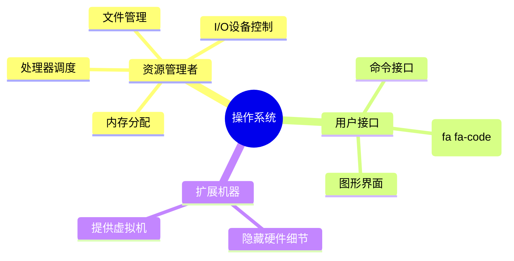

# 操作系统的定义与主要目标

# 操作系统的定义与主要目标

## 从三个视角理解操作系统

拿到一台电脑，你打开电源，看到桌面、鼠标指针、可以点开浏览器——这些是谁提供的？你写的程序要读取文件、占用 CPU、被意外终止时不能拖垮整个系统——这些又是谁在管理？

我们需要从三个层次来定义操作系统：

- **资源管理者**：操作系统是计算机硬件和软件资源的管家。它负责处理器的调度、内存的分配与回收、I/O 设备的驱动与控制、文件系统的组织。站在这个视角，操作系统追求的是**有效性**——让资源利用率尽可能高，不能有 CPU 闲着而大量进程在排队。
- **用户接口 / 服务提供者**：操作系统屏蔽了底层硬件的复杂性，向上提供一致的接口。用户通过 shell 命令行或 GUI 操作计算机；程序员通过**系统调用**请求操作系统内核完成 I/O、进程管理、通信等服务，而不必关心硬盘的磁头移动或网卡的寄存器配置。这个视角对应的是**方便性**。
- **扩展机器 / 虚拟机**：一台裸机只能执行特权指令，但操作系统为每个应用程序制造了一台“虚拟计算机”——有自己的地址空间、逻辑处理器、逻辑设备。语言处理程序运行在这台虚拟机上，感觉就像独占整台机器。这层抽象使编程门槛大大降低。

> [!IMPORTANT]
> ==操作系统是管理和控制计算机硬件与软件资源、合理组织工作流程、方便用户使用的程序集合==。三视角不是相互独立，而是同一实体的不同剖面。

---

## 设计操作系统的主要目标

考纲中简答题频繁出现这道题，常考四个目标的原文概括。

> [!IMPORTANT]
> 操作系统设计的四个主要目标是：方便性、有效性、可扩充性、开放性。

| 目标 | 核心含义 | 典型体现 |
| :--- | :--- | :--- |
| **方便性** | 提供友好的用户接口，隐藏硬件细节 | GUI、shell、系统调用 |
| **有效性** | 充分管理和分配资源，提高系统效率 | CPU 调度、虚拟内存、缓冲 |
| **可扩充性** | 适应硬件和应用发展，便于扩展新功能 | 微内核的模块化设计 |
| **开放性** | 遵循统一标准，保证互连和移植能力 | POSIX 接口、TCP/IP 协议栈 |

**方便性**强调用户看到的：输入命令即运行程序，在代码中调用 `open()` 就能操作文件，不必知道磁盘物理地址。

**有效性**是资源管理视角的直接目标。它回答“为什么要设计操作系统”的根本问题之一——==没有 OS，硬件资源会大量闲置，工作流程无法合理组织==。

**可扩充性**不是一次两次考试的热门点，但你写 OS 课设时一定会感受到：内核模块加载、驱动程序的热插拔都是可扩充性的实践。

**开放性**则是现代分布式系统和网络互连的基石。一个遵循 POSIX 标准的程序，可以从 Linux 移植到其他 Unix-like 系统；一个实现 TCP/IP 协议栈的操作系统，能无缝接入互联网。

> [!WARNING]
> 常见误区：有同学把“可靠性”“安全性”当作 OS 设计的主要目标写在简答题中。可靠性/安全性固然重要，但考纲指定的是==方便性、有效性、可扩充性、开放性==，多写可能反而扣分。

---

## 处理器状态：管态与目态

填空题“多数系统将处理器工作状态划分为\_\_\_和\_\_\_”的答案是 **管态（内核态/系统态）** 和 **目态（用户态）**。

为什么需要两种状态？设想你的程序直接执行 `cli` 指令关中断，整个系统就会瘫痪。OS 必须把**可能危及系统的指令**设为**特权指令**，只允许在管态下执行。

| 状态 | 别名 | 可执行的指令 | 运行的程序 |
| :--- | :--- | :--- | :--- |
| 管态 | 内核态 / 系统态 | 所有指令（包括特权指令） | OS 内核 |
| 目态 | 用户态 | 非特权指令 | 用户程序 |

> [!TIP]
> 记忆口诀：“目态看，管态干”——用户态只能“看”自己的地址空间、不能“伸手”改系统资源；需要 I/O 等操作时必须通过**访管指令（陷入指令）** 切换到管态，由操作系统代为完成。

以此为基础，当操作系统在**资源管理者**视角下调度 CPU 时，==通过管态/目态的切换保护系统安全==，同时实现资源共享；当操作系统作为**扩展机器**时，目态下运行的用户程序感知到的是它独占了一台虚拟机，实际背后是管态下 OS 在为其执行 I/O、处理缺页中断。

理解了操作系统的定义和目标后，后面的章节就在回答“OS 怎么做到方便”（用户接口/系统调用）、“怎么做到有效”（进程调度/内存管理）、“怎么做到开放和可扩充”（接口标准化/模块化设计）。</write>
