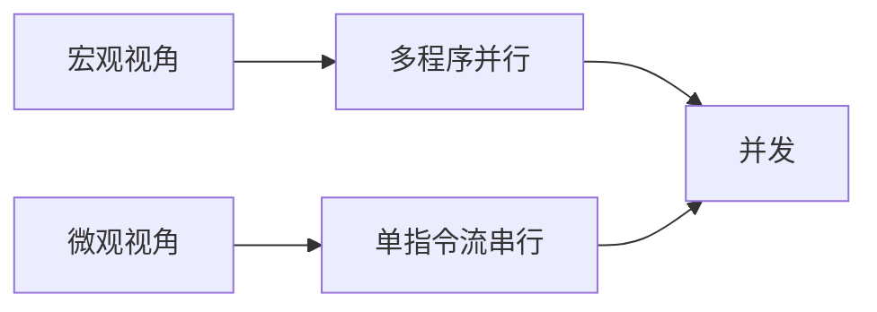
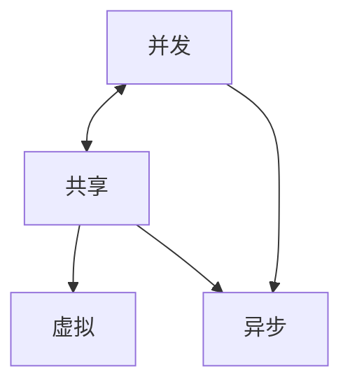

# 现代操作系统的特征（并发、共享、虚拟、异步）

现代操作系统与过去的单道程序系统最大的不同，就在于它能==同时==管理多个活动。但注意，"同时"这个词在宏观与微观上的含义并不相同：从宏观上看，计算机里确实有多个程序在"同时执行"；而微观上，==任一时刻 CPU 上真正运行的只有一条指令流==。这种"宏观并行、微观串行"的性质就是**并发性**。

## 并发性

**并发性**指两个或两个以上的事件（或活动）在同一时间间隔内发生。它能消除系统部件之间的相互等待，改善资源利用率、提高吞吐率。需要注意与"并行"的区别——并行强调==同一时刻==真正同时，只有多处理器硬件才能做到；而并发是单处理器通过时间片轮转等手段制造出的"假象"。

> [!NOTE]
> "并发"的另一面是：程序**失去了封闭性与可再现性**，执行结果可能因为推进速度不同而不同。这正是后续学习"临界区""互斥与同步"的动机。

## 共享性

**共享性**指系统资源可被多个并发执行的用户/系统程序共同使用，而不是被某一个程序独占。共享分两类：

| 形式 | 含义 | 典型例子 |
| --- | --- | --- |
| 顺序（互斥）共享 | 轮流使用，同一时刻仅一个进程访问 | 打印机、共享变量 |
| 同时（并发）共享 | 同一时刻允许多个访问 | 磁盘、可重入代码段 |

## 虚拟性

**虚拟性**是把==物理上的一个实体变成逻辑上的多个对应物==，或反过来把物理上的多个实体变成逻辑上的一个对应物。前者如 CPU→多个虚拟处理器（每进程一个"CPU"）、独占设备→多个虚拟设备（SPOOLing）；后者如磁盘+内存→一个大得多的虚拟存储器。

> [!TIP]
> 判断一道选择题问"虚拟化的目的"时，选 ==提高资源利用率、为用户提供方便高效的操作环境== 基本不会错。

## 异步性（不确定性）

**异步性**指进程按各自独立的、不可预知的速度向前推进，走走停停。其根本原因是**并发 + 共享**：多个进程抢夺资源、又受中断等随机事件影响，若不加控制就会出现"与时间有关的错误"（如飞机订票把同一张票卖给两个人）。

> [!IMPORTANT]
> 四者关系==并发和共享是两个最基本的特征，互为存在的条件==；虚拟技术为共享提供更好条件；==并发与共享是导致异步性的根本原因==。

## 一道经典选择题

> Spooling 技术是一种实现虚拟（　）的技术。
> A. 处理器　B. 设备　C. 存储器　D. 链路

思路：SPOOLing 用磁盘输入/输出井与预输入、预输出进程，把**独占设备**改造成**共享设备**，多用户可同时使用打印机——这属于==虚拟设备==，答案为 **B**。注意与"虚拟存储器"区分：后者扩充的是主存容量，虚拟设备扩展的是独占 I/O 设备。
