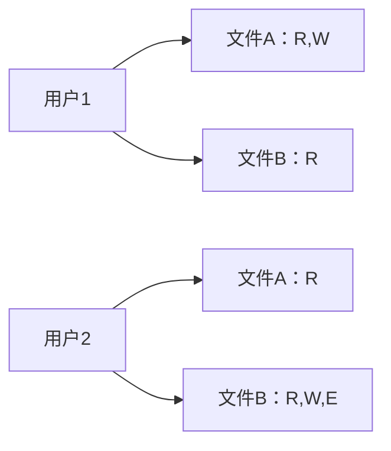
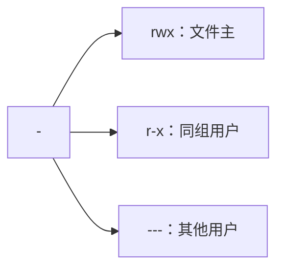

# 文件的保护机制（存取控制矩阵、存取控制表）

我们先从一个问题开始：操作系统凭什么相信一个用户对某个文件的操作是“合法”的？如果每个用户都能随意读写别人的文件，文件系统就失去了基本的安全意义。所以文件管理必须提供一种机制，在用户和文件之间建立权限边界。常用的实现方式主要有两类：**存取控制矩阵**和**存取控制表**，这也是南邮《操作系统》课程中“文件保护机制”的核心考点。

## 为什么需要文件保护

文件保护要解决的核心问题是：**谁（用户）能对哪个文件做什么操作（读、写、执行等）**。在操作系统中，文件不是一个孤立的数据块，而是带有属主、属组和权限信息的资源。文件系统在每次访问文件时，都要根据这些信息判断访问是否被允许。

## 存取控制矩阵

存取控制矩阵是一个二维表：

- **行**：系统中的所有用户
- **列**：系统中的所有文件
- **交叉单元**：该用户对该文件的访问权限集合

例如一个简化的系统中有两个用户 `user1`、`user2`，两个文件 `A`、`B`：

| 用户 | 文件 A | 文件 B |
|------|--------|--------|
| user1 | R, W | R |
| user2 | R | R, W, E |

其中 `R` 表示读，`W` 表示写，`E` 表示执行。

> [!NOTE]
> 存取控制矩阵的优点是**概念直观**，但缺点是**空间浪费严重**。实际系统中用户和文件数量都很大，矩阵会变得非常稀疏，因此很少直接采用完整矩阵来管理权限。

## 存取控制表

存取控制表是为**每个文件**单独保存一张权限表，表中只列出与该文件有关的用户及其权限。它相当于把存取控制矩阵按列拆分，每个文件保存自己那一列的非空部分。

以“文件 A 的存取控制表”为例：

| 用户 | 权限 |
|------|------|
| user1 | R, W |
| user2 | R |

> [!IMPORTANT]
> 存取控制表是文件系统中实际常用的方式。每个文件在创建时都会附带一张控制表，系统在打开文件时检查该表，判断当前用户能否进行请求的操作。

## UNIX 文件权限：一种简化的保护机制

UNIX 把用户划分为三类：

- **文件主（Owner）**
- **同组用户（Group）**
- **其他用户（Others）**

每类用户分别用三个权限位表示：`r` 读、`w` 写、`x` 执行。文件属性字符串中的第一个字符表示文件类型，`-` 表示普通文件，`d` 表示目录。

例如 `-rwxr-x---`：

含义是：

- 这是一个**普通文件**
- 文件主拥有**读、写、执行**权限
- 同组用户拥有**读、执行**权限
- 其他用户**没有任何权限**

> [!TIP]
> 记忆口诀：`rwx` 三个字母顺序固定，`-` 表示该位置权限缺失。第 1 位是文件类型，第 2～4 位是文件主权限，第 5～7 位是同组用户权限，第 8～10 位是其他用户权限。

## 常见的坑

> [!WARNING]
> **“其他用户”≠“同组用户”≠“文件主”**。UNIX 判断权限时按顺序匹配：先看是不是文件主，再看是不是同组用户，最后才归入其他用户。一个用户只要匹配了前面某一类，就不会再按后面的类别判断。

> [!CAUTION]
> 在 `-rwxr-x--x` 中，其他用户权限是 `--x`，**能执行但不能读**。如果题目问“能否读取”，就必须严格看读位 `r` 是否存在，不能因为能执行就误以为能读。

## 一个算对了的例子

题目：一个 UNIX 文件 F 的文件属性表示为 `-rwxr-x--x`。

**（1）解释含义。**

逐段拆解：

| 位置 | 内容 | 含义 |
|------|------|------|
| 第 1 位 | `-` | 普通文件 |
| 第 2～4 位 | `rwx` | 文件主可读、写、执行 |
| 第 5～7 位 | `r-x` | 同组用户可读、执行，不可写 |
| 第 8～10 位 | `--x` | 其他用户可执行，不可读、写 |

**（2）判断另一个用户能否读取文件 F。**

已知：文件主 `uid=16`，`gid=2`；另一个用户 `uid=7`，`gid=2`。

- 该用户 `uid != 16`，不是文件主。
- 该用户 `gid == 2`，与文件主同组，匹配**同组用户**。
- 同组用户权限为 `r-x`，其中包含 `r`。

因此该用户**能读取**文件 F。

> [!IMPORTANT]
> 判断 UNIX 文件权限的步骤：先确定文件类型，再按“文件主 → 同组用户 → 其他用户”的顺序定位当前用户所属类别，最后只看该类别对应的三个权限位。
