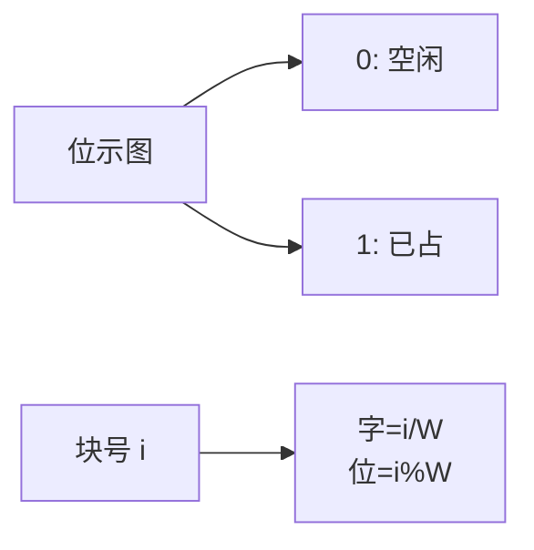

# 文件存储空间的管理方法（位示图法、空闲表法、空闲链表法）

## 为什么需要管理文件存储空间？

当用户创建文件时，操作系统必须在磁盘上找到空闲块；删除文件时，又需回收这些块。如果缺乏统一管理，磁盘将迅速碎片化甚至无法写入。==文件存储空间管理的核心目标，就是高效地追踪“哪些块空闲、哪些块已占”==。南邮《操作系统》课程重点考察三种经典方法：位示图法、空闲表法和空闲链表法。

## 三种管理方法怎么做？

### 位示图法

用二进制位串表示磁盘块状态：`0` 表示空闲，`1` 表示已分配。若磁盘有 $N$ 个块，则需 $\lceil N/8 \rceil$ 字节的存储空间。

> [!IMPORTANT]
> 位示图法是**盘空间管理**的专用方法，切勿与页式虚拟存储中的页面调度混淆。真题选择9明确考查此区分，答案为A。

给定块号 $i$，其对应位示图中的字号和位号计算公式为：
$$
\text{字号} = \left\lfloor \frac{i}{W} \right\rfloor, \quad \text{位号} = i \bmod W
$$
其中 $W$ 为机器字长（位数）。反之，由字号 $j$、位号 $k$ 可得块号：$i = j \times W + k$。

### 空闲表法

维护一张表格，记录所有==连续空闲区==的起始块号和长度。分配时查表找合适空闲区，回收时合并相邻空闲区。适合连续分配策略，但空闲区多时表格庞大、查找慢。

### 空闲链表法

将所有空闲块链接成链表。分为两种：

- **空闲块链**：每个空闲块含指向下一块的指针，粒度细，但I/O开销大；
- **空闲盘区链**：链接的是连续空闲区描述符，兼顾效率与空间。

> [!TIP]
> 链接结构文件（如FAT）允许逻辑记录存放在不相邻物理块中，这与空闲链表法是不同概念：前者管**文件数据布局**，后者管**空闲空间追踪**。真题选择10考的是文件物理结构，勿张冠李戴。

## 三者对比与常见误区

| 方法         | 空间开销       | 分配/回收效率     | 适用场景           |
|--------------|----------------|-------------------|--------------------|
| 位示图法     | 固定，较小     | 快（位运算）      | 通用，现代系统主流 |
| 空闲表法     | 随空闲区数变化 | 连续分配快        | 连续文件为主       |
| 空闲链表法   | 每块或每区1指针 | I/O次数多         | 小型系统或备用     |

> [!WARNING]
> 位示图的字号/位号计算中，**整除取 floor，不是四舍五入**。例如字长32位，块号32对应字号1、位号0，而非字号0、位号32。

## 算对了的例子

设磁盘共 4096 块，字长 32 位。求块号 100 在位示图中的位置。

$$
\text{字号} = \left\lfloor \frac{100}{32} \right\rfloor = 3, \quad \text{位号} = 100 \bmod 32 = 4
$$

验证：$3 \times 32 + 4 = 100$，正确。反之，若字号=3、位号=4，块号必为100。此计算是填空题高频考点，务必熟练。

> [!NOTE]
> Linux 等现代系统虽采用混合索引管理文件内容（如综合题8所述），但其**底层空闲空间管理仍多用位示图或其变种（如ext系列的块位图）**，二者属于文件系统不同层次的功能。
