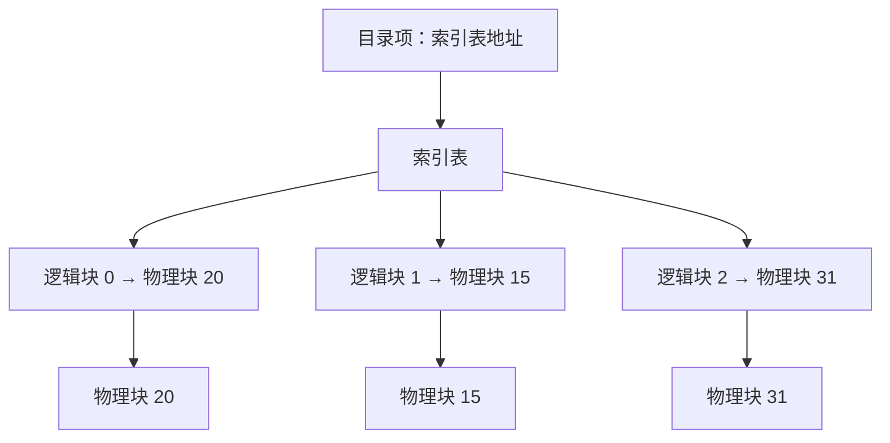
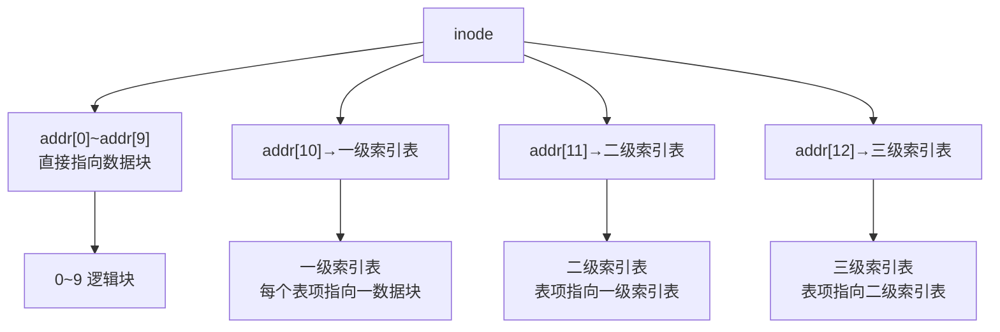

# 文件的物理结构（连续、链接、索引、混合索引）

## 文件的物理结构：连续、链接、索引与混合索引

文件物理结构解决的核心问题是：**一个文件在磁盘上到底怎么放？** 逻辑上连续的文件记录，到了物理磁盘上，可能被拆散到各个角落。组织方式选得好不好，直接影响存取速度、空间利用率和文件能否动态增长。

### 连续结构：最简单也最“娇气”

连续结构把文件逻辑上连续的信息，依次存放到物理上**相邻**的盘块中。比如文件占 10 个块，就给它分配一段连续的 10 个盘块，目录里只需记录起始块号和块数。

它的优点很实在：==顺序存取速度在所有结构中最快==，磁头几乎不用来回寻道。但缺点同样致命：

- 必须**事先知道文件最大长度**，动态增长的文件很难办；
- 要求**连续的空闲空间**，磁盘用久了碎片多，可能明明总量够却放不下；
- 插入、删除记录要**移动大量数据**。

> [!WARNING]
> 连续结构不适合用户文件、数据库文件等频繁修改的场景，主要适合系统文件、只读文件等长度固定的场合。

### 链接结构：用指针串起离散盘块

既然连续空间难找，那就允许文件**离散存放**。每个盘块末尾留一个指针，指向下一个盘块，像链条一样串起来。目录只需记录第一个盘块的地址。

优点是没有外部碎片，文件可以动态增长。但它有个大坑：==随机存取极慢==。想读第 100 个逻辑块，必须从第一个块开始顺着指针跳 99 次。另外每个块的指针也占了一点空间。

> [!NOTE]
> 这里说的“链接结构”通常指**隐式链接**——指针藏在每个盘块内部。FAT 文件系统用的“显式链接”则是把所有指针集中到文件分配表中，随机存取就快多了。

### 索引结构：建一张“逻辑→物理”对照表

索引结构同样允许离散存放，但把指针集中起来，为每个文件建立一张**索引表**。索引表按逻辑块号排列，每个表项记录该逻辑块对应的物理块号。

这样==既能顺序存取，又能随机存取==：要读第 $k$ 个逻辑块，直接查索引表第 $k$ 项，一次寻址就到。索引结构保留了链接结构免碎片、可增长的优点，又解决了随机存取慢的问题。

代价是索引表本身要占空间和访问时间。文件很大时，索引表可能大到本身需要多个盘块来存。

### 混合索引：大文件与小文件的折中

如果索引表本身太大怎么办？完全用一级索引，文件小时浪费空间，文件大时索引表自己就装不下了。**混合索引**是 Linux 等系统的实际方案：把索引表做成“直接 + 多级间接”的组合。

小文件靠前 10 个直接地址就能搞定；大文件再逐级启用间接索引，兼顾空间效率与容量上限。

### 算一个正确的例子

> [!IMPORTANT]
> 设盘块大小 1KB，盘块号占 4 字节，则一个索引块可放 $1024 \div 4 = 256$ 个地址。某文件采用三级混合索引：10 个直接地址，一级、二级、三级间接各 1 项。

问：该文件最大可有多少页（块）？

解：直接地址 10 块；一级间接 256 块；二级间接 $256^2$ 块；三级间接 $256^3$ 块。

$$
\text{最大块数} = 10 + 256 + 256^2 + 256^3
$$

> [!TIP]
> 做这类题先算**“一个索引块能装多少个盘块号”**（盘块大小 ÷ 盘块号字节数），再按级数累乘。千万别把“索引块数量”和“最终数据块数量”混为一谈。

### 三种结构对比

| 特性 | 连续结构 | 链接结构（隐式） | 索引结构 |
|------|---------|----------------|---------|
| 顺序存取速度 | 最快 | 快 | 较快 |
| 随机存取 | 快 | 极慢 | 快 |
| 文件动态增长 | 困难 | 容易 | 容易 |
| 外部碎片 | 有 | 无 | 无 |
| 额外开销 | 无 | 每块一个指针 | 索引表整块空间 |
| 典型用途 | 系统文件、只读文件 | 早期磁带/简单系统 | 现代主流文件系统 |

> [!CAUTION]
> 做选择题时注意：题目问“逻辑记录可以按**任意次序**存放在**不相邻**的存储块中”，答案必定是 **链接结构** 或 **索引结构**，不会选连续结构。若选项中只有“链接结构”，标准答案就是它。连续结构要求相邻，链接与索引都允许不相邻，但“任意次序”更贴合链接结构把记录串成链的描述。
