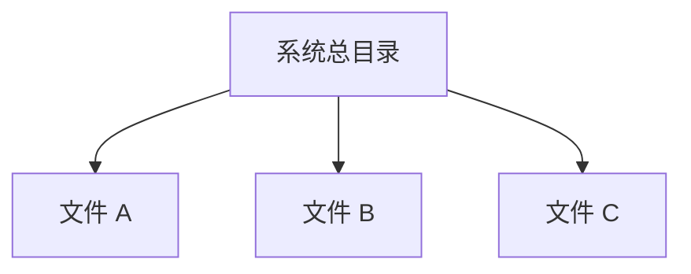
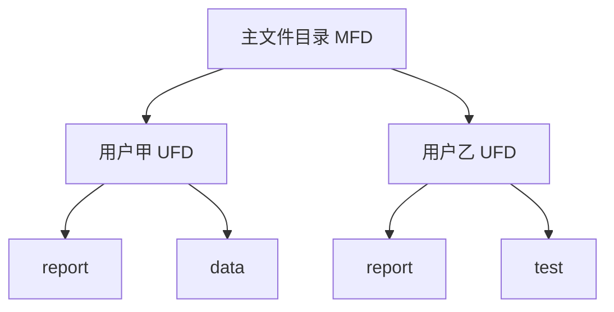
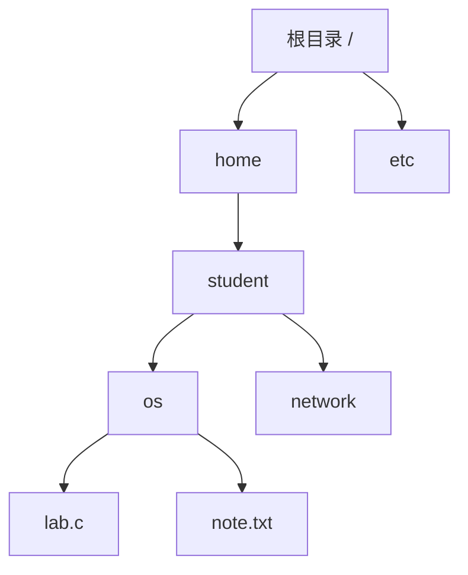

# 文件目录结构（单级、二级、多级目录）及特点

## 为什么需要文件目录

文件系统要管理大量文件，用户通常只知道文件名，而磁盘实际保存文件需要知道其物理位置。因此，目录的基本作用就是建立 **文件名与文件控制信息之间的对应关系**，实现“按名存取”。

目录管理还应满足以下要求：

- 提高目录检索速度，加快文件存取；
- 允许不同用户的文件重名；
- 支持文件共享，使多个用户能够访问同一个文件；
- 便于文件的分类、组织和管理。

目录中通常保存文件名及文件控制块 FCB 等信息。按本课程填空题的表述，==目录中必不可少的基本信息是文件名和物理地址==。

## 单级目录结构

单级目录又称一级目录：整个文件系统只建立一张目录表，所有文件的目录项都登记在这张表中。

查找文件时，系统按文件名在这张目录表中检索，找到目录项后即可取得文件的物理地址等信息。

其优点是==结构简单、实现容易==；缺点也很明显：

1. 所有文件处于同一命名空间，文件名不能重复；
2. 文件数量增多后，目录表变长，顺序检索速度慢；
3. 不便于多用户分类管理文件。

因此，单级目录只适合文件数量较少、用户较少的简单系统。

## 二级目录结构

如果既想保留目录管理的简单性，又要解决不同用户之间的重名问题，可以先按用户划分目录，这就形成了二级目录。

二级目录由两级组成：

- 第一级是**主文件目录 MFD**，每个用户对应一个目录项；
- 第二级是**用户文件目录 UFD**，登记该用户拥有的文件。

例如，用户甲和用户乙都可以拥有名为 `report` 的文件，因为它们分别位于不同的用户文件目录中，实际标识为“用户＋文件名”。

> [!IMPORTANT]
> 二级目录是为解决一级目录的==文件命名冲突==，并提高目录检索速度而改进的。检索时先查主文件目录，再查相应用户目录，不必搜索全部文件。

但它仍有局限：同一用户的不同文件通常仍不能重名，而且一个用户内部难以继续按项目、类型等分类组织文件。

## 多级目录结构

多级目录通常采用**树形目录结构**。根目录下可以建立子目录，子目录中既能保存文件，也能继续建立子目录，从而形成层次结构。

文件可以用路径名定位：

- **绝对路径名**：从根目录开始，如 `/home/student/os/lab.c`；
- **相对路径名**：从当前目录开始。若当前目录为 `/home/student`，则可用 `os/lab.c` 表示同一文件。

多级目录==支持层次化命名，便于分类管理和提高查找效率==，是现代文件系统的主流。树形结构还允许不同目录下的文件重名，因为完整路径不同。

## 三种目录结构对比

| 结构 | 目录组织 | 重名情况 | 检索与管理 | 主要特点 |
|---|---|---|---|---|
| 单级目录 | 全系统一张目录表 | 所有文件不能重名 | 文件多时查找慢 | 最简单 |
| 二级目录 | 主目录＋用户目录 | 不同用户可重名 | 按用户缩小检索范围 | 解决用户间命名冲突 |
| 多级目录 | 根目录＋多层子目录 | 不同目录可重名 | 层次清晰、便于分类 | 现代系统主流 |

## 一个路径查找例子

设当前目录为 `/home/student`，要访问 `/home/student/os/lab.c`：

1. 使用绝对路径时，从根目录开始，依次查找 `home`、`student`、`os`，最后找到 `lab.c`；
2. 使用相对路径时，从当前目录开始，只需沿 `os/lab.c` 查找。

两条路径可以定位同一个文件，但**查找起点不同**。

> [!WARNING]
> “不同目录允许重名”不等于“同一目录允许重名”。同一目录下通常仍要求文件名唯一；目录结构解决的是命名空间问题，不是磁盘块如何分配的问题。

> [!NOTE]
> 目录结构讨论“怎样按名字组织、查找文件”，文件物理结构讨论“文件内容怎样存放在盘块中”。UNIX 的 `i.addr[]` 索引、盘块号和块内偏移属于后者，不要与单级、二级、多级目录混淆。
