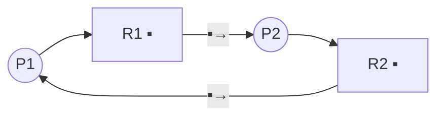

# 死锁的检测（资源分配图）与解除方法

## 为什么需要检测与解除

死锁预防和死锁避免都要在分配资源前做大量限制或计算，系统开销较大。另一种思路是：**允许死锁产生**，操作系统不断监视系统进展，判断当前是否真的出现了死锁；一旦确认，就采取专门措施解除死锁、恢复运行。这样平时开销低，只在出事时付出代价。

> [!IMPORTANT]
> ==进程-资源分配图是用来做死锁检测的==（常考选择题）。检测思路：判断该图是否**可完全简化**。

## 资源分配图的符号

| 图形 | 含义 |
|---|---|
| 圆圈（内写进程名） | 进程 |
| 方框 | 资源类 |
| 方框中的黑圆点 | 资源实例 |
| 圆点 → 圆圈 | 分配边（资源已分给进程） |
| 圆圈 → 方框 | 申请边（进程正在请求该资源） |

注意方向易混：==资源指向进程是"已分配"，进程指向资源是"在申请"==。

## 怎么化简检测

1. 找一个**既不阻塞、又非孤立**的进程结点 $P_i$（它申请的资源此时都能满足）。
2. 消去 $P_i$ 的所有申请边和分配边——相当于让它运行完并释放全部资源。
3. 重复上述过程。

若能经过一系列简化使**所有进程都成为孤立结点**，则称该图**可完全简化**，系统无死锁；否则为**不可完全简化**，存在死锁，剩下的非孤立进程就是死锁进程。

上图中 P1 等 R1、P2 等 R2，谁也满足不了，无法消去任何边，所以不可完全简化——死锁。

> [!TIP]
> 化简顺序不唯一，但结论唯一：只要存在一种顺序能全部化完，图就是可完全简化的。

## 死锁的解除

检测到死锁后，常用解除方法：

- **撤消进程**：直接终止若干死锁进程，释放资源，直到死锁解除；
- **剥夺资源（进程回退）**：从某些进程抢占资源分给其他进程，被抢占者回退到安全状态重新执行。

选择牺牲进程时通常考虑代价：优先级、已运行时间、剩余时间、占用资源数等。

> [!WARNING]
> 别混淆三种途径：预防是破坏四个必要条件之一（静态限制）；避免是分配前算安全性（银行家算法）；检测与恢复是事后发现再处理。

## 例题

进程-资源分配图是用来（ ）。
A. 死锁的预防 B. 解决死锁的静态方法 C. 死锁的避免 D. 死锁的检测

**答案：D**。资源分配图通过化简过程判断系统是否存在死锁，是检测工具，与预防（静态）、避免（动态计算）都不同。
