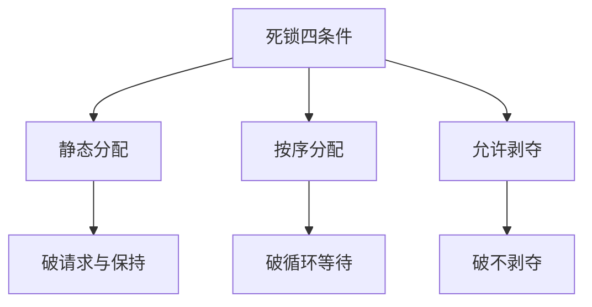
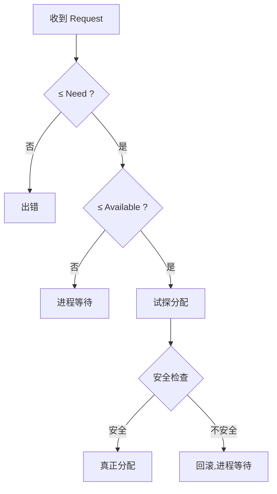

# 死锁的预防方法与避免方法（银行家算法）

## 死锁预防与避免：从"事后补救"到"事前规划"

上一节我们知道，死锁一旦发生，四个必要条件（互斥、请求与保持、不剥夺、循环等待）会同时成立。操作系统有三种应对思路：**预防**（事前破坏条件）、**避免**（事中动态检查）、**检测与恢复**（事后处理）。本节重点讲前两种，其中银行家算法是考试大题的高频考点。

## 死锁预防：把四个条件"拆掉"一个

预防的思路很直接：既然四个条件必须同时满足才死锁，那就**静态地**破坏其中一个，让死锁永远不可能发生。

| 破坏的条件 | 具体策略 | 代价 |
|---|---|---|
| 请求与保持 | ==静态分配==（一次申请全部资源） | 资源利用率低、易饥饿 |
| 不剥夺 | 允许 OS 强行剥夺已分配资源 | 实现复杂，只适合易保存状态的资源 |
| 循环等待 | ==按序分配==（给资源编号，按递增序申请） | 编号困难，顺序僵化 |

> [!TIP]
> 静态分配破坏"请求与保持"，按序分配破坏"循环等待"——这两条是简答题的标准答案。

## 死锁避免：银行家算法

预防太"狠"，会浪费资源。**避免**思路更温和：==允许进程动态申请资源，但每次分配前都做一次安全性检查，只把系统留在"安全状态"==。银行家算法就是它的经典实现。

### 核心数据结构

设系统有 $n$ 个进程、$m$ 类资源：

- **Available**：当前每类资源的可用量向量
- **Max**：每个进程的最大需求矩阵
- **Allocation**：当前已分配矩阵
- **Need = Max - Allocation**：剩余需求矩阵

### 请求处理流程（银行家算法主干）

当进程 $P_i$ 提出请求 $\text{Request}_i$ 时：

1. 若 $\text{Request}_i \le \text{Need}_i$，否则出错
2. 若 $\text{Request}_i \le \text{Available}$，否则等待
3. **试探分配**：更新 Available、Allocation、Need
4. 调用**安全性检查**；若安全则真正分配，否则回滚并让 $P_i$ 等待

### 安全性检查（Safety Algorithm）

目标是找一个**安全序列** $\langle P_{i1}, P_{i2}, \dots, P_{in} \rangle$，使得每个进程都能在前面进程释放资源后完成：

1. 令 $\text{Work} = \text{Available}$，$\text{Finish}[i] = \text{false}$
2. 找一个 $\text{Finish}[i]=\text{false}$ 且 $\text{Need}_i \le \text{Work}$ 的 $P_i$
   - 若找到：$\text{Work} = \text{Work} + \text{Allocation}_i$，$\text{Finish}[i]=\text{true}$，回到 2
   - 若找不到：检查所有 $\text{Finish}$ 是否全为 true
3. 全 true ⇒ 安全；否则不安全

> [!IMPORTANT]
> ==安全状态一定不死锁，但不安全状态≠已经死锁==，只是"可能"死锁。银行家算法会拒绝不安全的分配。

## 一个算对了的例子

系统总资源 150，三个进程已分配与需求如下：

| 进程 | Max | Allocation | Need |
|---|---|---|---|
| P1 | 70 | 25 | 45 |
| P2 | 60 | 40 | 20 |
| P3 | 60 | 45 | 15 |

当前 $\text{Available} = 150 - (25+40+45) = 40$。P4 到达，$\text{Max}=60$。

**情形 (1)：P4 请求 25**
试探分配后 $\text{Work}=15$，$\text{Need}$ 为 P1(45)、P2(20)、P3(15)、P4(35)。
先取 P3（Need 15 ≤ 15）⇒ $\text{Work}=15+45=60$；
再取 P1 ⇒ $\text{Work}=60+25=85$；
再取 P2 ⇒ $\text{Work}=85+40=125$；
最后 P4 ⇒ 完成。==安全序列存在，例如 ⟨P3,P1,P2,P4⟩==。

**情形 (2)：P4 请求 35**
试探分配后 $\text{Work}=5$，所有进程 Need ≥ 15 > 5，**找不到任何可完成进程** ⇒ 不安全，拒绝请求。

> [!WARNING]
> 常见坑：
> - 忘记先更新 Available 再做安全检查（试探分配必须做）。
> - Need 算成 Max 而不是 Max − Allocation。
> - 把"不安全"当成"已死锁"，答案表述要准确。
> - 安全序列通常不唯一，题目让"找出所有"时要列全或举多个。

## 与相近概念的区分

| 方法 | 时机 | 特点 | 代表 |
|---|---|---|---|
| 死锁预防 | 运行前 | 破坏条件，保守 | 静态/按序分配 |
| ==死锁避免== | 运行中 | 动态检查，安全状态 | ==银行家算法== |
| 死锁检测与恢复 | 运行后 | 允许发生再处理 | 资源分配图化简 |

> [!NOTE]
> 银行家算法要求**预先声明 Max**，且资源类型、进程数固定——这是它工程上难用的原因，但考试里假设都满足。
