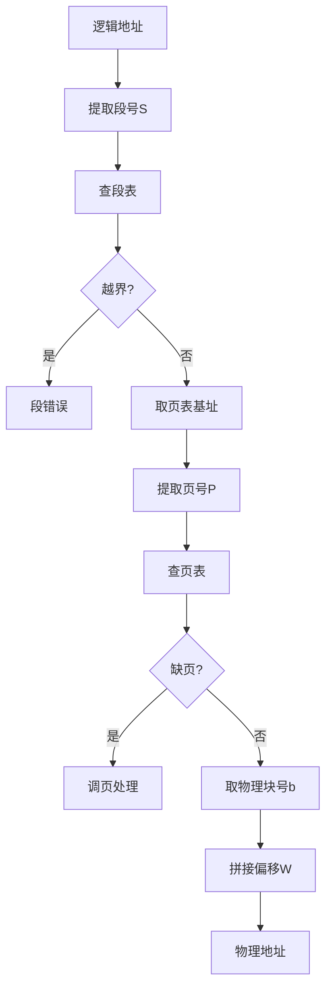

# 段页式存储管理的基本原理

如果分页能高效利用内存，分段又方便用户编程和共享保护，有没有一种机制能把两者的优点合二为一？段页式存储管理正是为此而生。它==先按逻辑关系分段，再在段内按固定大小分页==，既保留了分段的语义清晰性，又获得了分页的内存利用率。

## 基本原理与地址变换

段页式的核心思想是“段表+页表”两级映射。用户程序按逻辑划分为若干段（如代码段、数据段），每个段内部再划分为固定大小的页。内存分配以页为单位，但管理仍以段为入口。

地址变换需三次访存：第一次查段表得页表基址，第二次查页表得物理块号，第三次才是真正访问数据。若使用快表（TLB），可显著减少开销。

> [!IMPORTANT]
> 段页式地址 = 段表基址 + $S \times$ 段表项长度 → 页表基址；再经页号索引得物理块号 $b$；最终物理地址 = $b \times$ 页大小 + $W$。

## 与分页、分段的对比

| 特性         | 分页               | 分段               | 段页式                     |
|--------------|--------------------|--------------------|----------------------------|
| 划分依据     | 物理固定大小       | 逻辑可变长度       | 逻辑分段 + 段内物理分页    |
| 地址结构     | 页号 + 页内偏移    | 段号 + 段内偏移    | 段号 + 页号 + 页内偏移     |
| 碎片问题     | 无外部碎片         | 有外部碎片         | 无外部碎片                 |
| 共享/保护粒度| 页（不自然）       | 段（自然）         | 段级共享，页级分配         |
| 访存次数     | 2次（无TLB）       | 2次                | 3次（无TLB）               |

> [!NOTE]
> 段页式中，==段内偏移被拆分为页号和页内偏移==，这是区别于纯分段的关键。

## 典型例题解析

设某系统采用段页式管理，页大小为 4KB（$2^{12}$ B）。逻辑地址为 32 位，其中高 8 位为段号，中间 12 位为页号，低 12 位为页内偏移。已知段号为 2 的段表项指向页表基址 `0x80000`，该页表中页号 5 对应的物理块号为 `0x1A`。求逻辑地址 `(2, 5, 0x3F0)` 的物理地址。

**解**：  
- 段号 $S=2$，查段表得页表基址 `0x80000`；  
- 页号 $P=5$，在页表中第 5 项得物理块号 $b = \text{0x1A}$；  
- 页内偏移 $W = \text{0x3F0}$；  
- 物理地址 = $0x1A \times 4096 + 0x3F0 = \text{0x1A3F0}$。

> [!WARNING]
> 计算时务必确认页大小单位！4KB = $2^{12}$ = 4096，不是 1000。物理块号左移 12 位等价于乘以 4096。

## 常见误区提醒

> [!CAUTION]
> 段页式中“段内偏移”≠ 纯分段的段内偏移！前者还需进一步分解为页号+页内偏移，不能直接加到段基址上。

> [!TIP]
> 记忆口诀：“段找页表，页找块号，偏移拼尾”。三步走，缺一不可。
