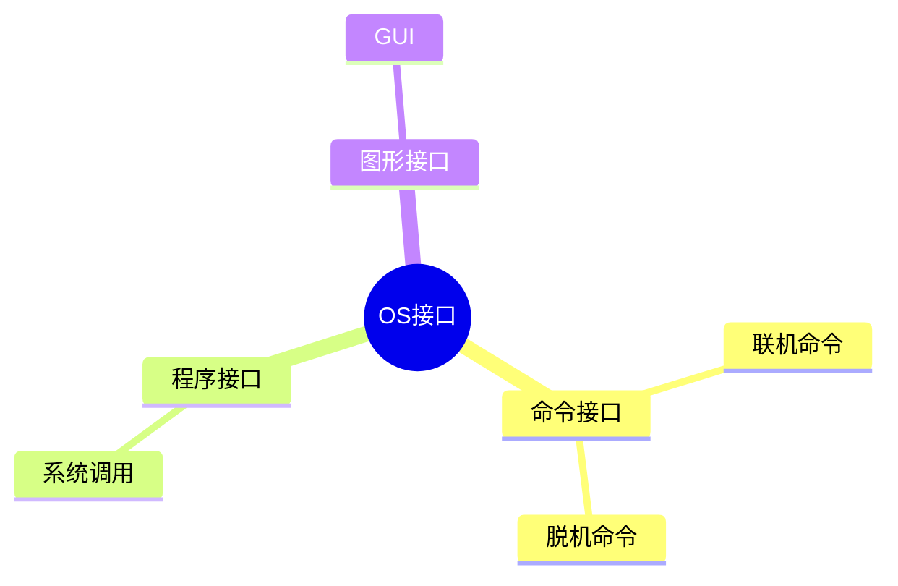

# 操作系统的用户界面（命令接口、程序接口、图形接口）

操作系统是硬件之上的第一层软件，但用户和应用程序如何“指挥”它干活？这就需要通过==操作系统的用户界面（接口）==。

> [!IMPORTANT]
> 核心结论：操作系统为用户提供两个接口：==命令接口==（面向用户）和==程序接口==（面向程序员）。图形接口本质上是对命令接口的封装。

## 为什么需要接口

试想一下：如果每次读写文件都要直接给磁盘控制器发电信号，编程将极其痛苦。操作系统把复杂的硬件操作封装成简单的服务，而**接口就是获取这些服务的“窗口”**。结合南邮考题中“操作系统设计目标”，良好的接口直接支撑了==方便性==与==开放性==。

## 三种接口怎么做

### 命令接口

供用户直接组织作业、控制程序执行。

- **联机命令接口**：用于==分时系统==，用户通过终端敲键盘输入命令（如 `ls`），系统立即响应，又称交互式命令。
- **脱机命令接口**：用于==批处理系统==，用户事先写好作业控制说明书，系统按脚本批量执行，无需人工干预。

### 程序接口

供程序员在代码中请求 OS 服务，其唯一实现途径是==系统调用==（System Call）。

例如真题中考到：程序员利用系统调用打开 I/O 设备时，通常使用的设备标识是什么？答案是**逻辑设备名**。因为程序接口屏蔽了底层物理特性，程序员只需指明“我要一台打印机”，而不必关心具体是哪根线连着的哪台机器。

### 图形接口

即 GUI（Graphical User Interface），用图标、菜单、鼠标点击代替键盘敲命令。

> [!NOTE]
> 本质辨析：图形接口并非独立于命令接口的新底层机制，而是将命令或系统调用封装成了可视化组件。你双击一个图标，底层依然是在执行一条命令或触发一次系统调用。

## 相近概念的区别

| 比较维度 | 命令接口 | 程序接口 |
| :--- | :--- | :--- |
| **面向对象** | 普通用户 / 操作员 | 程序员 / 应用程序 |
| **使用方式** | 键盘输入命令或脚本 | 在代码中编写系统调用 |
| **交互特点** | 联机交互或脱机批处理 | 程序运行期间动态请求 |
| **典型例子** | `rm file.txt` | `open("file.txt")` |

## 常见的坑

> [!WARNING]
> 易错点：填空题常考“操作系统用户接口可分为____和____”。标准答案是==命令==和==程序==（或称操作接口和程序接口）。不要填成“键盘和鼠标”或“联机和脱机”，后者只是命令接口的子类！

> [!CAUTION]
> 高危误区：认为“系统调用”是一种独立的接口。记住：==程序接口就是由系统调用组成的==，两者在考试语境下等价。

## 真题实战

来看一道南邮期末填空真题：

> **题目**：操作系统可以通过________和________两种接口方式把它的服务和功能提供给用户。

**解题思路**：回忆 OS 服务对象——既要服务“人”（用户），也要服务“代码”（程序）。对应人的叫命令接口，对应程序的叫程序接口。

**答案**：==用户接口（命令接口）==；==程序接口==。
