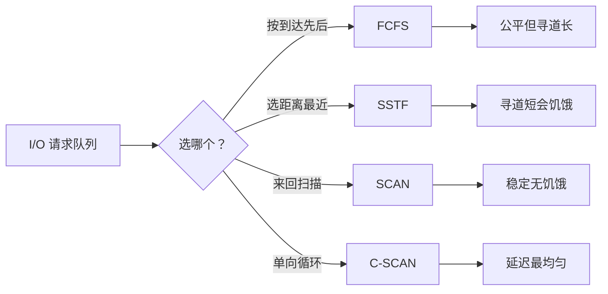

# 磁盘调度算法（FCFS、SSTF、SCAN、CSCAN）

## 为什么需要磁盘调度

磁盘读写前必须把磁头（存取臂）移到目标柱面，这一步叫**寻道**，是磁盘 I/O 中最慢的一环。如果 I/O 队列里积压了多个请求，先服务谁、后服务谁，直接决定总寻道距离。==磁盘调度算法的目标：使磁头移动总量（寻道距离）尽可能小，同时避免某些请求长期得不到服务。==

> [!IMPORTANT]
> 磁盘调度只负责"移臂调度"（决定访问柱面的顺序），不涉及旋转延迟和扇区选择。LRU 是页面置换算法，时间片轮转、优先级调度、高响应比优先都是 CPU 调度算法，==都不是磁盘调度==。

## 四种算法

### 先来先服务（FCFS）

按请求到达的先后次序依次服务。公平、简单，但完全不考虑磁头当前位置，可能来回大范围移动，平均寻道时间较长。

### 最短寻道时间优先（SSTF）

每次从队列中挑出**距当前磁头位置最近**的柱面先服务。

- 优点：平均寻道距离短。
- 缺点：==可能产生"饥饿"==——远处柱面的请求（如边缘柱面）可能长期被邻近请求挤掉。

### 扫描算法 SCAN（电梯调度）

规定一个方向（如由内向外），磁头沿该方向**一路扫到底**，沿途服务所有经过的请求，到达最外端（或该方向无请求）后反向再扫。像电梯一样来回运行。

- 优点：克服了 SSTF 的饥饿，性能稳定。
- 缺点：刚被服务过的区域若有新请求，要等磁头折返。

### 循环扫描算法 C-SCAN

只沿**一个方向**扫描（如由内向外），到达最外端后**直接空返到最内端**，归途中不服务任何请求，再开始下一轮外扫。

- 优点：==各柱面请求的最大延迟基本一致==，适合请求分布均匀的场景。
- 缺点：空返段不处理请求，整体效率略低于 SCAN。

## 对比

| 算法 | 选择依据 | 平均寻道 | 饥饿 | 适用场景 |
| :--- | :--- | :--- | :--- | :--- |
| FCFS | 到达顺序 | 最长 | 无 | 负载很轻 |
| SSTF | 距当前最近 | 最短 | ==有== | 追求短寻道 |
| SCAN | 沿方向顺路 | 较短 | 无 | 负载较重 |
| C-SCAN | 单向顺路 | 较短 | 无 | 请求分布均匀 |

## 一个算对的例子

磁盘共 200 个磁道（0~199），磁头刚完成 127 号，**正在 140 号服务，方向向外（磁道号增大）**。队列：83, 148, 91, 178, 94, 150, 102, 175, 130。

**SSTF**：每步选距离当前最近的柱面

$$140 \to 148 \to 150 \to 130 \to 102 \to 94 \to 91 \to 83 \to 175 \to 178$$

移动量 $= 8+2+20+28+8+3+8+92+3 = 172$

**SCAN**：先向外扫完所有大于 140 的请求，再反向

$$140 \to 148 \to 150 \to 175 \to 178 \to 130 \to 102 \to 94 \to 91 \to 83$$

移动量 $= (178-140) + (178-83) = 38+95 = 133$

> [!WARNING]
> SCAN 必须==先确认当前移动方向==（可由"刚服务的柱面 → 当前柱面"推断）。方向判反，整个访问序列和移动量都会错。另外 SCAN 不一定真的走到 0 或 199 端点，只需走到该方向最后一个有请求的柱面即可折返。
