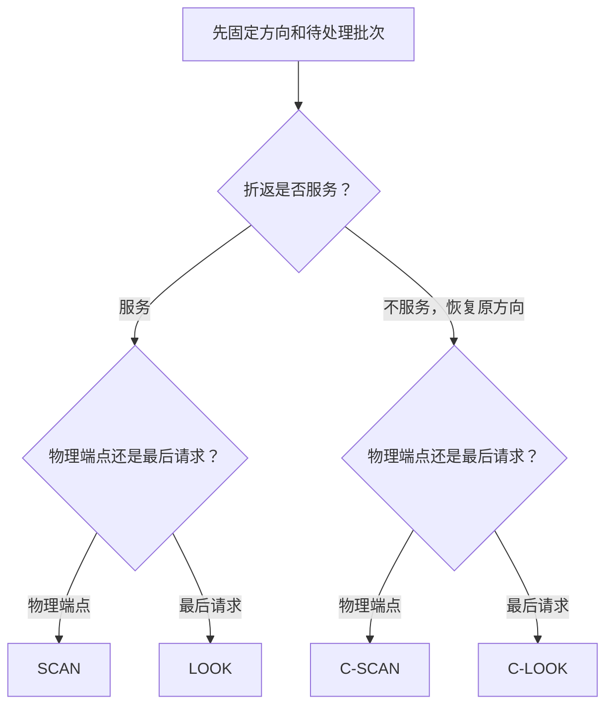

# 磁盘调度算法（FCFS、SSTF、SCAN、CSCAN）

## 为什么需要磁盘调度

机械磁盘读写前，存取臂要移到目标柱面，这一步叫寻道。若队列里有几个目标，顺路处理可能减少总移动量，但不能只看下一步最近就断言整体最短，也不能据此保证每个请求及时得到服务。下文先固定一批请求，只计算柱面移动，不把它当成包含旋转延迟的实际耗时。

## 四种算法

### 先来先服务（FCFS）

按请求到达顺序处理，不考虑磁头位置。若连续收到盘面两端的请求，可能来回移动。

### 最短寻道时间优先（SSTF）

在本页用柱面间距近似寻道代价，每次选与当前位置距离最近的请求。若不断有邻近请求到来，较远的请求可能长期推迟。算例若遇到等距离，须约定优先方向或按到达顺序决胜。

### 扫描算法 SCAN（电梯调度）

沿当前方向服务请求，按物理端点约定扫到盘端后反向，反向也服务请求。若在最后一项需要服务的请求处就反向，则为 LOOK。

### 循环扫描算法 C-SCAN

只沿一个方向服务请求。扫到物理端点后空返到另一端，再按原方向扫描；空返不服务。若循环的边界改成当前待处理请求两端，则为 C-LOOK。

## 对比

先分两件事：**回程是否服务**，以及**把哪儿当成扫描尽头**。在本页的物理端点约定中，SCAN 与 C-SCAN 延展到磁盘端点；LOOK 与 C-LOOK 只看当前批次中尚需处理的请求。

| 算法 | 去程扫到哪儿 | 到尽头以后 |
| --- | --- | --- |
| SCAN | 当前方向的物理端点 | 掉头；反向也服务请求 |
| LOOK | 当前方向最远的待处理请求 | 就地掉头；反向也服务请求 |
| C-SCAN | 当前方向的物理端点 | 空返到另一物理端点，再按原方向服务；空返不服务 |
| C-LOOK | 当前方向最远的待处理请求 | 跳到另一侧最远端的待处理请求，再按原方向服务；跳回途中不服务 |

## 一个算对的例子

磁盘柱面编号 0 到 199，磁头从 127 到 140，接着沿编号增大的方向开始扫描。固定队列为 83、148、91、178、94、150、102、175、130，只算到这批请求全部完成。记两次位置之差的绝对值；若题目另约定循环空返不计，再从总移动量减去那一段。

**SSTF** 依次访问 $148,150,130,102,94,91,83,175,178$，总移动量为 $8+2+20+28+8+3+8+92+3=172$。

扫描族向大号走时先访问 148、150、175、178。区别在此后：

| 算法 | 从 178 起如何继续 | 算入所有实际移动 |
| --- | --- | ---: |
| SCAN | 继续到 199，反向服务 130、102、94、91、83 | $(199-140)+(199-83)=175$ |
| LOOK | 在 178 立即反向，服务 130、102、94、91、83 | $(178-140)+(178-83)=133$ |
| C-SCAN | 走到 199，空返到 0，再服务 83、91、94、102、130 | $(199-140)+(199-0)+(130-0)=388$ |
| C-LOOK | 从 178 跳回 83，服务 83、91、94、102、130 | $(178-140)+(178-83)+(130-83)=180$ |

如果循环题明确不计空返，C-SCAN 从 388 减去 199 得 189，C-LOOK 从 180 减去 95 得 85。这是计分约定不同，不是磁头没有移动。左右两组都已服务完就停，不再人为加一段到端点的距离。

> [!TIP]
> 先写服务序列，再额外标出没有请求的端点和空返。上例 SCAN 与 LOOK 的**服务序列完全相同**，总移动量仍差 42。若历史题把最后请求处折返称作 SCAN，应写明实际折返位置，而不是把两个值都记成同一约定。
