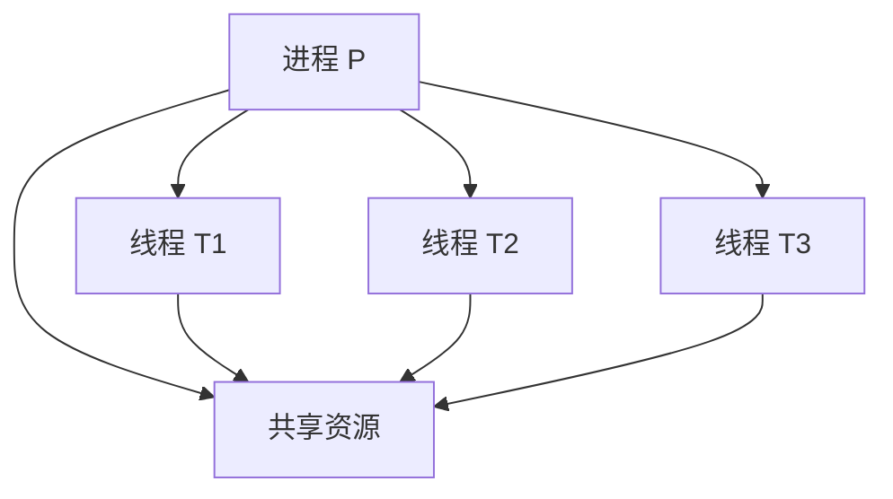
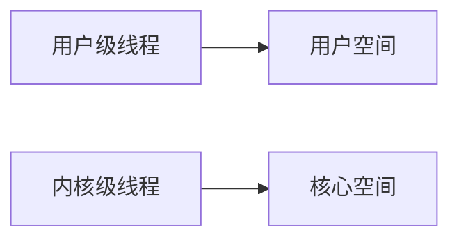

# 线程的概念及与进程的区别

## 线程的概念

线程是==程序执行过程中的一条路径==，是操作系统进行 CPU 调度和执行的基本单位。一个进程可以包含多个线程；同一进程中的线程共享该进程的地址空间、代码、数据和已打开的文件等资源，但每个线程又拥有自己的线程控制信息。

线程解决的核心问题是：传统进程既是==资源分配单位==，又是==执行和调度单位==。当一个进程中需要同时处理多项工作时，如果只能通过创建多个进程实现，就会产生较高的创建、撤销和通信开销。引入线程后，可以在同一进程内部并发执行多个任务，从而降低系统开销并提高并发能力。

## 线程与进程的区别

| 比较方面 | 传统进程 | 线程 |
|---|---|---|
| 调度 | 传统进程是 CPU 调度单位 | ==线程是 CPU 调度单位== |
| 并发性 | 进程之间可并发执行 | 同一进程中的线程也可并发执行 |
| 资源 | 独占进程地址空间及其他资源 | 同一进程的线程共享进程资源 |
| 独立数据 | 进程间通常相互独立 | 线程各自拥有栈、寄存器和程序计数器 |
| 创建、撤销 | 开销较大 | 开销较小 |
| 通信方式 | 需管道、消息、共享内存等机制 | 可直接通过共享变量通信，但需同步 |
| 故障影响 | 一个进程崩溃通常不影响其他进程 | 一个线程出错可能导致整个进程崩溃 |

> [!IMPORTANT]
> 线程是执行和调度单位，进程是资源分配单位；引入线程后，CPU 调度的基本单位不再是进程，而是线程。

## 为什么要使用线程

线程特别适合实现以下并发任务：

- 网络服务器同时处理多个客户端请求；
- 图形界面一边计算、一边响应用户操作；
- 数据库系统同时执行查询和后台维护；
- 多媒体程序同时进行音频、视频和数据处理。

线程共享资源，切换时不必重新切换整个地址空间，因此响应速度较快。不过，共享数据也带来了竞态条件、死锁等同步问题，必须使用互斥锁、信号量、条件变量等机制进行控制。

## 线程的实现方式

从实现角度，线程可分为：

1. ==用户级线程==：由用户空间的线程库管理，切换时不进入内核，运行在用户空间。
2. ==内核级线程==：由操作系统内核直接管理，切换时需要进入内核，运行在核心空间。

> [!TIP]
> 记忆口诀：**用户线程用户管，内核线程内核管。**

## 常见误区

> [!WARNING]
> “线程比进程轻量”不代表线程不需要操作系统管理。用户级线程虽然切换开销小，但某个线程发起系统调用时可能阻塞整个内核级线程，甚至影响同一进程中的其他用户级线程。

> [!CAUTION]
> 不要把“线程共享全部资源”理解得过于绝对。线程共享进程的代码、数据、地址空间和打开的文件等，但栈、程序计数器、寄存器和线程局部存储等是各自独立的。

## 算对的例子

题目问：“在引入线程的操作系统中，CPU 调度的基本单位是什么？”

答案应选 ==D. 线程==。

原因是：引入线程后，进程仍然可以作为资源分配单位，但 CPU 可以在同一进程的不同线程之间切换和调度。因此，**进程是资源分配单位，线程是调度和执行单位**。
