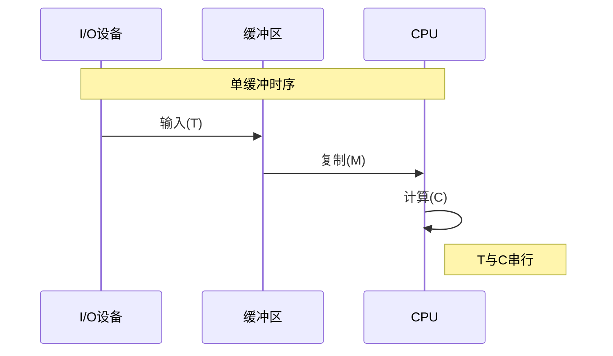

# 缓冲技术的引入目的与类型（单缓冲、双缓冲、循环缓冲）

## 为什么需要缓冲技术

CPU 的处理速度远高于 I/O 设备（如磁盘、打印机）。若 CPU 直接等待 I/O 完成，会造成巨大的资源浪费。引入缓冲技术的 ==核心目的== 是 ==改善 CPU 与 I/O 设备之间速度不匹配的情况==，实现两者的并行工作，从而提高系统效率。

> [!IMPORTANT]
> 缓冲并非为了节省内存，反而占用内存空间；其核心价值在于用空间换时间，平滑速度差异。

## 三种基本缓冲类型及原理

根据缓冲区数量和组织方式，主要分为单缓冲、双缓冲和循环缓冲。

### 1. 单缓冲 (Single Buffering)
系统只设置一个缓冲区。数据输入时，CPU 必须等待数据从设备传入缓冲区（时间 $T$），再从缓冲区复制到用户区（时间 $M$），最后 CPU 处理数据（时间 $C$）。
- **特点**：简单，但串行程度高。
- **耗时公式**：处理一块数据的时间为 $\max(C, T) + M$。
- **逻辑推导**：当 CPU 处理上一块数据时，I/O 设备无法同时向缓冲区输入新数据（因为缓冲区被占用或数据未取走），因此 $C$ 和 $T$ 不能并行，只能取最大值。

### 2. 双缓冲 (Double Buffering)
设置两个缓冲区。当 CPU 从缓冲区 1 读取数据时，I/O 设备可向缓冲区 2 写入数据，实现 ==输入与计算的并行==。
- **特点**：提高了并行度，适用于连续数据流。
- **耗时公式**：若 $C > T$，时间为 $C + M$；若 $C < T$，时间为 $T + M$。即 $\max(C, T) + M$ 中的并行部分被优化，但在极限情况下仍受限于较慢的一方。更准确地说，理想并行下每块数据平均耗时趋近于 $\max(C, T)$（忽略 $M$ 或将其合并）。
- **注意**：南邮课件中常强调，双缓冲使得 $C$ 和 $T$ 可以重叠。

### 3. 循环缓冲 (Circular Buffering)
由多个缓冲区组成环形队列。适用于多个生产者和消费者场景，通过指针管理读写位置，解决双缓冲在复杂交互下的局限性。

> [!TIP]
> **记忆口诀**：单缓冲串行慢，双缓冲并行快，循环缓冲队列管。

## 常见误区与对比

| 类型 | 并行能力 | 适用场景 | 关键公式/特征 |
| :--- | :--- | :--- | :--- |
| **单缓冲** | 无 ($C$ 与 $T$ 串行) | 简单交互 | $\max(C, T) + M$ |
| **双缓冲** | 有 ($C$ 与 $T$ 并行) | 连续数据流 | 提高吞吐量 |
| **SPOOLing** | 虚拟设备 | 独占设备共享化 | 磁盘作为井 |

> [!WARNING]
> **易错点**：不要混淆“缓冲”与“SPOOLing”。缓冲主要在内存中，解决速度匹配；SPOOLing 利用磁盘作为巨大缓冲区，解决独占设备的共享问题（虚拟设备技术）。

## 典型例题解析

**题目**：采用单缓冲技术，每块数据输入时间 $T=10\mu s$，CPU 处理时间 $C=20\mu s$，复制时间 $M=1\mu s$。求处理一块数据的时间。

**解析**：
根据单缓冲公式 $Time = \max(C, T) + M$。
代入数值：$\max(20, 10) + 1 = 20 + 1 = 21\mu s$。
此处 $C > T$，CPU 是瓶颈，I/O 设备需等待 CPU 处理完毕才能进行下一次输入。

> [!NOTE]
> 若改为双缓冲，且数据流连续，则平均处理时间可接近 $\max(C, T) = 20\mu s$（忽略 $M$ 的影响或假设 $M$ 包含在 $C/T$ 重叠中），效率显著提升。
