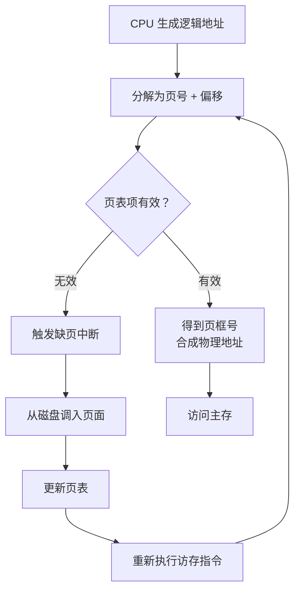

# 虚拟存储器的基本思想与局部性原理

## 引入：物理内存不够用了，怎么办

先设想一个场景：你同时打开了 IDE、浏览器十几个标签页、音乐播放器，这些进程的逻辑地址空间加起来远超物理内存的容量。但系统并没有崩溃，每个进程都“以为”自己独占了一大块连续内存。

它凭什么呢？——凭的是**虚拟存储器**。

换一个问题：进程一旦启动，是不是必须把它的全部代码和数据一次性装入内存？

答案是不需要。一个进程在任一短时间内，真正频繁访问的只是其中一小部分。既然如此，为什么要把暂时用不到的部分也常驻内存里占地方？按需调入，腾出空间给别的进程，岂不更好？

---

## 局部性原理：虚拟存储器成立的根基

“按需调入”能成立，是因为程序的访问行为有一个统计规律——**局部性原理**：

- **时间局部性**：刚刚被访问过的指令或数据，很可能在不久之后再次被访问。典型场景是循环体中的指令、频繁使用的变量。
- **空间局部性**：靠近刚被访问过的指令或数据，很可能很快也被访问。典型场景是顺序执行的代码、数组的连续元素。

> [!IMPORTANT]
> 局部性原理保证：进程在一段时间内，只会集中访问逻辑地址空间中的一个**局部**，而不是随机地在整个地址空间中“跳来跳去”。==正因如此，只把当前局部驻留内存、其余放在磁盘上，缺页率也可以维持在很低的水平==。

虚拟存储器的完整定义就可以顺势推出：

> [!NOTE]
> 虚拟存储器是指具有**请求调入**和**置换**功能，能从逻辑上对内存容量加以扩充的一种存储器系统。它把磁盘作为主存的扩展，向用户呈现一个比物理内存大得多的逻辑地址空间。

用图来表示这个关系：

---

## 它是怎样实现的

请求页式存储管理下的基本流程是：

这里的关键词是**中断 + 置换**：当访问的页不在内存时，由操作系统缺页中断处理程序把它从磁盘调入；若内存已满，还要先选择一个页面置换出去。

---

## 和“交换”不是一回事

容易混淆的两个概念：

| 维度 | 虚拟存储器 | 交换技术 |
| :--- | :--- | :--- |
| 粒度 | 页 / 段 | 整个进程 |
| 谁的决策 | 缺页中断触发，进程不感知 | 操作系统调度触发 |
| 进程是否暂停 | 仅当前访存指令重执行 | 进程整体换出，长时间不运行 |
| 目标 | 逻辑上扩充内存 | 提升多道程序度 |

一句话区分：==交换是把“整个进程”搬进搬出，虚拟存储器是把“部分页/段”搬进搬出==。

---

## 常见误区：页面越小，缺页率越低吗

一种直觉是：页面划分得越小，内部碎片越少，内存利用率越高，所以缺页率应该越低。这个想法忽略了一个反作用力：

> [!WARNING]
> 页面过小时，**页表急剧膨胀**，而且覆盖同样的逻辑空间需要**调入更多不同页面**，反而可能破坏空间局部性，导致缺页中断次数上升。

对比来看：

| 因素 | 内存利用率 | 页表大小 | 缺页率趋势 |
| :--- | :--- | :--- | :--- |
| 页面过大 | 内部碎片多 | 小 | 可能因碎片浪费而升高 |
| 页面过小 | 内部碎片少 | 大 | 通常升高 |
| 页面适中 | 平衡 | 适中 | 存在一个较优点 |

所以“页面越小，缺页中断率越低”是**错误的绝对化表述**。正确的关系是：==存在一个最优页面大小，过大或过小都会使缺页率变差==。

---

## 算对一个例子

下题选自南邮期末试卷的选择题，正好用来验证上面的结论：

> 下列说法中错误的是（ ）。
> A. 作业分得的主存块数越多，缺页中断率越低
> B. 作业划分的页面越小，缺页中断率越低
> C. 程序局部性越好，缺页中断率越低
> D. OPT 算法的缺页中断率最低

逐项分析：

- **A 正确**：分配的内存块数越多，能同时驻留的页面越多，缺页概率下降。
- **C 正确**：局部性越好，按需调入的页面被反复使用的概率越大，缺页率越低。
- **D 正确**：OPT（最佳置换算法）是理论上界，任何实际算法都不可能比它缺页更少。
- **B 错误**：页面越小，缺页率通常升高，并非越低。

答案：**B**。

> [!TIP]
> 记一个判断顺序：遇到“页面大小 ↔ 缺页率”的题，先问自己——逻辑空间被切成更多页了，每次缺页能连续访问的范围变小了吗？变小了，局部性被切碎，缺页率就上去了。
