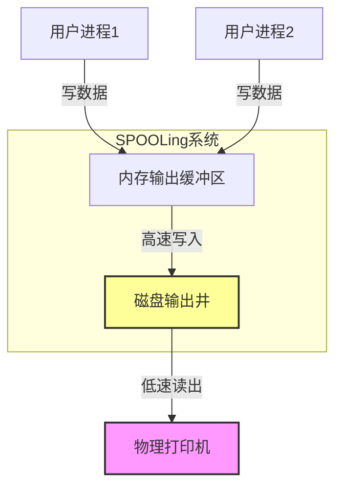

# 设备的分类（按资源分配角度：独享、共享、虚拟设备）

## 设备的分类：从独占到虚拟

在操作系统中，I/O 设备种类繁多。若仅按物理特性分类过于繁杂，因此**从资源分配角度**，我们将设备分为三类：**独享设备**、**共享设备**和**虚拟设备**。理解这一分类的核心在于把握“并发”与“共享”这两个操作系统的基本特征。

### 1. 独享设备与共享设备

**独享设备**是指在一段时间内只允许一个进程访问的设备。
*   **典型代表**：打印机、磁带机。
*   **特点**：必须采用互斥访问方式。若多个进程同时请求，需排队等待，否则会导致输出混乱（如打印内容交错）。

**共享设备**是指在一段时间内允许多个进程“同时”访问的设备。
*   **典型代表**：磁盘。
*   **特点**：这里的“同时”并非物理上的绝对同步，而是宏观上的并发。通过磁头移动和旋转延迟的调度，多个进程的 I/O 请求可以交替执行，从而获得良好的设备利用率。

> [!IMPORTANT]
> ==核心区别==：独享设备具有**排他性**，共享设备具有**并发性**。磁盘之所以能共享，是因为其寻道时间和旋转延迟远大于数据传输时间，为其他进程的请求插队提供了时间窗口。

### 2. 虚拟设备：SPOOLing 技术

独享设备利用率低且阻塞进程，共享设备硬件成本高。**虚拟设备**通过软件技术，将一台物理上的**独占设备**改造为逻辑上的**共享设备**。

实现虚拟设备的核心技术是 **SPOOLing**（Simultaneous Peripheral Operations On-Line，外部设备联机并行操作）。

#### SPOOLing 系统的组成
根据南邮课件重点，虚拟设备由以下三部分构成：
1.  **输入/输出井**：在磁盘上开辟的大缓冲区，模拟脱机输入/输出时的磁盘。
2.  **输入/输出缓冲区**：在内存中开辟的缓冲区，用于暂存数据，平衡 CPU 与 I/O 速度差异。
3.  **输入/输出进程**：
    *   **预输入程序**：将数据从输入设备送入输入井。
    *   **预输出程序**：将数据从内存送入输出井。
    *   **井管理程序**：负责井空间的分配与回收。

> [!TIP]
> ==解题技巧==：看到“把独占设备改造成共享设备”或“提高 I/O 效率”，直接联想 **SPOOLing** 和 **虚拟设备**。

### 3. 常见误区与辨析

| 概念 | 物理本质 | 逻辑表现 | 典型例子 |
| :--- | :--- | :--- | :--- |
| **独享设备** | 独占 | 独占 | 打印机 |
| **共享设备** | 共享 | 共享 | 磁盘 |
| **虚拟设备** | **独占** | **共享** | SPOOLing 后的打印机 |

> [!WARNING]
> ==易错坑==：虚拟设备**不是**一种新的物理硬件，而是一种**技术效果**。物理上它仍然是独占设备（如一台打印机），但在用户看来，仿佛每个人都拥有一台专用的打印机。

### 4. 经典例题解析

**题目**：通过硬件和软件的功能扩充，把原来独立的设备改造成能为若干用户共享的设备，这种设备称为？
A. 存储设备  B. 系统设备  C. 共享设备  D. 虚拟设备

**解析**：
*   A、B 是按功能或归属分类，无关资源分配方式。
*   C 共享设备通常指磁盘等天然支持并发访问的设备，无需复杂的软件改造即可共享。
*   D **虚拟设备**正是通过 SPOOLing 技术，将物理上的独立（独占）设备逻辑上转化为共享设备。

**答案**：**D**
