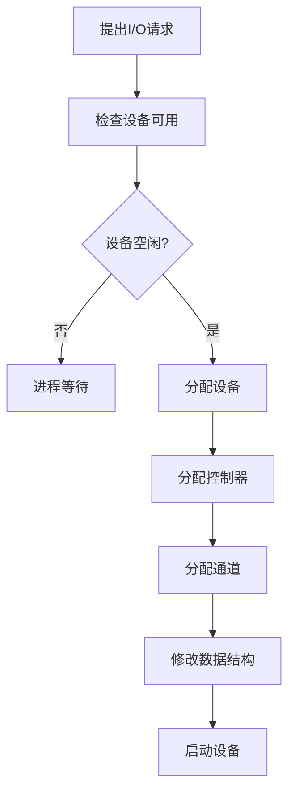

# 设备分配的过程（分配设备、分配控制器、分配通道）

操作系统中，设备分配是设备管理的重要功能。进程提出 I/O 请求后，系统不能直接把设备交给它，而要按照一定步骤完成分配，保证设备使用安全、有效。

> [!IMPORTANT]
> 设备分配的一般步骤是：  
> **检查设备是否可用 → 分配设备 → 需要时分配控制器和通道 → 修改相关数据结构 → 启动设备**

## 为什么需要设备分配

设备属于系统资源，多个进程可能同时请求使用。如果不统一管理，就可能出现：

- 两个进程同时使用同一设备，导致数据混乱；
- 只分配了设备，却没有对应的控制器或通道，设备仍无法工作；
- 设备状态没有被正确修改，系统误以为它仍空闲。

因此，系统要借助 **DCT、COCT、CHCT** 等数据结构记录设备、控制器、通道的状态，再决定能否分配。

## 设备分配的过程

可以把整个过程理解成：先看“能不能用”，再把“设备本身和配套资源”一起安排好。

### 检查设备是否可用

系统先根据请求查找相应的 **设备控制表 DCT**，判断设备当前状态：

- 若设备空闲，则可继续分配；
- 若设备忙碌，则请求进程通常需要等待。

### 分配设备

根据设备类型和进程请求，把合适的设备分配给进程。分配后，要修改 **DCT** 中的状态信息，表明该设备已被占用。

这里程序员通常使用 **逻辑设备名** 发起请求，系统再把它转换为具体的物理设备。

> [!TIP]
> 用户写程序时一般不直接关心“哪一台具体设备”，而是给出逻辑设备名，由系统完成映射和分配。

### 分配控制器和通道

很多设备并不是“设备一分配就结束”，它还依赖：

- **设备控制器**：负责控制具体设备；
- **通道**：负责在内存和设备之间传送数据。

因此，在分配设备后，还可能继续分配控制器和通道，并修改：

- **COCT**：控制器控制表；
- **CHCT**：通道控制表。

> [!WARNING]
> 常见误区：认为只要分配了设备就一定能启动 I/O。  
> 实际上，若控制器或通道不可用，设备仍不能工作。

## 和相近概念的区别

| 概念 | 作用 | 是否等于设备分配 |
|---|---|---|
| 设备分配 | 把设备资源分给进程 | 是核心内容 |
| 设备驱动 | 控制设备完成具体操作 | 不是 |
| 设备打开 | 建立进程与设备的联系 | 不是 |
| 设备启动 | 分配完成后真正开始工作 | 不是 |

## 常见的坑

### 把 JCB 当成设备管理数据结构

这是常考选择题的陷阱。

- **JCB**：作业控制块，属于作业管理；
- **DCT**：设备控制表；
- **COCT**：控制器控制表；
- **CHCT**：通道控制表。

所以，**JCB 不属于设备管理数据结构**。

> [!IMPORTANT]
> ==设备分配相关数据结构主要是 DCT、COCT、CHCT，不包括 JCB。==

## 一个做对的例子

题目：设备管理程序对设备进行管理时，下面哪项 **不属于** 设备管理数据结构？

- A. JCB  
- B. DCT  
- C. COCT  
- D. CHCT  

分析：

- DCT 记录设备状态；
- COCT 记录控制器状态；
- CHCT 记录通道状态；
- JCB 是作业控制块，与设备分配无直接关系。

答案：**A. JCB**

> [!NOTE]
> 做这类题时，先想“这个表是不是直接描述设备、控制器或通道状态”，不是设备链条上的结构就排除。
