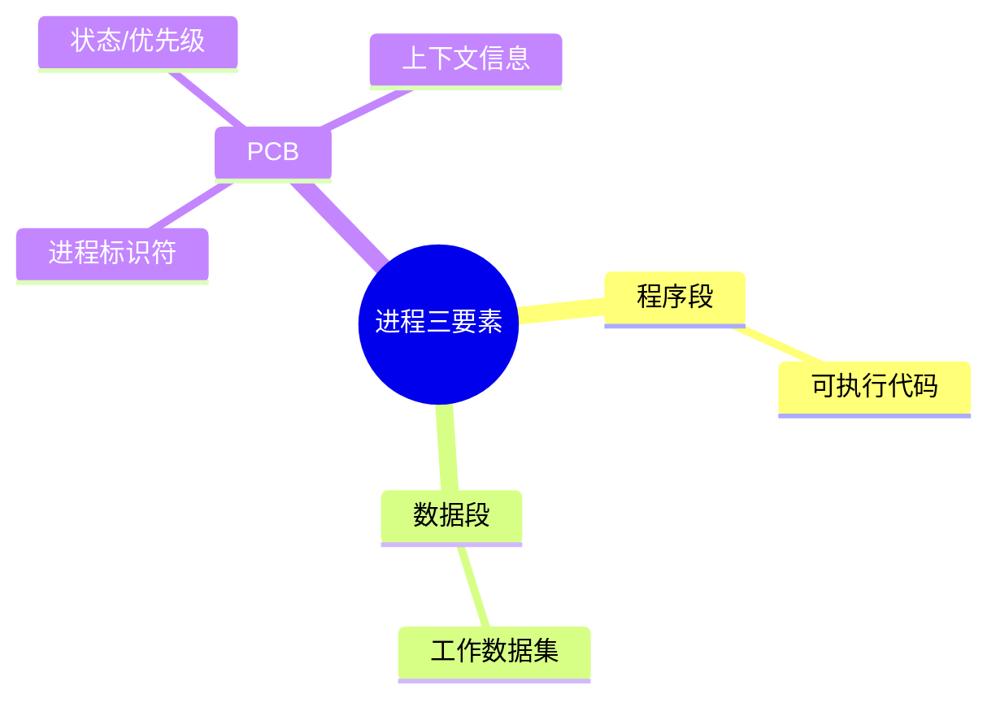

# 进程与程序的区别与联系

## 为什么需要区分进程与程序

如果程序只是存储在磁盘上的指令集合，那操作系统如何管理多个用户同时运行同一个编译器？当你在任务管理器中看到几十个 `chrome.exe` 时，它们真的是“同一个东西”吗？显然不是。为了描述程序在并发执行时对资源的动态占用与共享，必须引入一个能刻画==执行过程==的概念，这就是进程。

> [!IMPORTANT]
> 进程是具有独立功能的程序关于某个数据集合上的一次运行活动，是系统进行==资源分配、调度和保护的独立单位==。

## 核心区别：静态代码 vs 动态实体

理解二者关系的关键在于把握“静”与“动”的对立统一。程序是永久的、被动的文本；进程是短暂的、主动的执行流。

| 比较维度 | 程序 (Program) | 进程 (Process) |
| :--- | :--- | :--- |
| **本质属性** | 静态的指令有序集合 | 动态的执行过程 |
| **组成要素** | 仅包含代码和数据 | ==程序 + 数据 + PCB== |
| **生命周期** | 相对长久（文件级） | 短暂（创建→撤销） |
| **对应关系** | 1个程序可对应N个进程 | N个进程可含同一程序 |
| **并发特征** | 无 | 具有独立性、异步性、制约性 |
| **创建能力** | 不能创建其他进程 | 可通过系统调用创建子进程 |

[!TIP]
记忆口诀：**程静进动，程单进三；一程多进，进能创进。** “进三”指进程由程序、数据和PCB三部分组成，这是简答题高频得分点。

## 常见误区与真题辨析

> [!WARNING]
> 切勿认为“进程就是运行中的程序”。这种说法忽略了==PCB==的存在。没有PCB，系统无法感知、调度或保护该执行流，它就不能称为进程。PCB是进程存在的==唯一标志==。

在南邮历年真题中，该知识点常以简答或选择题形式出现。例如：

**【真题示例】** 叙述进程和程序的主要区别。

**✅ 标准答题要点：**
1.  进程是动态概念，强调执行过程；程序是静态概念，是指令有序集合。
2.  进程具有并发特征（独立性、异步性、制约性），程序没有。
3.  不同的进程可以包含同一个程序；同一程序在不同数据集上执行构成不同进程。
4.  进程有生命周期（创建到消亡），程序相对永久。
5.  进程由程序、数据和PCB组成，程序仅是代码序列。

> [!CAUTION]
> 选择题陷阱：若选项说“进程是指令的集合”，直接排除。这是程序的定义。进程必须包含==动态执行语义==和==PCB结构==。另外，“一个进程只能对应一个程序”也是错误表述，因为现代进程中可能通过动态链接加载多个程序模块。

掌握这一知识点，不仅是为了应对“区别与联系”类简答题，更是理解后续进程同步、死锁、调度等章节的基础——所有这些机制操作的对象都是==进程实体==，而非静态程序本身。
