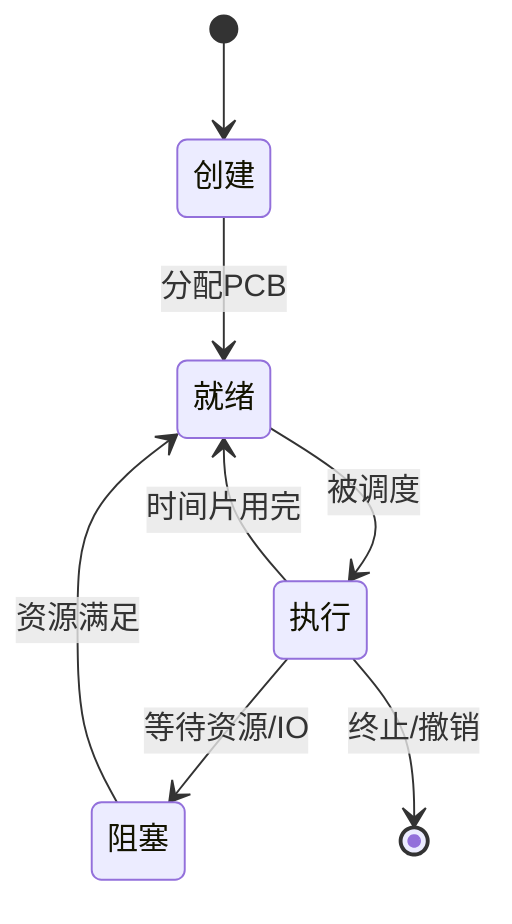

# 进程的定义与特征（动态性、并发性、独立性、制约性、异步性、结构性）

## 进程的定义与特征

### 从程序到进程：为什么需要“进程”这个概念

程序是静态的指令集合，但操作系统面对的是多个程序同时在内存中“跑起来”的场景。如果只有“程序”这个概念，就无法回答：这个程序执行到哪一步了？它占用了哪些资源？它和另一个程序谁先运行？

> [!NOTE]
> 并发和共享是操作系统的两个最基本特征，它们互为存在条件。并发导致多个程序同时争用资源，共享又使资源需要在并发程序之间分配。**程序本身无法刻画这种动态的资源使用过程**，于是引入了“进程”。

**进程的定义**：进程是程序在处理机上的一次执行过程，是系统进行资源分配和调度（单线程进程）的基本单位。它由三部分组成：==程序段、数据段、进程控制块（PCB）==。

### 六大特征逐一拆解

| 特征 | 含义 | 关键理解 |
|------|------|----------|
| **动态性** | 进程有生命周期：创建→就绪→执行→阻塞→终止 | 程序是静态的，进程是动态的 |
| **并发性** | 多个进程可同时在内存中存在，在一段时间内同时运行 | 宏观并行，微观串行 |
| **独立性** | 进程是能独立运行的基本单位，也是资源分配的基本单位 | 各进程按自己的逻辑推进 |
| **制约性** | 进程间因争用资源或协作而相互制约 | 竞争共享资源是最常见来源 |
| **异步性** | 进程按各自独立的、不可预知的速度向前推进 | 走走停停，不保证执行顺序 |
| **结构性** | 由程序、数据、PCB 三要素组成 | PCB 是进程存在的唯一标志 |

上图是进程的动态性在状态层面的体现：进程因创建而产生，因调度而执行，因等待资源而阻塞，最后因撤销而消亡。==“动态性”是进程最本质的特征==——没有动态性，其余特征无从谈起。

> [!IMPORTANT]
> 动态性、并发性、独立性、制约性、异步性、结构性这六条中，动态性是根本，并发性是引入进程概念的出发点，结构性中的 PCB 是操作系统管理进程的抓手。

### 进程与程序的区别

| 维度 | 程序 | 进程 |
|------|------|------|
| 本质 | 静态的代码集合 | 动态的执行过程 |
| 生命周期 | 永久存在（存于磁盘） | 有创建和撤销，暂时存在 |
| 并发性 | 不能真实描述并发 | 能刻画系统中的并发特征 |
| 组成 | 仅指令和数据 | 程序 + 数据 + PCB |
| 对应关系 | 一个程序可对应多个进程 | 一个进程只对应一个程序 |

### 常见的坑

- **“并发就是同时执行”**：不准确。单 CPU 下并发是宏观并行、微观串行，任意时刻只有一个进程真正占用 CPU。只有多核系统才可能真正同时执行多个进程。
- **“进程是资源分配的基本单位”**：这句话在引入线程后需要限定——传统单线程进程既是资源分配单位也是调度单位；引入线程后，==进程仍是资源分配的基本单位，但调度的基本单位变为线程==。
- **把“异步性”理解为“随机出错”**：异步性只是说推进速度不可预知，并不等于结果不确定。只要同步机制正确，并发进程的最终结果仍应是可重复的。
- **忽略制约性的双向性**：制约性既包括**竞争**（互斥、死锁的来源），也包括**协作**（同步、通信的基础）。两者都是进程间关系的体现。

### 一个定位特征的小例子

某系统中有三个进程 A、B、C。A 正在 CPU 上执行，B 在等待打印机，C 在就绪队列中等待调度。判断以下描述对应哪些特征：

1. 三个进程都存在于内存中，且都在“向前推进”——==并发性==
2. B 因为打印机被 A 占用而无法继续——==制约性==（资源竞争）
3. A 可能会在时间片用完后从执行态回到就绪态——==动态性==
4. 无法预知下一时刻哪个进程会获得 CPU——==异步性==
5. 每个进程都有自己的 PCB，记录各自的现场和状态——==结构性==
6. A、B、C 各自独立运行、互不干扰，分别使用分配给自己的资源——==独立性==

> [!TIP]
> 记忆口诀：**“动并独制异结”**——动态、并发、独立、制约、异步、结构。看到“生命周期的变化”选动态性，看到“多个同时在内存”选并发性，看到“资源争用或协作”选制约性，看到“速度不可预知”选异步性，看到“三要素组成”选结构性。
