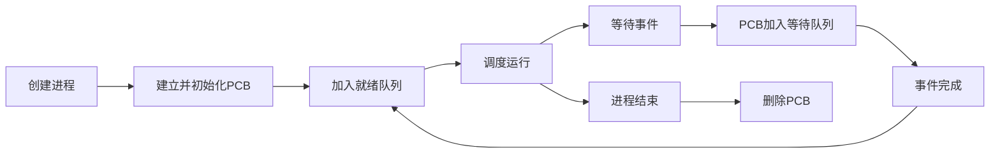

# 进程控制块（PCB）的作用与内容

## 进程控制块是什么

进程控制块（PCB，Process Control Block）是操作系统为了管理进程而设置的一个专门的数据结构，用它来记录进程的外部特征，描述进程的运动变化过程。

进程具有**结构性**，由程序、数据和 PCB 三部分组成。其中，程序是代码序列，数据是程序运行所处理的信息，PCB 则保存操作系统管理和调度进程所需的信息。

> [!IMPORTANT]
> ==PCB 是进程存在的唯一标志==。操作系统通过 PCB 感知、管理和控制进程：创建进程时建立 PCB，撤销进程时删除 PCB。

## 为什么需要 PCB

程序本身只是静态的代码序列，无法反映进程当前处于运行、就绪还是等待状态，也无法记录进程被中断后应当从哪里继续执行。

因此，操作系统需要一个专门的数据结构保存进程的动态信息。例如，进程因等待某事件而阻塞时，系统会将其状态改为等待状态，并把它的 PCB 插入相应等待队列；事件发生后，再将进程唤醒，使其转为就绪状态。

## PCB 包含哪些内容

按照本课程简答题的表述，PCB 通常包含以下四类内容：

| 内容类别 | 主要信息 | 作用 |
|---|---|---|
| 进程描述信息 | 进程名、进程标识符等 | 唯一标识进程 |
| 进程控制信息 | 当前状态、优先级、代码执行入口地址等 | 支持调度与状态转换 |
| 所拥有的资源和使用情况 | 占用内存大小、资源情况、相关管理数据结构指针等 | 支持资源管理 |
| CPU 现场保护信息 | 寄存器值、指向段表或页表的指针等 | 保存现场，便于恢复执行 |

其中，CPU 现场保护信息也常称为**处理机状态信息或上下文信息**。进程暂停时保存现场，再次获得 CPU 时恢复现场，才能从原来的位置继续执行。

> [!NOTE]
> 有些教材将 PCB 内容概括为“进程标识符信息、处理机状态信息、进程调度信息、进程控制信息”。分类名称可能不同，答题时应抓住标识、状态与调度、资源、CPU 现场这些核心信息。

## 与相近概念的区别

| 概念 | 管理对象 | 与 PCB 的区别 |
|---|---|---|
| PCB | 进程 | 进程存在的唯一标志 |
| JCB | 作业 | 用于作业管理，不是进程存在的标志 |
| FCB | 文件 | 存放管理文件所需的信息 |
| 程序和数据 | 进程执行内容 | 是进程的组成部分，但不能代替 PCB 描述动态过程 |

> [!WARNING]
> “进程被唤醒”只表示等待的事件已经发生，进程由等待状态转为就绪状态，==不等于立即重新占有 CPU==，也不意味着优先级变为最大或 PCB 移至等待队列队首。

## 例题

**题目：** 进程控制块是什么，有何作用？通常包含哪四种内容？

**参考答案：** PCB 是操作系统为管理进程而设置的专门数据结构，用于记录进程的外部特征、描述进程的运动变化过程，是进程存在的唯一标志。通常包括：

1. 进程描述信息，如进程标识符；
2. 进程控制信息，如当前状态、优先级、代码执行入口地址；
3. 所拥有的资源和使用情况，如内存占用及相关管理指针；
4. CPU 现场保护信息，如寄存器值、段表或页表指针。

> [!TIP]
> 记忆主线：**“是谁、怎样管、有什么、如何恢复”**，分别对应描述信息、控制信息、资源信息和 CPU 现场信息。
