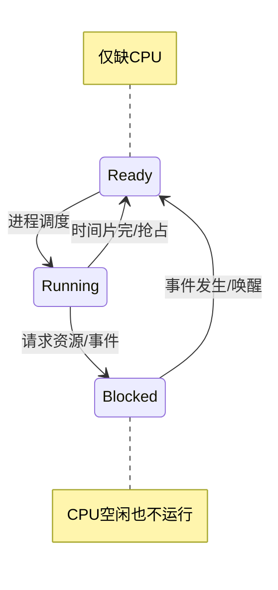

# 进程的基本状态（就绪、执行、阻塞）及状态转换

## 进程的基本状态与转换

如果CPU只有一个核心，多个程序如何“同时”运行？答案在于==时间片轮转与状态切换==。进程并非一直占用CPU，而是在不同状态间动态流转，这正是并发执行的基础。

### 三态模型核心定义

进程在生命周期中至少经历三种基本状态：

-   **就绪态（Ready）**：已分配到除CPU外的所有必要资源，只要获得处理机即可立即执行。
-   **执行态（Running）**：占有CPU，正在处理机上执行指令。
-   **阻塞态（Blocked）**：因等待某一事件发生（如I/O完成、信号量P操作）而暂时无法运行，==即使CPU空闲也不能被调度==。

> [!IMPORTANT]
> ==阻塞→就绪≠阻塞→运行==。等待的事件发生后，进程只能回到就绪队列排队，必须经过调度程序选择才能再次获得CPU。直接跳转到运行态是**绝对错误**的转换。

### 关键状态转换触发条件

| 转换方向 | 触发原因 | 主动/被动 |
| :--- | :--- | :--- |
| 就绪 → 执行 | 低级调度（进程调度）选中该进程 | 被动 |
| 执行 → 就绪 | 时间片用完；或被高优先级进程抢占 | 被动 |
| 执行 → 阻塞 | 请求I/O、执行P操作且S<0等 | ==主动== |
| 阻塞 → 就绪 | I/O完成中断、V操作唤醒等 | 被动 |

> [!TIP]
> 记忆口诀：**“就绪等CPU，运行占CPU，阻塞等资源”**。只有“执行→阻塞”是进程自己发起的（主动让权），其余转换均由操作系统控制。

### 模式切换与状态转换的区别

很多同学混淆“用户态/内核态切换”与“进程状态转换”。当中断发生时，CPU从目态切到管态执行中断处理程序，这是==模式切换==；若中断处理导致当前进程被剥夺CPU或进入等待，才引发==进程状态转换==。两者层次不同：前者是硬件级的特权级变化，后者是OS级的进程管理行为。

### 挂起状态的扩展理解

当系统内存紧张时，会引入挂起机制将进程换出到外存：

-   **就绪挂起**：就绪进程被换出，释放内存给更高优先级进程。
-   **阻塞挂起**：阻塞进程被换出，因其短期内不会运行，换出收益更大。

> [!WARNING]
> 挂起≠阻塞。阻塞是等待事件，事件来了就变就绪；挂起是被OS强制移出内存，需显式“激活”才能回到就绪或阻塞态。==没有“阻塞→运行”或“挂起→运行”的直接转换==。

### 真题验证：时间片用完的状态变化

> **题目**：若当前进程因时间片用完而让出处理机时，该进程应转变为( )状态。
> A. 完成 B. 就绪 C. 运行 D. 等待

**解析**：时间片用完属于正常的CPU释放，进程仍具备继续执行的条件，只是暂时失去CPU使用权，因此转入==就绪态==等待下次调度。选B。此题反复考查的核心就是区分“被动让出CPU（→就绪）”与“主动等待事件（→阻塞）”。
