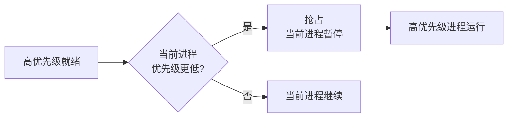
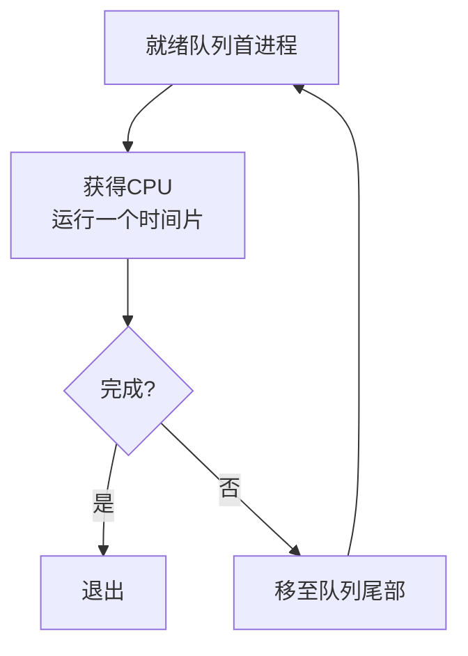
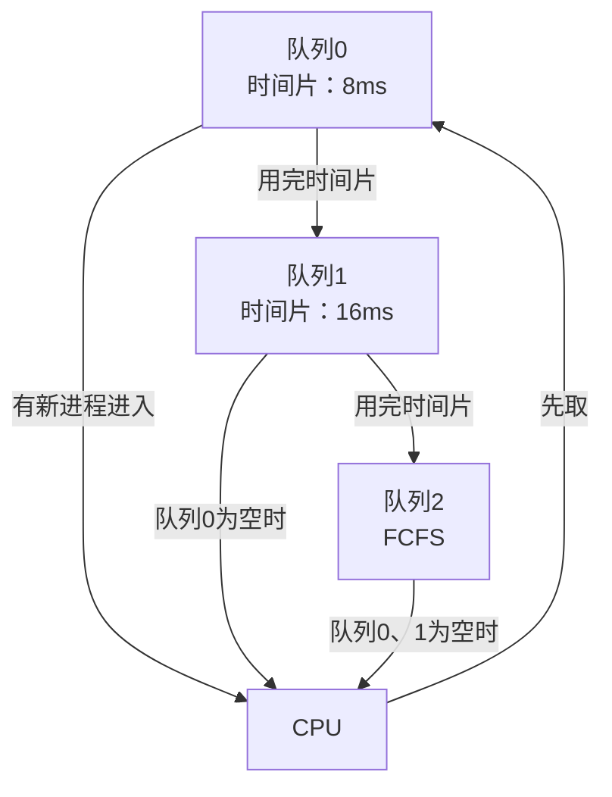

# 进程调度算法（FCFS、SJF、优先级、时间片轮转、多级反馈队列）

## 进程调度算法

进程调度是操作系统管理 CPU 的核心机制。当多个进程同时就绪时，调度程序必须决定将 CPU 分配给谁，这个决策直接影响系统的响应速度、吞吐量和公平性。

### 为什么需要调度算法

CPU 是计算机中最稀缺的资源之一。在单核系统上，任意时刻只能有一个进程运行。调度算法的目标，就是在多个竞争中进程之间做权衡：

- **公平**：每个进程都能获得 CPU 时间
- **高效**：CPU 尽可能忙碌，不空转
- **响应快**：交互式用户不想等太久
- **周转短**：批处理作业尽快完成

不同的算法在这些目标上各有取舍。

[!IMPORTANT]
> 调度算法可以从“抢占性”和“决策依据”两个维度理解：是否允许中断正在运行的进程？决策依据是优先级、执行时间还是到达顺序？

---

## 先来先服务（FCFS）

FCFS 是最简单的调度策略：谁先到达，谁先得到 CPU。

```mermaid
gantt
    title FCFS 示例（P1 先到）
    dateFormat HH:mm
    axisFormat %H:%M
    section P1
    运行        :p1, 10:00, 30min
    section P2
    就绪等待    :p2w, 10:05, 25min
    运行        :p2, after p1, 20min
```

**特点**

- **非抢占式**：一旦进程获得 CPU，会一直运行到完成或主动阻塞。
- **公平但不高效**：对短作业尤其不利。如果前面排了一个长作业，后面的短作业只能干等，这种现象称为“护航效应”。

[!WARNING]
> FCFS 对长作业有利，短作业的响应时间和周转时间会显著恶化。==在分时系统中几乎不单独使用。==

---

## 短作业优先（SJF）与最短剩余时间优先（SRTF）

SJF 的直觉很朴素：先处理能快速完成的作业，让短作业尽快离开系统，降低平均周转时间。

- **SJF（非抢占）**：在全部作业都就绪后，选择估计运行时间最短的作业执行。
- **SRTF（抢占）**：如果新到达作业的剩余运行时间比当前正在运行的进程更短，就抢占 CPU。SRTF 是 SJF 的可剥夺版本。

```mermaid
gantt
    title SRTF 示例（JOB1-4）
    dateFormat HH:mm
    axisFormat %H:%M
    section JOB1
    运行->暂停  :p1a, 10:00, 5min
    暂停等待    :p1w, 10:05, 20min
    恢复运行    :p1b, 10:25, 40min
    section JOB2
    运行->暂停  :p2a, 10:05, 5min
    暂停等待    :p2w, 10:10, 5min
    恢复运行    :p2b, 10:15, 10min
    section JOB3
    运行        :p3, 10:10, 5min
    section JOB4
    运行        :p4, 10:25, 10min
```

**性能优势**

可以证明，==SJF 和 SRTF 在平均周转时间上是最优的==——这是它们最核心的理论价值。

[!CAUTION]
> SJF 的致命问题是**长作业饥饿**：如果短作业源源不断地到来，长作业可能永远得不到执行。此外，需要预先知道作业的执行时间，这在实际系统中难以准确估算。

---

## 优先级调度

为每个进程分配一个优先数（priority），调度程序总是选择优先数最高（或最小，看约定）的进程运行。

- **静态优先级**：创建时确定，运行期间不变。实现简单，但可能不够灵活。
- **动态优先级**：根据进程行为或等待时间调整。例如，等待时间越长，优先级逐步提升，防止饥饿。

优先级调度可以是**抢占式**的，也可以是非抢占的。抢占式版本中，一旦有更高优先级的进程就绪，当前运行的进程立即被剥夺 CPU。

[!TIP]
> 记忆：优先级调度 + 抢占 = “随时插队”。这是实时系统常用的组合。

---

## 时间片轮转（RR）

轮转专为分时系统设计。每个进程分配一个固定长度的时间片（time quantum），用完还没结束的进程回到就绪队列队尾，等待下一次轮到自己。

**关键参数：时间片长度**

- **太大**（如几秒）→ 退化为 FCFS，响应感受变差。
- **太小**（如几毫秒）→ 上下文切换开销占比过高，CPU 有效利用率下降。
- **经验值**：10~100ms，让 80% 的 CPU 请求在一次时间片内完成。

[!WARNING]
> 时间片轮转对 I/O 密集型进程不够友好：这类进程经常主动让出 CPU，但在就绪队列要等很久才能再次轮到自己。这也是多级反馈队列出现的动机之一。

---

## 多级反馈队列

这是实际系统中最常用的综合方案。把就绪队列分成多个级别，每个级别有不同的时间片长短和调度策略。

**运行规则**

- 新进程进入最高优先级队列（队列 0）。
- 在队列 0 用完一个时间片还未结束，则降级到队列 1；再次用完，降到队列 2，以此类推。
- ==CPU 总是优先调度高优先级队列中的进程==，只有高优先级队列为空时才转向低优先级队列。
- 低优先级队列通常分配更长的时间片，减少长作业的上下文切换开销。

[!IMPORTANT]
> 多级反馈队列 ==兼顾了响应时间和周转时间==：短作业在高优先级队列快速完成，长作业也会被逐步降级，获得更长的连续执行时间。同时，采用抢占机制时，也能保证交互式进程的及时响应。

---

## 五种算法对比

| 算法 | 抢占性 | 决策依据 | 优点 | 缺点 |
| :--- | :--- | :--- | :--- | :--- |
| FCFS | 非抢占 | 到达顺序 | 简单公平 | 短作业等待严重 |
| SJF / SRTF | 均可 | 估计运行时间 | 平均周转最优 | 长作业可能饥饿 |
| 优先级 | 均可 | 优先数 | 关键任务优先 | 低优先级可能饥饿 |
| RR | 抢占 | 时间片 | 响应快，公平 | 上下文切换开销 |
| 多级反馈队列 | 抢占 | 多队列+时间片+优先级 | 综合平衡 | 参数配置复杂 |

[!NOTE]
> 高响应比优先调度（HRRN）是一个折中策略，优先数 = $(等待时间 + 运行时间) / 运行时间$，既照顾短作业，又不会让长作业无限等待，是批处理系统中常用的非抢占算法。

---

## 一个完整的计算示例

题目（取自南邮考题）：具有两道作业的批处理系统，作业调度用短作业优先（非抢占），进程调度用优先数小的抢占。作业序列如下：

| 作业 | 到达时间 | 运行时间 | 优先数 |
| :--- | :--- | :--- | :--- |
| A | 10:00 | 40 | 5 |
| B | 10:20 | 30 | 3 |
| C | 10:30 | 50 | 4 |
| D | 10:50 | 20 | 6 |

**逐步分析**

1. **10:00** — A 到达，内存空闲，A 进入并运行。
2. **10:20** — B 到达，内存有空位，B 进入。比较优先数：A(5)、B(3)，B 更高，抢占 A。A 已运行 20 分钟，剩余 20 分钟。
3. **10:30** — C 到达，内存满（A、B），C 等待。
4. **10:50** — D 到达，内存满，D 等待。此时 B 恰好运行结束。内存剩 A（剩余 20，优先数 5）。作业调度：C 需 50，D 需 20，D 更短，D 进入内存。进程调度：A(5) vs D(6)，A 优先运行。
5. **11:10** — A 结束。内存剩 D。作业调度：C 进入。进程调度：C(4) vs D(6)，C 优先运行。
6. **12:00** — C 结束。D 继续运行。
7. **12:20** — D 结束。

**最终时间表**

| 作业 | 进入内存 | 开始运行 | 结束时间 | 周转时间 |
| :--- | :--- | :--- | :--- | :--- |
| A | 10:00 | 10:00 | 11:10 | 70 分钟 |
| B | 10:20 | 10:20 | 10:50 | 30 分钟 |
| C | 11:10 | 11:10 | 12:00 | 90 分钟 |
| D | 10:50 | 12:00 | 12:20 | 90 分钟 |

平均周转时间 = $(70 + 30 + 90 + 90) / 4 = 70$ 分钟。
