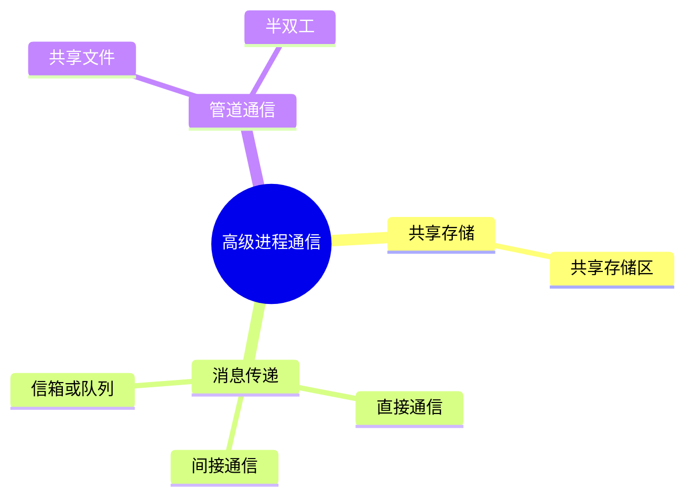

# 进程通信方式（共享存储、消息传递、管道通信）

## 它是什么

在操作系统里，进程拥有独立地址空间，不能直接互访数据，因此必须靠内核提供的**高级进程通信方式**来交换信息。南邮课件把它归为三类：==共享存储器系统、消息传递系统和管道通信系统==。

## 为什么需要

先想一个问题：如果两个进程都直接读写同一块物理内存，谁来保证不同时写坏数据？正是为了避免各自为政导致的混乱，操作系统才提供了带不同“同步代价”的通信手段。

## 怎么做

### 共享存储区机制

内核划出一块内存，多个进程把它映射到自己的虚拟地址空间。它==速度最高，因为数据不用在内核与用户态间拷贝==，但缺点是进程要自己用信号量等解决互斥。

### 消息传递系统

分为**直接通信**（指明对方）和**间接通信**（经信箱或消息队列）。

> [!IMPORTANT]
> 可靠信箱通信规则：发信时信箱满，发送进程阻塞等空位；取信时信箱空，接收进程阻塞等信件。

它自带同步控制，不需要额外写同步原语。

### 管道通信机制

管道是一个==共享文件==，写进程从一端写，读进程从另一端读，属于半双工、固定缓冲。

## 相近概念区别

| 方式 | 本质 | 同步由谁做 | 速度 |
| :--- | :--- | :--- | :--- |
| 共享存储区 | 共享内存 | 用户自己 | 最高 |
| 消息传递 | 信箱或队列 | 内核自带 | 中 |
| 管道 | 共享文件 | 内核自带 | 较低 |

## 常见坑

> [!WARNING]
> 管道不是共享存储区，也不是普通消息传递；其实质是==共享文件通信机制==。

## 算对了的例子

选择题：利用管道进行的进程通信机制实质是？

- A. 信号通信机制
- B. 共享存储区通信机制
- C. 共享文件通信机制
- D. 消息传递通信机制

答案选 C。因为管道在内核中以文件形式存在，读写双方通过该文件共享数据，而非直接共享内存或发离散消息。
