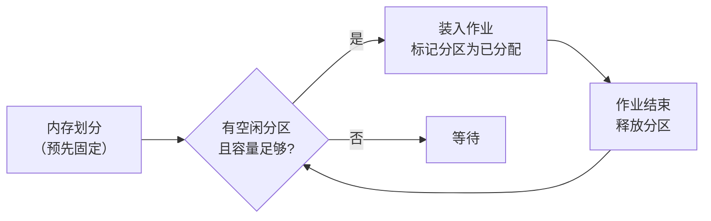
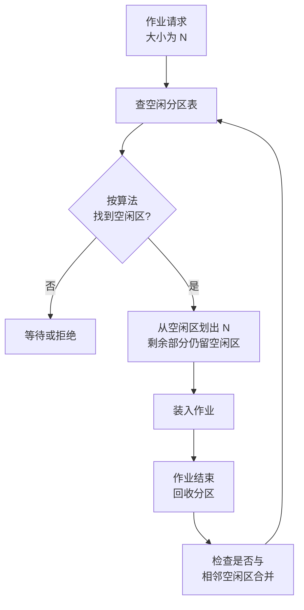

# 连续分配方式（单一连续、固定分区、动态分区）及分配算法

## 连续分配方式与分配算法

先想一个问题：内存只有一块，多个作业要同时装入，怎么划分才既简单又高效？连续分配方式的核心思路是：==每个作业占用内存中一段连续的地址空间==。根据“谁来划分、何时划分”，分为三种方案。

### 单一连续分配

这是最简单的方案：内存中任意时刻只有一道作业，独占整个用户区。

- **特点**：内存分为系统区和用户区，用户区全部分配给当前作业。
- **优点**：实现最简单，无需复杂管理。
- **缺点**：==内存利用率极低==，作业排队串行执行，无法多道程序运行。

> [!NOTE]
> 这种方案只适用于早期的单道批处理系统，现代操作系统中已不使用。

### 固定分区分配

**它是什么**：系统启动时，预先把用户内存空间划分为若干个大小固定的连续分区。分区大小**可以相同，也可以不同**，但一旦划分完成，运行期间不再改变。

**怎么做**：设置一张“内存分配表”，记录每个分区的起始地址、大小和状态（已分配/空闲）。作业到来时，找一个容量足够且空闲的分区装入。

**优点**：实现简单，分配和回收速度快。

**缺点**：==分区大小固定，与实际作业长度不匹配时产生“内部碎片”==。大作业装不进小分区，小作业占大分区又浪费。

>[!IMPORTANT]
> 固定分区的核心特点是：**分区大小可以不同，但预先固定，不随作业长度变化**。考题中“可以不同但预先固定”是正确答案。

### 动态分区分配（可变分区）

**为什么需要**：固定分区太死板，作业大小千差万别，能否按需划分？

**它是什么**：系统不预先划分分区，而是在作业装入时，根据作业的实际大小动态地划出一块连续空间。

**怎么做**：维护一张“空闲分区表”或“空闲分区链”，记录每个空闲区的起始地址和大小。分配时按算法从空闲区中选一块；回收时若与相邻空闲区邻接则合并。

**常见的坑**：动态分区虽然按需分配，但反复分配和回收后，内存中会出现许多零零散散的小空闲区，总量够但单个容量不满足作业需求，这就是==外部碎片==。解决方法是“紧凑”（拼接），但会带来额外开销。

### 动态分区分配算法

当有多个空闲区都满足作业需求时，选哪一个？这就是分配算法要回答的问题。

| 算法 | 分配策略 | 优点 | 缺点 |
|------|----------|------|------|
| 首次适应 | 从低地址开始找第一个满足的空闲区 | 简单、快速 | 低地址端易产生小碎片 |
| 最佳适应 | 找容量最接近作业需求的空闲区 | 减少浪费 | 易产生无法利用的小碎片 |
| 最差适应 | 找容量最大的空闲区 | 剩余区较大、可再用 | 大作业到来时可能无空间 |
| 循环首次适应 | 从上一次分配位置继续找 | 空闲区分布均匀 | 缺乏大空闲区 |

> [!WARNING]
> **常见误区**：把固定分区和动态分区混淆。固定分区强调“预先划分、大小固定不变”；动态分区强调“按作业实际大小临时划分、可合并回收”。考题中“分区存储管理可分为固定分区、可变分区两种方式”，其中“可变分区”即动态分区。

### 一个算对的例子

**题目**：在固定分区分配中，每个分区的大小是（ ）。

**分析**：固定分区的核心是“预先划分、固定不变”。选项 A“相同”只是其中一种情况，不是必须；选项 B“随作业长度变化”描述的是动态分区；选项 C“可以不同但预先固定”准确概括了固定分区的本质；选项 D“根据作业长度固定”自相矛盾。

**答案**：==C. 可以不同但预先固定==。
