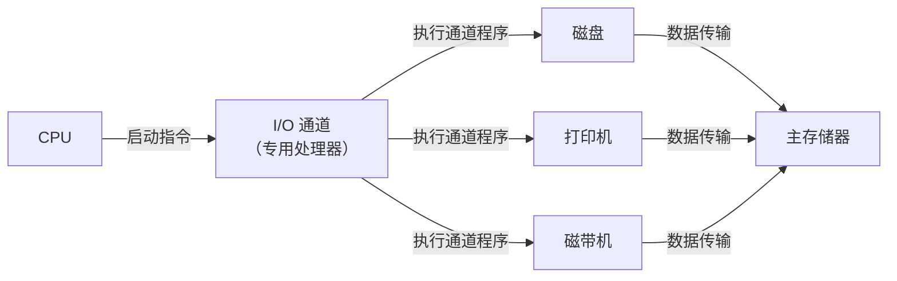
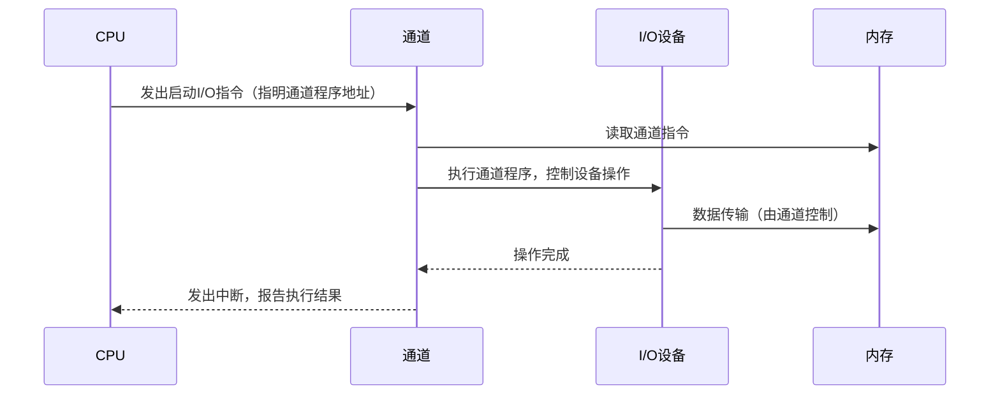

# 通道的概念与作用

## 什么是通道？

在设备管理的 I/O 控制方式演进中，我们经历了程序查询、中断驱动、DMA（直接存储器访问）这几个阶段。但随着系统规模增大，DMA 依然存在问题：==一台 DMA 控制器只能管理有限几台同类设备，CPU 仍然要负责发起每条 I/O 指令，当外设数量暴增时，CPU 依然会深陷繁杂的 I/O 管理之中。==

于是，**通道（Channel）** 应运而生。通道是一种**专用的 I/O 处理器**，它能执行自己的**通道程序**，独立完成 I/O 操作，真正将 CPU 从繁重的 I/O 事务中解放出来。

> [!IMPORTANT]
> 通道的本质：不是普通的数据通路，而是一颗专门负责 I/O 的处理器，能执行通道指令编制的通道程序，直接控制设备与内存交换数据。

你可能会问：DMA 不也能脱离 CPU 传送数据吗？区别在于：

- **DMA**：初始化仍需 CPU 设定内存地址、传送字数等，只能实现一块数据的传送，功能相对单一。
- **通道**：能执行完整的通道程序，包含多条通道指令，实现复杂的 I/O 操作序列，且一台通道可控制多台不同类型设备。

## 为什么需要通道？

为了回答这个问题，我们顺着 I/O 控制方式的演进逻辑想一步：

1. **程序查询**：CPU 轮询设备状态，外设工作期间 CPU 全程空等 → **CPU 利用率极低**
2. **中断方式**：设备完成时用中断通知 CPU → CPU 仍要花时间响应中断、执行中断服务程序搬移数据
3. **DMA 方式**：数据块传送由 DMA 控制器硬件完成，CPU 只需在开始和结束时干预 → **进一步解放 CPU，但每块数据仍需 CPU 初始化**
4. **通道方式**：==CPU 只下达一条 "I/O 指令"，通道自行按通道程序完成全部操作并返回状态== → **CPU 完全并行，大幅提升系统吞吐量**

这是大型机时代引入的关键技术，目的是让 CPU 的处理能力与外设的 I/O 操作最大化重叠。

> [!TIP]
> 记忆口诀：**“程序查询傻等，中断仍需帮办，DMA 只搬一块，通道全程包办。”**

## 通道的工作原理

核心流程：
1. CPU 通过**启动 I/O 指令**将通道程序的内存起始地址告知通道
2. 通道从内存取出通道指令并执行，控制设备完成 I/O
3. I/O 操作全部结束后，通道向 CPU 发出一个**中断**，报告完成状态

## 常见误区与易混点

| 对比项 | DMA 控制器 | 通道 |
|:---|:---|:---|
| 本质 | 硬件控制器 | ==专用 I/O 处理器== |
| 执行程序 | 无，按 CPU 设定的寄存器工作 | 可执行通道程序（多条指令） |
| 设备控制 | 一台 DMA 通常控制少数同类设备 | 一台通道可控制多类多台设备 |
| CPU 干预 | 每块数据需初始化 | ==一次启动，全程自理== |
| 适用场景 | 微型机、小型机 | 大型机、高吞吐场景 |

> [!WARNING]
> 考试中高频错误点：**把通道和 DMA 混为一谈**，甚至将通道说成“数据通道”或“I/O 端口”。题目常设干扰项“数据通道”“软件工具”，务必记住通道是**硬件**、是**专用处理器**。

## 考题示例与解析

> **选择 6**：I/O 设备的控制方式中比 DMA 方式效率高的是（C）。
> - A. 询问方式
> - B. 中断方式
> - C. 通道方式
> - D. 以上都不是

**解析**：
该题的考点是 I/O 控制方式的效率排序。==询问方式（程序查询）效率最低==，CPU 全程等待；中断方式比询问方式好，但 CPU 仍需干预数据传送；DMA 方式进一步减少 CPU 干预，但每次数据块传送仍要 CPU 初始化；通道方式下 CPU 只需发出一条启动指令，后续全部由通道自行处理，==效率最高、并行度最强==。因此选 C。
