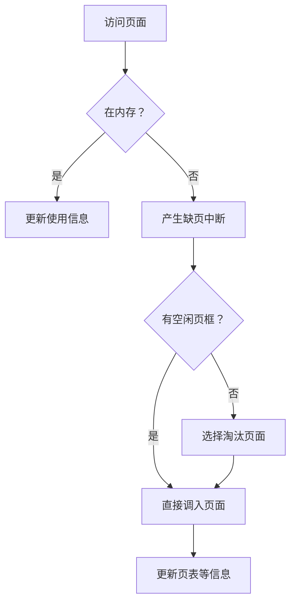

# 页面置换算法（OPT、FIFO、LRU、Clock、LFU）

## 页面置换算法

在请求分页存储管理中，若访问页面不在内存，则产生**缺页中断**，将页面从外存调入。若此时内存无空闲页框，就必须按某种规则选择一个页面淘汰，这个规则就是**页面置换算法**。其目标是减少缺页次数，避免频繁换入换出造成系统抖动。

缺页率计算公式为：
$$
\text{缺页率}=\frac{\text{缺页次数}}{\text{页面访问总次数}}\times 100\%
$$

> [!IMPORTANT]
> 页面置换发生在“缺页且内存已满”时；初始调入页面也算缺页，但此时无需淘汰页面。

## 各算法的核心思想

| 算法 | 淘汰对象 | 特点与局限 |
|---|---|---|
| OPT（最佳置换） | 以后不再访问，或未来最久才访问的页面 | 缺页率最低，是评价其他算法的理论标准，但需要预知未来，实际无法实现 |
| FIFO（先进先出） | 最早进入内存、驻留时间最长的页面 | 实现简单，只需维护队列；不考虑页面使用情况，可能出现 Belady 异常 |
| LRU（最近最久未使用） | 最近一段时间内最久未被访问的页面 | 利用程序局部性，性能通常接近 OPT，但精确实现需要记录访问次序，开销较大 |
| Clock（时钟/第二次机会） | 扫描时访问位为 0 的页面 | LRU 的近似算法，利用访问位降低实现开销 |
| LFU（最不常用） | 一段时间内访问次数最少的页面 | 依据访问频率，而非最近访问时间；历史频率高可能使旧页面长期驻留 |

> [!NOTE]
> FIFO 与 LRU 的关键区别：页面命中时，==FIFO 不改变入队次序，LRU 必须更新最近使用次序==。Clock 则通过指针循环扫描：访问位为 1 时清零并跳过，访问位为 0 时淘汰，因此又称“第二次机会算法”。

## 一个算对的例子

页面走向为：
$$
2,\ 3,\ 2,\ 1,\ 5,\ 2,\ 4,\ 5,\ 3,\ 2,\ 5,\ 2
$$
分配 3 个物理页框，初始内存为空。下面用 LRU 算法计算。

| 访问页 | 内存状态（最近使用→最久未用） | 缺页 | 淘汰页 |
|---|---|---:|---:|
| 2 | 2 | 是 | — |
| 3 | 3，2 | 是 | — |
| 2 | 2，3 | 否 | — |
| 1 | 1，2，3 | 是 | — |
| 5 | 5，1，2 | 是 | 3 |
| 2 | 2，5，1 | 否 | — |
| 4 | 4，2，5 | 是 | 1 |
| 5 | 5，4，2 | 否 | — |
| 3 | 3，5，4 | 是 | 2 |
| 2 | 2，3，5 | 是 | 4 |
| 5 | 5，2，3 | 否 | — |
| 2 | 2，5，3 | 否 | — |

因此，LRU 缺页次数为 **7 次**，缺页率为：
$$
\frac{7}{12}\times100\%\approx58.33\%
$$

同一页面走向采用 FIFO，依次在访问 $5,2,4,3,5,2$ 时淘汰 $2,3,1,5,2,4$，共缺页 **9 次**，缺页率为：
$$
\frac{9}{12}\times100\%=75\%
$$

> [!TIP]
> 手工计算 LRU 时，每访问一页就重排一次内存次序：命中页移到“最近使用”端；缺页且页框已满时，淘汰“最久未用”端。FIFO 则始终只看出队、入队顺序。

## 常见易错点

> [!WARNING]
> **Belady 异常**：FIFO 中，分配的页框数增加，缺页次数反而可能增加。不能笼统认为“页框越多，任何算法的缺页率都必然越低”。OPT 和 LRU 属于堆栈类算法，不会出现该异常。

- **LRU 不是 LFU**：LRU 看“距今多久没访问”，LFU 看“累计或一段时间内访问多少次”。
- **OPT 不是 FIFO 的理想版本**：OPT 向后看未来访问序列，LRU 向前看历史访问情况。
- **不要混淆调度算法**：LRU 用于页面置换；最短寻道时间优先用于磁盘移臂调度；时间片轮转、优先级调度等通常用于处理机调度。
- **页面越小，缺页率不一定越低**：页面过小会使页数、页表规模增大，并可能增加缺页次数；页面过大则会增加内部碎片，应综合考虑。
