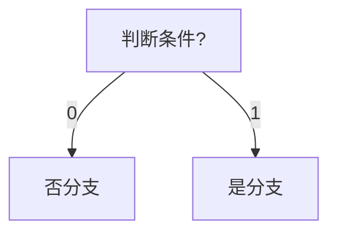
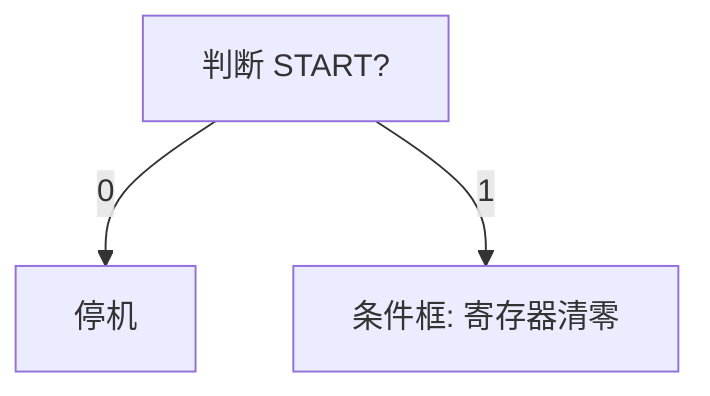
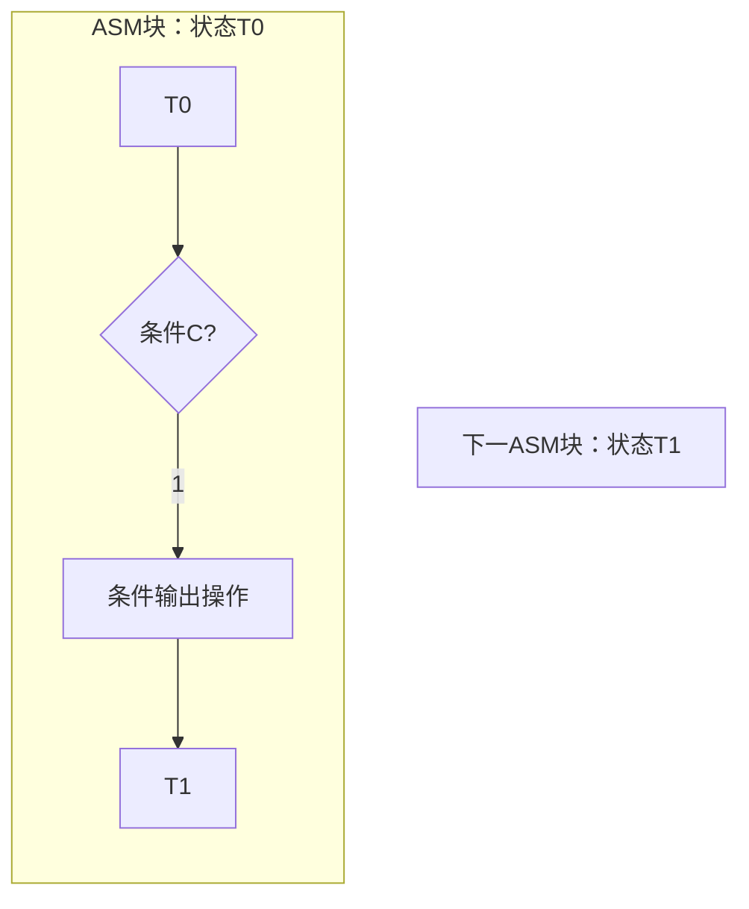
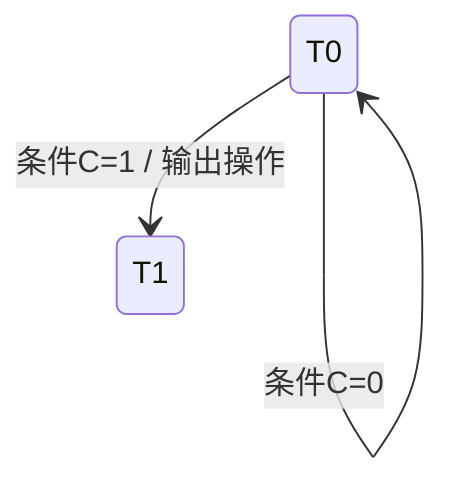
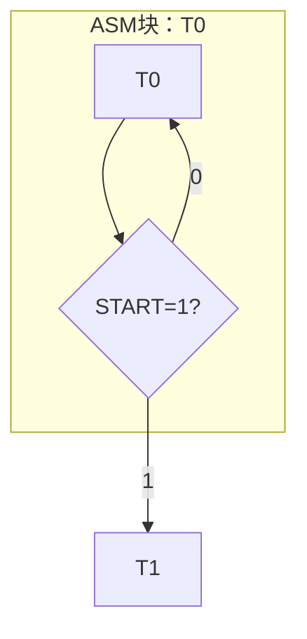
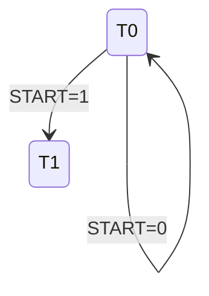

# 算法状态机(ASM)图的状态框、判断框、条件输出框及ASM块的构成规则

## 状态框、判断框、条件输出框

ASM 图用三种基本符号把系统的“状态”和“状态里的动作”画在一张时序相关的流程图上。把它们认清楚，是读懂和绘制 ASM 图的第一步。

### 状态框

状态框是一个**矩形**，表示控制器的一个状态。框内可以标注状态名（如 $T_0$）和状态编码（如 `00`），右上角通常写分配给该状态的二进制代码。

状态框里的操作在该状态**一个时钟周期内完成**。如果状态框为空，说明此状态下不产生任何数据处理器操作，只等待条件成立后转移。

### 判断框

判断框是一个**菱形**，内部写一个条件表达式，例如 `START`、`A>100`。它代表控制器需要依据输入或状态信号做出“分支”决策。

> [!IMPORTANT]
> 判断框不消耗一个时钟周期。状态转移发生在当前 ASM 块结束时的时钟有效沿，判断只是决定转移到哪个下一状态。

### 条件输出框

条件输出框是**圆角矩形**（或椭圆），也叫“条件框”。它必须紧接在判断框的某个分支后面，表示“==只有当这个入口条件成立时==”才执行的操作。

它是 ASM 图区别于普通流程图的关键：条件框内的操作是在满足判断条件时才发生，而不是无条件执行。

---

## ASM 块的构成规则

一个 **ASM 块**包含一个状态框和若干由此引出的判断框与条件框，==代表一个时钟周期内系统的全部动作==。

- 每个 ASM 块的唯一入口是一个状态框；
- 判断框和条件框属于同一块，不计入新状态；
- 块内所有寄存器操作、状态转换都在同一个有效时钟沿完成；
- 一个 ASM 块必须完整走完——遇到下一状态框时才进入新的块。

> [!TIP]
> 判断条件框是不是新状态：看它是否单独占用时钟周期。如果只是一个分支上的“附赠操作”，它不是新块。

---

## 与状态转移图的关系

ASM 图本质上是**状态转移图 + 输出条件**的图形化表达。转换时：

- 状态框 → 状态节点；
- 判断框消失，变成有向边的条件标注；
- 条件输出 → 标注在转移线上或作为 Mealy 输出。

> [!WARNING]
> 状态框内可写操作，但通常把**寄存器级操作写在条件框**中，表示“在某转移条件下才产生”。考试时注意识别哪些操作是条件输出、哪些是状态框内无条件输出。

---

## 一个算对了的例子

设计一个控制器：初始状态 $T_0$ 等待启动信号 `START`；`START=1` 时进入 $T_1$，否则停留在 $T_0$。试画 ASM 图并给出状态转移图。

**ASM 图：**

**状态转移图：**

注意 `START=0` 时没有发生状态转移，也不占新时钟周期，对应 ASM 块内部的自我循环。
