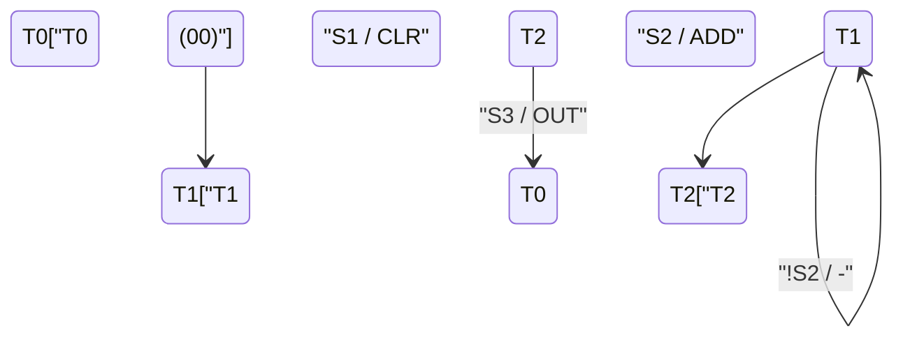

# 根据文字描述建立ASM图的原则，以及从ASM图推导处理器明细表和控制器状态转移图

数字系统设计通常分为**数据通路（处理器）**和**控制单元（控制器）**两部分。文字描述往往是一团乱麻，而 ASM 图就是把它翻译成“硬件能看懂的流程图”的桥梁。

## 从文字到 ASM 图的原则

把题目中的动作序列画成 ASM 图时，需遵守以下规则：

- **一个状态框代表一个时钟周期**。状态框内标注状态名（如 $T_0$）和该周期内处理器要执行的操作（如 `CLR`、`ADD`）。
- **条件判断用菱形框**，放在状态框之后。输入条件（如 $S_1, S_2$）决定下一个时钟周期进入哪个状态。
- **输出操作写在矩形框或状态框内**。若输出仅取决于当前状态，写在状态框中；若还依赖输入条件，写在条件框之后的操作框中。

> [!WARNING]
> 常见坑：把需要多个时钟周期才能完成的动作塞进同一个状态框里。记住，==每个状态框严格对应一个 CP 脉冲==。

## 推导处理器明细表

ASM 图画好后，处理器的任务就清晰了。处理器明细表本质是一个清单，列出每个状态下数据通路需要完成的操作。

做法很简单：**遍历 ASM 图中的所有状态框和操作框，提取出控制信号与对应的状态。**

例如某乘法器控制器的 ASM 图包含三个状态 $T_0, T_1, T_2$：
- $T_0$ 状态下，控制信号 `CLR` 有效（清零寄存器）；
- $T_1$ 状态下，若条件满足，控制信号 `ADD` 有效（执行加法）；
- $T_2$ 状态下，控制信号 `OUT` 有效（输出结果）。

据此直接列出明细表：

| 状态 | 处理器操作（控制信号） |
| :---: | :---: |
| $T_0$ | `CLR` |
| $T_1$ | `ADD` |
| $T_2$ | `OUT` |

## 推导控制器状态转移图

控制器负责产生上述控制信号。如何从 ASM 图得到控制器的状态转移图？

思考一下：ASM 图里的分支条件和状态跳转，不正是时序电路的状态转移吗？

具体步骤如下：

1. **状态编码**：数一数 ASM 图有几个状态。若有 3 个状态 $T_0, T_1, T_2$，则至少需要 2 个 DFF 触发器 $Q_2 Q_1$。设编码分别为 $00, 01, 10$。
2. **提取转移关系**：沿着 ASM 图的箭头，记录“现态 $\xrightarrow{\text{输入条件}}$ 次态 / 输出”。
3. **画图**：将提取出的关系画成传统的状态转移图（圆圈表示状态，箭头表示转移，斜线上方写输入，下方写输出）。

> [!IMPORTANT]
> ==ASM 图是算法流程，控制器状态转移图是时序逻辑模型==。两者描述的物理过程完全一致，但后者直接用于列激励方程和画电路图。

## 概念辨析与实战避坑

| 对比维度 | ASM 图 | 控制器状态转移图 |
| :--- | :--- | :--- |
| **关注点** | 算法执行的先后顺序与条件 | 触发器状态的翻转与控制信号输出 |
| **元素** | 状态框、条件框、操作框 | 状态节点、带条件的有向边 |
| **用途** | 理清系统架构与设计思路 | 求解次态方程、设计具体电路 |

> [!TIP]
> 考试解题口诀：“先定状态数，再分触发器；框内提操作，线上找条件。”

**算例回顾**：以课件题 7.4 为例，已知输入条件为 $V_1, V_2$，输出控制信号为 `CLR`, `ADD`, `OUT`。
1. 观察 ASM 图，确定有 3 个状态，选用 2 个 DFF，编码 $Q_2Q_1 = 00, 01, 10$。
2. 在 $T_0(00)$ 状态，若 $V_1=1$，转移到 $T_1(01)$，此时输出 `CLR`；否则保持在 $T_0$。
3. 依次类推，将所有路径转化为形如 $Q_2^n Q_1^n \xrightarrow{V_1 V_2} Q_2^{n+1} Q_1^{n+1} / \text{CLR ADD OUT}$ 的标注，即可画出完整的控制器状态转移图。

> [!CAUTION]
> 编码时务必避开多余状态（如 3 个状态用了 2 个触发器，剩下的 $11$ 是无效状态），并在设计时检查自启动性，防止系统跑飞后死锁。
